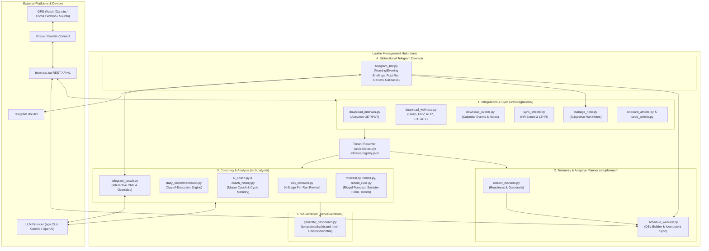

# 🏃‍♂️ Laufen — Multi-Athlete Running Analytics, Adaptive Planner & AI Coach

A zero-dependency (Python 3 standard library) endurance training platform that connects **Intervals.icu** (syncing Garmin Connect, Coros, Wahoo, Suunto, and Strava), **Antigravity CLI (`agy`) / LLM providers**, an interactive **Telegram Coach Bot**, and a self-contained **HTML5 Analytics Dashboard**.

---

## 🧭 System Architecture



---

## 🏗️ Core Design Principles

1. **Zero External Runtime Dependencies**: All production scripts (`src/`) use exclusively the Python 3 standard library (`urllib.request`, `json`, `datetime`, `pathlib`, `re`, `csv`). Only `pytest` and `pytest-bdd` are installed in `.venv` for automated Behavior-Driven Development (BDD) testing.
2. **Deterministic Telemetry First, Cognitive Interpretation Second**: Python deterministically computes physiological metrics (7-zone HR distribution, Aerobic Efficiency Factor, CTL/ATL/TSB form, interval splits, and readiness guardrails) before invoking an LLM for qualitative coaching synthesis.
3. **Multi-Tenant Dual-Mode Operation**:
   - **Managed Multi-Athlete Mode**: Central `athletes/registry.json` maps athletes to isolated `athletes/<slug>/` directories and unguessable dashboard slugs (`dist/<dashboard_slug>/index.html`). One Intervals.icu API key can manage multiple coached athletes.
   - **Single-Tenant / Legacy Fallback**: Automatically falls back to `config/athlete.json` and `data/` if `athletes/registry.json` is absent.
4. **Intervals.icu as Calendar Single Source of Truth**: Structured workouts and rest-day markers (`category: "NOTE"`, `"🛋️ Ruhetag (Coach)"`) are persisted directly to the Intervals.icu calendar, preventing duplicate scheduling across local CLI runs, CI workflows, and Telegram interactions, while syncing automatically to the athlete's watch.

---

## 📦 Service Catalog

### 1. Core & Multi-Athlete Context
| Module | CLI Entrypoint | Responsibilities |
| :--- | :--- | :--- |
| [`src/athletes.py`](src/athletes.py) | `python3 src/athletes.py --shell-env` | Resolves [`AthleteContext`](src/athletes.py#L22-L54) from `--athlete <slug>`, `$ATHLETE_SLUG`, `athletes/registry.json`, or legacy `data/` paths. Manages Telegram Chat ID linking and notification flags. |
| [`src/core/config.py`](src/core/config.py) | Library module | Shared helpers for `.env` parsing (`load_env_file`), JSON I/O, and athlete profile loading (`load_athlete_profile`). |
| [`src/core/contracts.py`](src/core/contracts.py) | Library module | Executable `TypedDict` data contracts and runtime schema validators (`validate_run_review_evaluation`, `validate_coach_history`, `validate_athlete_profile`, `validate_planning_markers`). |
| [`src/llm/client.py`](src/llm/client.py) | Library module | Provider-agnostic [`LLMClient`](src/llm/client.py#L43-L250) supporting `agy` (Antigravity CLI), `gemini` (Google Generative Language REST API), `openai` (OpenAI-compatible `/chat/completions`), and `mock` (offline deterministic responses). |

### 2. Platform Integrations (`src/integrations/`)
| Service Script | Runner Command | Description |
| :--- | :--- | :--- |
| [`download_intervals.py`](src/integrations/download_intervals.py) | `./run sync` | Fetches activity summaries and HR zone durations from `GET /api/v1/athlete/{id}/activities` into `intervals_activities.json`. Also provides [`update_intervals_activity()`](src/integrations/download_intervals.py#L106-L154) (`PUT /api/v1/activity/{id}`). |
| [`download_wellness.py`](src/integrations/download_wellness.py) | `./run wellness` | Downloads daily recovery telemetry (`ctl`, `atl`, `restingHR`, `hrv`, `sleepSecs`, `sleepScore`) from `GET /api/v1/athlete/{id}/wellness` into `intervals_wellness.json`. |
| [`download_events.py`](src/integrations/download_events.py) | `./run events` | Fetches scheduled calendar events and workouts (`-7` to `+14` days by default) from `GET /api/v1/athlete/{id}/events` into `calendar_events.json`. |
| [`sync_athlete.py`](src/integrations/sync_athlete.py) | `./run sync-profile` | Pulls sport-specific heart rate settings (`max_hr`, `lthr`, `icu_hr_zones`, `hr_zone_names`) and resting HR from Intervals.icu and updates `athlete.json`. |
| [`manage_note.py`](src/integrations/manage_note.py) | `./run note "<text>"` | Matches subjective athlete notes (e.g. muscle cramps, RPE, weather) to a specific run by `--id`, `--date`, `--time`, or latest run; updates the description on Intervals.icu and locally, and re-runs the 4-stage run review. |
| [`onboard_athlete.py`](src/integrations/onboard_athlete.py) | `./run add-athlete` / `./run athletes` | Lists registered athletes or onboards a new athlete slug: verifies Intervals.icu API access, creates `athletes/<slug>/`, generates a privacy dashboard slug, syncs profile, and bootstraps 90d activities + 30d wellness. |
| [`seed_athlete.py`](src/integrations/seed_athlete.py) | `./run seed --athlete berni-test` | Generates and uploads synthetic wellness and workout scenarios (`balanced`, `fatigued`, `fresh`, or `--clean`) for staging tests. Enforces a hard safety check blocking execution on production athlete `berni`. |
| [`upload_activities.py`](src/integrations/upload_activities.py) | Direct CLI | Bulk-uploads historical Strava archive exports (`activities.csv` + `.fit`/`.gpx`/`.tcx`) to `POST /api/v1/athlete/{id}/activities` with duplicate detection and rate-limit pauses. |

### 3. Telemetry Extraction & Adaptive Workout Planner (`src/planner/`)
| Service Script | Runner Command | Description |
| :--- | :--- | :--- |
| [`extract_markers.py`](src/planner/extract_markers.py) | `./run plan --markers [--json]` | **Phases 1 & 2 of Adaptive Planning**: Extracts readiness metrics (TSB, ATL, CTL, sleep hours/score, RHR vs. 7d baseline, HRV), training history (days since last run and last quality run, weekly volume/Z1-Z2%), target periodization slot configured in `athletes/<slug>/athlete.json` (`weekly_slots`), and guardrails. |
| [`schedule_workout.py`](src/planner/schedule_workout.py) | `./run plan [FLAGS]` | **Phases 3 & 4 of Adaptive Planning**: Renders parameterized workout templates from [`workouts/templates/`](workouts/templates/) (`easy_run`, `intervals`, `tempo_run`, `long_run`, `recovery_run`, `fartlek`, `threshold_intervals`, `micro_threshold`, `progressive_threshold`) into Intervals.icu/Garmin DSL. Supports single workout upload, weekly slot sync (`--sync-plan`), idempotent adaptive daily planning (`--adaptive-plan`), and calendar override/rest-day note creation (`override_workout_on_date`). |

### 4. Analysis & Coaching Engines (`src/analysis/`)
| Service Script | Runner Command | Description |
| :--- | :--- | :--- |
| [`recent_runs.py`](src/analysis/recent_runs.py) | `./run report` | Renders a formatted terminal summary table of recent running activities (date, distance, duration, pace, avg/max HR, load). |
| [`trends.py`](src/analysis/trends.py) | `./run report` | Aggregates ISO-week training metrics (`total_distance_km`, duration-weighted `avg_pace`, `avg_hr`, `z1_z2_pct`, `aerobic_ef`, `total_load`). |
| [`forecast.py`](src/analysis/forecast.py) | Library (Dashboard) | Computes Riegel race predictions (5K, 10K, Half Marathon, Marathon) with dynamically derived fatigue exponents, Banister impulse-response fitness/fatigue/form (`CTL`, `ATL`, `TSB`), and a 4-week progressive volume forecast (8% weekly build + automatic 4th-week deload). |
| [`daily_recommendation.py`](src/analysis/daily_recommendation.py) | `./run today` | Day-of-execution recommendation engine. Evaluates calendar events first, then onboarding state, same-day/yesterday run recovery, extended breaks ($\ge 7$ days gentle re-entry), 3:1 build/deload week cycle, and athlete-configured weekly slot resolution. |
| [`run_reviewer.py`](src/analysis/run_reviewer.py) | `./run review` | **4-Stage Per-Run Deep Evaluator** (`schema_version: 2`), caching results in `run_reviews.json`:<br>• **Stage 1 (`stage1_physiology`)**: 7-zone breakdown, EF, GAP, cadence, regex interval parser (`parsed_intervals`).<br>• **Stage 2 (`stage2_compliance`)**: Multi-signal intent resolution (keywords, paired event, coach history, flexible slot disambiguation, and subjective cramp/pain note detection).<br>• **Stage 3 (`stage3_optimizations`)**: Data-triggered coaching cues (cardiac-lag initial pacing, walk-break recovery pauses, alternative workout CLI discovery, cadence economy).<br>• **Stage 4 (`stage4_next_run`)**: Immediate post-run recovery window (24–48h) and next chronological slot directive. |
| [`coach_history.py`](src/analysis/coach_history.py) | `./run history` | Manages persistent coaching cycles in `coach_history.json` (cold-start initialization, open recommendation lookup, compliance status transitions, and HTML table rendering). |
| [`decision_trace.py`](src/analysis/decision_trace.py) | `./run trace` | **Decision Tracing & Coaching Criteria Inspector**: Evaluates all planning criteria (readiness, muscular/wellness guardrails, weekend base-anchor completion, open coach directives, and periodization slots), explains rejected alternatives, and logs/reads persistent audit records in `athletes/<slug>/decision_trace.jsonl`. |
| [`ai_coach.py`](src/analysis/ai_coach.py) & [`run-ai-coach.sh`](.github/scripts/run-ai-coach.sh) | `./run coach` | Macro AI Coach pipeline. Builds a comprehensive German coaching prompt from athlete zones, weekly trends, cached run reviews, and open cycle memory; queries `LLMClient`; persists `ai_coach_summary.json`, `ai_coach_commentary.md`, and updated `coach_history.json` (with deterministic fallback if the LLM is unavailable). |
| [`telegram_coach.py`](src/analysis/telegram_coach.py) | Library (Telegram Bot) | Formats morning briefings (`format_daily_briefing_message`) and interprets natural-language athlete replies (`process_athlete_message`) via LLM or deterministic fallback rules (`modify_workout`, `rest_day`, `keep_workout`, `add_run_note`, `answer_only`). |

### 5. Bidirectional Telegram Coach Bot (`src/integrations/telegram_bot.py`)
| Mode / Command | Invocation | Capabilities |
| :--- | :--- | :--- |
| **Interactive Long-Polling Daemon** | `./run bot --scheduler` | Polls Telegram `getUpdates` continuously and runs an internal scheduler checking every ~30s for due morning briefings, evening previews, and post-run reviews across all active athletes. |
| **Morning Briefing** | `./run briefing [--all]` | Syncs wellness, activities, and idempotent adaptive plan for today; sends readiness & workout briefing with inline buttons (`✅ Passt so`, `📉 Lockerer (Z2)`, `⏱️ Nur 35 Min`, `🛋️ Ruhetag`, `🔄 Schlaf aktualisieren`, or rest-day keyboard `✅ Ruhetag beibehalten` / `🏃 Heute trotzdem locker laufen (30m)`). |
| **Evening Preview** | `./run evening [--all]` | Sends evening logistics preview (`20:30` default) for tomorrow's planned session or rest day. |
| **Post-Run Review** | `./run post-run-review` | Evaluates the latest completed run via `evaluate_run_deep()` and sends a 4-stage coaching summary to Telegram. |
| **Chat Commands & Subjective Notes** | In Telegram Chat | `/start <slug>` links chat ID; `/settings`, `/morgen [on\|off\|HH:MM]`, `/abend [on\|off\|HH:MM]`, `/review [on\|off]` manage notifications; `/briefing` triggers an on-demand morning check; free-text messages modify today's workout or trigger an interactive confirmation workflow (`note_confirm:<id>`, `note_pick_other`, `note_cancel`) to attach subjective feedback to a run. |

### 6. Visualization & Dashboard (`src/visualization/`)
| Component | Command | Description |
| :--- | :--- | :--- |
| [`generate_dashboard.py`](src/visualization/generate_dashboard.py) & [`templates/dashboard.html`](templates/dashboard.html) | `./run dashboard` / `./run preview [PORT]` | Generates a self-contained, responsive HTML5 dashboard (`dist/<dashboard_slug>/index.html`) featuring KPI cards, Chart.js weekly volume/pace/HR/zone charts, aerobic efficiency toggles (Z2 base runs vs. all runs), Banister CTL/ATL/TSB curves, Riegel race predictions, daily recommendation card, AI coach commentary, coach cycle memory table, and expandable 4-stage run review cards. |

### 7. Standalone Agent Bundle & Skills (`agent/`, `.agents/skills/`)
| Component | Path | Description |
| :--- | :--- | :--- |
| **Personal Assistant Agent Bundle** | [`agent/manifest.yaml`](agent/manifest.yaml), [`agent/system_prompt.md`](agent/system_prompt.md), [`agent/tools/`](agent/tools/) | Standalone agent definition exposing 4 tools (`get_activities`, `get_weekly_trends`, `get_upcoming_workouts`, `schedule_workout`) for deployment to the Burkerserver personal assistant runtime. |
| **Workout Scheduler Skill** | [`.agents/skills/workout-scheduler/SKILL.md`](.agents/skills/workout-scheduler/SKILL.md) | Agent skill instructing coding assistants (Antigravity, Cursor, Claude Code) how to inspect telemetry markers and schedule structured workouts via `./run plan`. |

---

## 🚀 Quick Start & Configuration

### 1. Initialize Environment
```bash
./init.sh
source .paths.env
```
`./init.sh` locates Python 3 and `.venv/bin/pytest`, writing environment exports to `.paths.env` and `.paths.json`.

### 2. Configure `.env`
Copy `.env.example` to `.env` and configure your credentials:
```dotenv
# Required: Intervals.icu API Access (Settings -> Developer Settings)
INTERVALS_API_KEY=your_api_key_here
INTERVALS_ATHLETE_ID=i697752

# Optional: Telegram Coach Bot
TELEGRAM_BOT_TOKEN=123456:ABC-DEF...
TELEGRAM_ALLOWED_USER_IDS=157754568

# Optional: LLM Provider ("agy", "gemini", "openai", "mock")
LLM_PROVIDER=agy
AGY_MODEL="Gemini 3.8 Flash (Medium)"
```

---

## 🛠️ Central CLI Runner (`./run`)

All commands support `--athlete <slug>` (targets a specific tenant) or `--all` (iterates over all active athletes in `athletes/registry.json` for batch commands):

| Command | Description |
| :--- | :--- |
| `./run sync [--athlete <slug> \| --all]` | Sync athlete profile, wellness, activities, calendar events, and adaptive workout plan |
| `./run sync-profile [--athlete <slug>]` | Fetch calibrated HR zones, LTHR, and resting HR into `athletes/<slug>/athlete.json` |
| `./run wellness [--athlete <slug> \| --all]` | Fetch daily sleep, HRV, resting HR, and CTL/ATL/TSB metrics |
| `./run events [--athlete <slug> \| --all]` | Fetch scheduled calendar events and workouts (`-7d` to `+14d`) |
| `./run upload [ARGS]` | Bulk-upload historical activity export files to Intervals.icu |
| `./run note "<text>" [--date YYYY-MM-DD]` | Attach subjective athlete feedback to a run and re-evaluate its 4-stage review |
| `./run today [--athlete <slug>]` | Print today's adaptive training recommendation in the terminal |
| `./run review [--athlete <slug> \| --all]` | Run incremental 4-stage physiological & compliance reviews for unanalyzed runs |
| `./run coach [--athlete <slug> \| --all]` | Execute the full Macro AI Coach pipeline (`run-ai-coach.sh`) |
| `./run report [--athlete <slug>]` | Display terminal summary tables of recent runs and weekly trends |
| `./run runs [--athlete <slug>]` | Display recent running activities table |
| `./run trends [--athlete <slug>]` | Display weekly trends, volume, and HR zone discipline |
| `./run history [--athlete <slug>]` | Display Coach cycle memory and compliance feedback loop |
| `./run trace [--athlete <slug>] [ARGS]` | Inspect Coach thinking, evaluated decision criteria, rejected options, and `decision_trace.jsonl` |
| `./run dashboard [--athlete <slug> \| --all]` | Generate static HTML5 dashboard (`dist/<dashboard_slug>/index.html`) |
| `./run preview [PORT]` | Build dashboard and serve locally on `http://localhost:8080` |
| `./run plan [ARGS]` | Schedule workouts or inspect markers (`--markers`, `--adaptive-plan`, `--sync-plan`, `--type ...`) |
| `./run bot [--scheduler \| --once]` | Start the interactive Telegram Coach Bot daemon |
| `./run briefing [--athlete <slug> \| --all]` | Send proactive morning briefing via Telegram |
| `./run evening [--athlete <slug> \| --all]` | Send evening workout logistics preview via Telegram |
| `./run post-run-review [--athlete <slug> \| --all]` | Send 4-stage post-run review for the latest completed run via Telegram |
| `./run athletes` | List all registered athletes in `athletes/registry.json` |
| `./run add-athlete <slug> --intervals-id <id>` | Onboard a new athlete and bootstrap their historical data |
| `./run seed --athlete berni-test [ARGS]` | Inject or purge (`--clean`) synthetic test data on the staging sandbox |
| `./run dispatch [--sync-only]` | Trigger the remote GitHub Actions pipeline via `gh` CLI or REST API |
| `./run test` | Execute the offline BDD test suite (`pytest -m "not e2e"`) |
| `./run test:e2e` | Execute live Intervals.icu API contract tests against staging tenant `berni-test` |
| `./run init` | Inspect system and update `.paths.env` / `.paths.json` |
| `./run help` | Display runner command overview |

---

## 🧪 Testing Architecture

The project enforces a two-tier Behavior-Driven Development (BDD) architecture using `pytest-bdd` and the **Test Driver Pattern** (documented in [`tests/README.md`](tests/README.md)):

1. **Tier 1 — Offline Mocked BDD Suite (`./run test`)**:
   - Feature files running 100% offline against in-process mock HTTP servers (`MockIntervalsServer` in [`tests/drivers.py`](tests/drivers.py) and `MockCombinedAPIHandler` in [`tests/test_telegram_bot.py`](tests/test_telegram_bot.py)), `LLM_PROVIDER=mock`, and automated documentation/contract drift checks ([`tests/documentation_integrity.feature`](tests/documentation_integrity.feature)).
2. **Tier 2 — Live Staging Sandbox E2E (`./run test:e2e`)**:
   - Tagged with `@e2e` in [`tests/e2e_intervals.feature`](tests/e2e_intervals.feature) and restricted strictly to the staging account `berni-test` (`i771119`) via `LiveIntervalsDriver`.

---

## 🚢 Deployment & CI/CD Pipelines

All deployments are automated via GitHub Actions (manual deployments via `rsync` or `systemctl` are prohibited by project policy):

1. **[`.github/workflows/deploy-burkerserver.yml`](.github/workflows/deploy-burkerserver.yml)**:
   - Triggered on push to `main` (for code/config paths) or `workflow_dispatch`.
   - Runs Tier 1 offline BDD tests (`./run test`) and Tier 2 live E2E staging tests (`./run test:e2e`).
   - Synchronizes the application bundle to `~/dockerContainer/laufen` on Burkerserver, creates/updates `.venv`, installs and restarts the user systemd unit [`deploy/laufen-telegram-bot.service`](deploy/laufen-telegram-bot.service), and verifies service health.
2. **[`.github/workflows/deploy-pages.yml`](.github/workflows/deploy-pages.yml)**:
   - Runs daily at `05:00 UTC` (`07:00 CET/CEST`), on pushes to `main`, or via `./run dispatch`.
   - Iterates over all active athletes in `athletes/registry.json`: syncs profile, wellness, activities, calendar events, adaptive workout plan, run reviews, and AI coach summaries; commits updated state back to `main`; deploys multi-tenant dashboards to GitHub Pages (`https://berni-burker.github.io/laufen/`); and mirrors data/dashboards to Burkerserver.
3. **[`.github/workflows/deploy-agent.yml`](.github/workflows/deploy-agent.yml)**:
   - Packages and deploys `agent/`, `src/`, `config/`, and `workouts/` to the personal assistant container on Burkerserver when `agent/**` or `src/**` changes.

---

## 📋 Authoritative Specifications & Architecture Audit

- **[`docs/SYSTEM_SPEC.md`](docs/SYSTEM_SPEC.md)**: Authoritative domain specification (Coaching DNA, HR vs. Pace separation, physiological formulas, 24-hour operational lifecycle, and SOLL vs. IST architecture).
- **[`src/core/contracts.py`](src/core/contracts.py)**: Executable `TypedDict` data contracts and runtime schema validators.
- **[`docs/ARCHITECTURE_REVIEW_AND_FINDINGS.md`](docs/ARCHITECTURE_REVIEW_AND_FINDINGS.md)**: Active architecture audit, confirmed bug backlog, missing test matrix, and agreed refactoring roadmap.
- **[`docs/archive/`](docs/archive/README.md)**: Historical design plans and superseded specifications.

