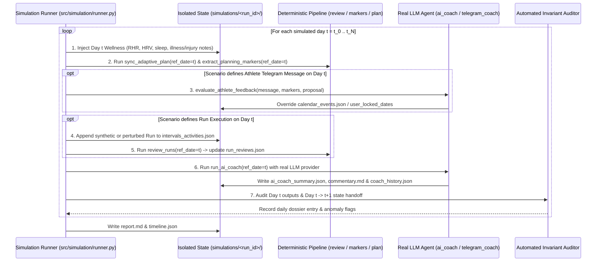

# Implementation Plan: On-Demand Agentic Scenario Simulator

**Date:** 2026-11-11  
**Status:** Planned (Depends on resolution of Findings 5.1–5.5 in [`ARCHITECTURE_REVIEW_AND_FINDINGS.md`](ARCHITECTURE_REVIEW_AND_FINDINGS.md))  
**Scope:** Multi-day time-stepping simulation harness for stress-testing the real LLM Coach ([`src/analysis/ai_coach.py`](../src/analysis/ai_coach.py) and [`src/analysis/telegram_coach.py`](../src/analysis/telegram_coach.py)) across realistic training, illness, injury, and compliance scenarios.  
**Companion Plan:** [`FORESIGHT_ENGINE_PLAN.md`](FORESIGHT_ENGINE_PLAN.md) (Deterministic Athlete Forward Projection, strictly separated from agentic testing).

---

## 1. Objectives & Architectural Boundaries

 Standard BDD tests (`./run test`) validate deterministic Python logic using `MockLLMClient`. While fast and deterministic for CI, they cannot expose failure modes inside the **agentic feedback loop**—where real LLM reasoning (`ai_coach.py`, `telegram_coach.py`), persistent coaching memory (`coach_history.json`), and deterministic calendar scheduling (`schedule_workout.py`) interact across multiple consecutive days.

### Strict Separation of Concerns
1. **Not a CI Regression Gate**: This harness invokes real LLMs (`agy` or `gemini`) across multi-day trajectories. It is executed **deliberately on demand** (`./run simulate`), never inside automated CI/CD or `./run test`.
2. **Separated from Athlete Foresight**: This tool is a **diagnostic QA and prompt-hardening harness** that injects stressors (illness, cramps, overpacing, skipped sessions) to uncover bugs in the Coach and its state handoffs. Athlete-facing future projections are handled separately in [`FORESIGHT_ENGINE_PLAN.md`](FORESIGHT_ENGINE_PLAN.md).
3. **Complete Sandbox Isolation**: Simulations execute strictly inside temporary or git-ignored directories (`simulations/<timestamp>_<scenario>/`) and never mutate production athlete files (`athletes/<slug>/`) or call live Intervals.icu/Telegram HTTP endpoints.

---

## 2. Pre-Flight Prerequisites (Findings 5.1–5.5)

Before running multi-day agentic simulations, the five handoff defects documented in [`ARCHITECTURE_REVIEW_AND_FINDINGS.md` §5](ARCHITECTURE_REVIEW_AND_FINDINGS.md) must be resolved:

1. **Finding 5.1**: Update `coach_history.json` on rest, illness, and injury days even when `runs_since` is empty ([`src/analysis/ai_coach.py`](../src/analysis/ai_coach.py)).
2. **Finding 5.2**: Preserve `"rest_day"` and `"recovery_run"` directives from `coach_history.json` instead of mapping all `coach_directive_override` flags to a 45m Z2 run ([`src/planner/extract_markers.py`](../src/planner/extract_markers.py), [`src/planner/schedule_workout.py`](../src/planner/schedule_workout.py)).
3. **Finding 5.3**: Enforce multi-session aerobic ramp-up after breaks $\ge 7\text{–}10$ days so the second run after illness does not immediately trigger intervals ([`src/planner/schedule_workout.py`](../src/planner/schedule_workout.py), [`src/analysis/decision_trace.py`](../src/analysis/decision_trace.py)).
4. **Finding 5.4**: Replace hardcoded `datetime.now()` / `date.today()` calls in [`src/analysis/coach_history.py`](../src/analysis/coach_history.py) and [`src/analysis/ai_coach.py`](../src/analysis/ai_coach.py) with `ref_date` and expose `--ref-date` on the `ai_coach.py` CLI.
5. **Finding 5.5**: Filter loaded activities by `start_date_local[:10] <= ref_date.isoformat()` across all planning and coaching modules to prevent future data leaks during time-stepping.

---

## 3. Multi-Day Simulation Architecture

### 3.1 Module Layout
- `src/simulation/scenarios.py`: Declarative multi-day scenario definitions (initial baseline + day-by-day event scripts for wellness, run execution/deviation, athlete notes, and Telegram messages).
- `src/simulation/auditor.py`: Automated verification rules checking LLM outputs against physiological guardrails, Coaching DNA, and calendar handoff state.
- `src/simulation/runner.py`: Time-stepping orchestrator and report generator (`report.md` and `timeline.json`).
- `./run simulate`: CLI entrypoint supporting `--scenario <name>`, `--athlete <slug>` (to seed baseline profile/history from a real athlete), `--provider agy|gemini`, and `--days <N>`.

---

## 4. Scenario Catalog for Stress-Testing the Coach

### Scenario 1: `illness_relapse_and_reentry` (14 Days)
- **Trajectory**:
  - Days 1–3: Normal slot execution (1 quality session, 1 easy base run).
  - Days 4–10: Acute infection (`restingHR: +7 bpm` above baseline, `hrv` suppressed by 25%, wellness comment `"Erkältung und Halsschmerzen"`, zero runs).
  - Day 11: Wellness normalizes; athlete completes 30m Z2 re-entry run.
  - Days 12–14: Athlete returns to regular weekday slots.
- **What We Verify**:
  - Does the AI Coach immediately switch `next_workout_type` to `"rest_day"` and `status_level` to `"warning"` on Day 4?
  - Does `coach_history.json` overwrite the prior open quality directive on Day 4 without requiring a completed run?
  - Does the Coach keep Day 13 in Zone 2 (`easy_run`) rather than prematurely demanding intervals right after the single 30m re-entry run?

### Scenario 2: `overpacing_and_cramp_cascade` (10 Days)
- **Trajectory**:
  - Day 1: Coach prescribes a 45m Zone 2 Easy Run (`< 158 bpm`).
  - Day 2: Athlete overpaces the Easy Run into Zone 3/4 (`avg_hr: 166 bpm`, `z1_z2_pct: 32%`) and attaches the note `"Wadenkrämpfe ab km 4, musste abbrechen"`.
  - Days 3–5: Recovery window and next scheduled quality slot.
- **What We Verify**:
  - Does the AI Coach remain matter-of-fact and non-judgmental (no scolding per Coaching DNA) while strictly enforcing recovery (`rest_day` / `recovery_run`)?
  - Does the Day 2 cramp note propagate through `run_reviewer.py` (48h recovery window) and `extract_markers.py` (`health_warning = True`) to block the Day 4 quality slot?

### Scenario 3: `telegram_negotiation_and_veto` (7 Days)
- **Trajectory**:
  - Day 1 (Tuesday, Slot 1): Planner schedules `5x 1m Speed Intervals`.
  - Day 1 Morning: Athlete sends Telegram free-text: `"Beine sind heute ziemlich schwer und ich habe nur 30 Minuten Zeit"`.
  - Day 1 Afternoon: Athlete completes the modified 30m Z1/Z2 run.
  - Day 2–7: Subsequent flexible and weekend long-run slots.
- **What We Verify**:
  - Does `telegram_coach.py` downgrade the session to a 30m `recovery_run` / `easy_run` and lock the date?
  - Does `ai_coach.py` on Day 1/2 recognize that the athlete followed the adjusted calendar plan (`compliance_status: "erfüllt"`) instead of falsely accusing the athlete of skipping intervals?

### Scenario 4: `chronic_grey_zone_and_missing_anchor` (14 Days)
- **Trajectory**:
  - Athlete repeatedly skips the weekend Slot 3 Base Anchor (`long_run`) and turns every weekday run into a moderate-hard Zone 3/4 tempo effort (`z1_z2_pct < 45%` over 2 weeks).
- **What We Verify**:
  - Does the Coach accurately track consecutive quality runs without base anchors?
  - Does the Coach enforce an aerobic base catch-up without prescribing a forbidden target pace (e.g., never writing `"Laufe mit 6:30 min/km"`)?

---

## 5. Automated Audit & Counter-Check Matrix (`src/simulation/auditor.py`)

At the end of every simulated day $t$, the auditor inspects the generated artifacts and flags any violation in `report.md`:

| Audit Check ID | Invariant / Rule Checked | Detection Mechanism |
| :--- | :--- | :--- |
| **`AUDIT-01: Text-vs-JSON Drift`** | `coach_commentary` prose must not contradict `history_evaluation.next_workout_type`. | Flags when prose explicitly instructs complete rest (`"komplett pausieren"`, `"kein Lauf"`) while `next_workout_type` is `"intervals"` or `"tempo_run"`, or vice versa. |
| **`AUDIT-02: HR vs. Pace Separation`** | Zone 2 / Base / Recovery recommendations must never prescribe a target pace (`min/km`). | Regex scan across `coach_commentary`, `next_recommendation`, and `recommendations[].text` when `next_workout_type in ("easy_run", "recovery_run", "long_run")`. |
| **`AUDIT-03: Health Guardrail Override`** | Acute illness, injury, cramps, or $\Delta\text{RHR} \ge +4\text{ bpm}$ must force `"rest_day"` or `"recovery_run"`. | Asserts `next_workout_type in ("rest_day", "recovery_run")` whenever `markers["guardrails"]["health_warning"]` is `True`. |
| **`AUDIT-04: Calendar Handoff Parity`** | Day $t$ Coach directive in `coach_history.json` must be reflected in Day $t+1$ `sync_adaptive_plan` output. | Compares `coach_history[-1]["target_type"]` from Day $t$ against the scheduled or overridden calendar event on Day $t+1$. |
| **`AUDIT-05: Contract Compliance`** | All generated JSON artifacts must pass runtime schema validation. | Runs `validate_coach_history`, `validate_run_review_evaluation`, `validate_planning_markers`, and `validate_decision_trace_entry` from [`src/core/contracts.py`](../src/core/contracts.py). |
| **`AUDIT-06: Anti-Scolding / Tone Check`** | Coach must not scold the athlete or label intentional Flexi-Model threshold runs as "grey zone mistakes". | Scans `coach_commentary` for prohibitive scolding phrases or false compliance penalties when the athlete executed a scheduled calendar workout. |

---

## 6. Output Artifacts & Inspection Workflow

Each simulation run produces a self-contained directory `simulations/<YYYYMMDD_HHMMSS>_<scenario>/`:
1. **`report.md`**: Human-readable chronological dossier containing:
   - Executive summary (Total days simulated, LLM calls made, Audit pass/warn/fail counts).
   - Day-by-day collapsible timeline showing:
     - **Injected State**: Wellness metrics, completed activity, athlete notes, Telegram input.
     - **Deterministic Markers**: `TSB`, `CTL`, `ATL`, active guardrails, selected calendar workout.
     - **Agent Decision**: `status_title`, `compliance_status`, `next_workout_type`, `next_recommendation`, and full `coach_commentary`.
     - **Auditor Verdict**: Pass or detailed warning/failure breakdown.
2. **`timeline.json`**: Full machine-readable snapshot of each day's inputs, markers, prompts, raw LLM outputs, and audit results for diffing before and after prompt/code fixes.
