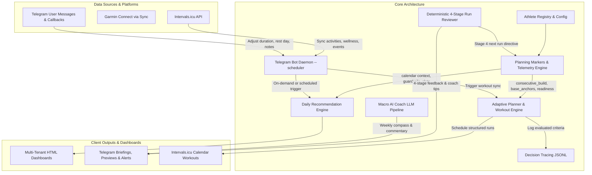

# Architecture Specification & System State: IST vs. SOLL

**Date:** 2026-11-04  
**Scope:** Full architectural state, system invariants, component contracts, and SOLL vs. IST reference across all integrations, planning engines, analysis pipelines, Telegram bot daemon, dashboard generator, agent bundle, and automated BDD test suite.  
**Companion Specifications:** [`SYSTEM_SPEC.md`](SYSTEM_SPEC.md) (Coaching DNA & Physiological Formulas), [`../src/core/contracts.py`](../src/core/contracts.py) (Executable Data Contracts), and [`../README.md`](../README.md) (Task Runner & CLI Reference).

---

## 1. Architectural Overview & System State

The `laufen` platform operates as a multi-tenant, privacy-focused running coach and planning system. It reconciles intended training periodization (**SOLL**) with actual physiological execution (**IST**) across a 24-hour operational lifecycle.

The system state is characterized by:
- **Unified Deterministic Planning**: A single telemetry-driven marker pipeline ([`src/planner/extract_markers.py`](../src/planner/extract_markers.py)) feeds both calendar scheduling ([`src/planner/schedule_workout.py`](../src/planner/schedule_workout.py)) and user-facing daily recommendations ([`src/analysis/daily_recommendation.py`](../src/analysis/daily_recommendation.py)).
- **Two-Stage Analysis Architecture**: Strict decoupling of immediate deterministic 4-stage per-run reviews ([`src/analysis/run_reviewer.py`](../src/analysis/run_reviewer.py)) from holistic weekly Macro AI Coach evaluations ([`src/analysis/ai_coach.py`](../src/analysis/ai_coach.py)).
- **Multi-Tenant Profile Isolation**: Strict tenant scoping where all athlete zones, weekly periodization slots, credentials, and notification settings reside in isolated athlete directories (`athletes/<slug>/`) resolved via [`src/athletes.py`](../src/athletes.py) and [`athletes/registry.json`](../athletes/registry.json).
- **Daemon-Governed Operational Lifecycle**: Burkerserver Telegram bot daemon ([`src/integrations/telegram_bot.py`](../src/integrations/telegram_bot.py)) serves as the sole authoritative scheduler for morning briefings, evening previews, and periodic 10-minute activity upload polling.
- **Contract-Guarded Test Isolation**: Full test coverage (176 offline BDD scenarios) with complete external API isolation via unified mock HTTP drivers ([`tests/drivers.py`](../tests/drivers.py)), guaranteeing zero external API leaks and zero contract drift.

---

## 2. Component Architecture: SOLL vs. IST Mapping

The following matrix documents the agreed target architecture (**SOLL**) alongside the active production implementation (**IST**).

| Component / Subsystem | Target Architecture (SOLL) | Active Implementation (IST) | State |
| :--- | :--- | :--- | :--- |
| **Unified Planning Pipeline** | Single source of truth for all training decisions. Deterministic calculation of continuous telemetry markers (build weeks, base anchor status, break duration, readiness) driving workout selection without divergent procedural rules. | Both [`schedule_workout.py`](../src/planner/schedule_workout.py) and [`daily_recommendation.py`](../src/analysis/daily_recommendation.py) share [`extract_markers.py`](../src/planner/extract_markers.py) continuous benchmarks (`consecutive_build_weeks`, `base_anchors_in_last_14d`, `days_since_last_run`) and adhere to [`PlanningMarkersContract`](../src/core/contracts.py). | **Unified & Enforced** |
| **Calendar Event Context** | Calendar events (workouts, rest notes, paired activities) serve as decision context rather than hard-coded bypasses or blind blockers. | In [`daily_recommendation.py`](../src/analysis/daily_recommendation.py), explicit rest notes trigger rest days and completed runs trigger recovery, but empty days evaluate slot periodization and readiness instead of short-circuiting to `"Ruhetag (Laut Kalender)"`. | **Contextual & Enforced** |
| **Health, Cramp & Re-Entry Guardrails** | Muscular cramps, illness symptoms, or elevated resting HR automatically forbid high-intensity work; breaks $\ge 7$ days enforce 25–30m easy re-entry; $\ge 3$ consecutive build weeks trigger deload. | [`extract_markers.py`](../src/planner/extract_markers.py) flags `health_warning`, `is_reentry_run`, and `is_deload_week`. High-intensity slots (intervals, tempo) are replaced by 45m Z2 base or recovery runs across both engines. | **Standardized & Enforced** |
| **Decision Tracing & Auditability** | Every automated training adjustment or workout selection must record its evaluated criteria, rejected alternatives, and winning directive in a structured format. | [`src/analysis/decision_trace.py`](../src/analysis/decision_trace.py) logs structured JSONL entries to `athletes/<slug>/decision_trace.jsonl` during plan sync and coaching runs, inspectable via `./run trace [--athlete <slug>] [--ref-date YYYY-MM-DD] [--json]`. | **Traceable & Enforced** |
| **4-Stage Per-Run Review** | Deterministic 4-stage post-run review (Physiology, Compliance, Optimization, Next Run Directive) conforming to Schema v2, with dynamic 24h/48h recovery windows and cramp detection. | [`src/analysis/run_reviewer.py`](../src/analysis/run_reviewer.py) computes all 4 stages conforming to `RunReviewContract` (`schema_version: 2`) and formats Telegram messages with exact recovery hours and coach directives. | **Structured & Enforced** |
| **Macro AI Coach Pipeline** | Daily LLM evaluation of macro trends, weekly volume compass, and recovery telemetry, operating consistently on both training and rest days. | [`src/analysis/ai_coach.py`](../src/analysis/ai_coach.py) runs daily via `./run coach`, ingests wellness telemetry (RHR delta, sleep score, soreness/stress, active injuries) via `--wellness`, and outputs structured coaching artifacts (`ai_coach_summary.json` & `ai_coach_commentary.md`). | **Daily & Enforced** |
| **Telegram Bot Lifecycle & Polling** | Burkerserver Bot Daemon (`--scheduler`) is the sole trigger authority for daily morning briefings (07:00), evening previews (20:30), and periodic activity polling (every 10m). | [`src/integrations/telegram_bot.py`](../src/integrations/telegram_bot.py) daemon manages schedules with strict idempotency (`last_briefing_date`), cold-start spam protection, and real-time interactive callbacks (`note_confirm`, `note_pick_other`, `note_cancel`). | **Autonomous & Enforced** |
| **Multi-Tenant Scoping & Registry** | Complete tenant isolation: individual directories (`athletes/<slug>/`), unguessable dashboard privacy slugs, per-athlete zones, and dynamic context resolution. | Resolved via [`src/athletes.py`](../src/athletes.py) and [`athletes/registry.json`](../athletes/registry.json). All scripts, CLI commands (`./run <cmd> --athlete <slug>`), and agent tools dynamically resolve tenant paths without single-tenant hardcoding. | **Multi-Tenant & Enforced** |
| **Code Hygiene & Central Config** | Zero boilerplate duplication for environment loading, athlete profile access, or core run classifications. | [`src/core/config.py`](../src/core/config.py) centralizes `load_env_file()` and `load_athlete_profile()`. Core functions (`is_quality_run`) are shared across planner and recommendation modules. | **Centralized & Clean** |
| **Automated Verification & BDD Architecture** | Declarative Gherkin scenarios with strict Driver Pattern separation, 100% external API mocking, and automated documentation drift prevention. | 176 automated BDD scenarios in `tests/*.feature` with Driver classes in `tests/test_*.py` and [`tests/drivers.py`](../tests/drivers.py). Zero real HTTP requests during `./run test`. | **100% Passing (176 Tests)** |
| **CI/CD & Server Deployment** | Exclusively automated deployments via GitHub Actions to Burkerserver with pre-flight CI testing, staging validation against `berni-test`, and atomic directory synchronization. | [`.github/workflows/deploy-burkerserver.yml`](../.github/workflows/deploy-burkerserver.yml), [`.github/workflows/deploy-agent.yml`](../.github/workflows/deploy-agent.yml), and [`deploy/docker-compose.bot.yml`](../deploy/docker-compose.bot.yml) maintain harmonized paths (`~/dockerContainer/`) and daemon scheduler flags. | **Automated & Guarded** |

---

## 3. Core System Invariants

The following invariants are permanently maintained across the codebase and validated by automated tests:

### 3.1 Physiological & Coaching Invariants
1. **Heart Rate vs. Pace Separation**:
   - Aerobic base workouts (Zone 2) are governed strictly by heart rate thresholds (`z2_max_hr`), never pace.
   - High-intensity intervals (Zone 4/5) and threshold work are governed by calibrated pace targets (`min/km`) or localized threshold zones.
2. **De-Dogmatized 80/20 Compass**:
   - 80/20 is an overarching compass across 4–6 week blocks, not a rigid per-week enforcement. Deload weeks occur systematically after $\ge 3$ consecutive build weeks or when chronic fatigue accumulates (TSB $\le -15$).
3. **Run-Walk Biomechanics & Cramp Protocols**:
   - Subjective cramp or muscular pain complaints instantly force a 48-hour recovery window and substitute quality sessions with restorative base/recovery runs.

### 3.2 Operational & Data Invariants
1. **Contract Validity**:
   - All reviews in `athletes/<slug>/run_reviews.json` must validate against `RunReviewContract` (`schema_version: 2`).
   - All historical coaching entries in `athletes/<slug>/coach_history.json` must validate against `CoachHistoryEntryContract`.
   - All decision records in `athletes/<slug>/decision_trace.jsonl` must validate against `DecisionTraceEntryContract`.
2. **Briefing & Notification Idempotency**:
   - Daily morning briefings are dispatched at most once per athlete per day (`last_briefing_date == today_iso`), unless explicitly triggered with `--force`.
   - Post-run reviews are sent only for runs completed today or within the last 6 hours, preventing historical spam upon daemon reboot.
3. **Calendar Preservation**:
   - Rolling plan synchronization (`sync_adaptive_plan`) preserves all out-of-window calendar events ($> 14$ days future or past events) and never truncates `calendar_events.json`. Dry-run executions never mutate disk files.

---

## 4. Verification & Operational Health Checks

System integrity is continuously verified through the following test runners and inspection tools:

| Verification Task | Command | Scope & Invariants Checked |
| :--- | :--- | :--- |
| **Full Offline BDD Suite** | `./run test` | Runs 176 declarative BDD scenarios covering all pipelines, bot states, planner rules, mock servers, and contract compliance. |
| **Documentation & Drift Check** | `.venv/bin/pytest tests/test_documentation_integrity.py` | Verifies relative path integrity across all active Markdown docs, validates CLI command parity, and checks data contract drift. |
| **Decision Trace Inspection** | `./run trace [--athlete <slug>] [--ref-date YYYY-MM-DD]` | Inspects evaluated decision criteria, rejected workout alternatives, and coach directive overrides for any given date. |
| **Multi-Tenant Dashboard Build** | `./run dashboard --all` | Compiles German-localized HTML dashboards for all active athletes to `dist/<dashboard_slug>/index.html`. |
| **Live Staging E2E Validation** | `./run test:e2e` | Executes live end-to-end integration tests exclusively against the staging tenant (`berni-test`) to protect production data. |
