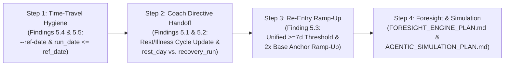

# Architecture Convergence, IST Status & Roadmap to SOLL

**Date:** 2026-11-13  
**Authoritative SOLL Architecture Reference:** **[`SYSTEM_SPEC.md`](SYSTEM_SPEC.md)** (§1 Core Invariants, §2 Target System & Component Architecture, §5 24-Hour Workflow-Dispatch Lifecycle)  
**Companion Specifications & Plans:**
- [`../src/core/contracts.py`](../src/core/contracts.py) — Executable Data Contracts (`TypedDict` & Runtime Validators)
- [`WORKFLOW_DISPATCH_ARCHITECTURE_PLAN.md`](WORKFLOW_DISPATCH_ARCHITECTURE_PLAN.md) — Modular GitHub Actions Dispatch & Thin Event-Router Architecture
- [`FORESIGHT_ENGINE_PLAN.md`](FORESIGHT_ENGINE_PLAN.md) — Deterministic 14–28 Day Load & Deload Projection Engine
- [`AGENTIC_SIMULATION_PLAN.md`](AGENTIC_SIMULATION_PLAN.md) — Multi-Day Agentic Scenario Simulator (`./run simulate`)

---

## 1. IST Architecture Summary & Convergence Status

The target **SOLL architecture** is specified in **[`SYSTEM_SPEC.md` §2 & §5](SYSTEM_SPEC.md)**. The active production implementation (**IST**) has converged to **~95% parity with SOLL**, verified by **185 offline BDD scenarios** (`./run test`) with 100% external API isolation.

| Subsystem (SOLL Reference in [`SYSTEM_SPEC.md`](SYSTEM_SPEC.md)) | Active Implementation (IST) | Convergence Status |
| :--- | :--- | :--- |
| **Unified Planning Pipeline** ([`SYSTEM_SPEC.md` §2.1](SYSTEM_SPEC.md)) | [`schedule_workout.py`](../src/planner/schedule_workout.py) and [`daily_recommendation.py`](../src/analysis/daily_recommendation.py) share [`extract_markers.py`](../src/planner/extract_markers.py) continuous benchmarks (`consecutive_build_weeks`, `base_anchors_in_last_14d`, `days_since_last_run`) conforming to [`PlanningMarkersContract`](../src/core/contracts.py). | **SOLL-Aligned (100%)** |
| **Calendar Context, Workout Preservation & Dual Options (A/B)** ([`SYSTEM_SPEC.md` §1.2 & §5](SYSTEM_SPEC.md)) | Empty calendar days evaluate slot periodization without short-circuiting. Existing unpaired workouts are preserved (`[BEREITS GEPLANT]`). Evening previews (`--evening-preview --dual-options`) schedule both **Slot 2A (Threshold)** and **Slot 2B (Z2 Base)** on flexible Slot 2 days. | **SOLL-Aligned (100%)** |
| **Decision Tracing & Auditability** ([`SYSTEM_SPEC.md` §2.1](SYSTEM_SPEC.md)) | [`decision_trace.py`](../src/analysis/decision_trace.py) logs structured JSONL records to `athletes/<slug>/decision_trace.jsonl` (inspectable via `./run trace` and published to `$GITHUB_STEP_SUMMARY`). | **SOLL-Aligned (100%)** |
| **4-Stage Per-Run Review** ([`SYSTEM_SPEC.md` §2.1 & §4](SYSTEM_SPEC.md)) | [`run_reviewer.py`](../src/analysis/run_reviewer.py) computes deterministic 4-stage reviews (`schema_version: 2`) with dynamic 24h/48h recovery windows and subjective note re-evaluation via [`manage_note.py`](../src/integrations/manage_note.py). | **SOLL-Aligned (100%)** |
| **Event-Driven Workflow Dispatch & Thin Telegram Router** ([`SYSTEM_SPEC.md` §2 & §5](SYSTEM_SPEC.md)) | [`telegram_bot.py`](../src/integrations/telegram_bot.py) (`--scheduler --dispatch-mode`) acts as a thin sensor/router (`last_dispatched_briefing_date` separated from `last_briefing_date`), delegating planning, reviews, notifications, and Pages builds to [`coach-plan.yml`](../.github/workflows/coach-plan.yml), [`send-telegram.yml`](../.github/workflows/send-telegram.yml), [`post-run-review.yml`](../.github/workflows/post-run-review.yml), and [`deploy-pages.yml`](../.github/workflows/deploy-pages.yml). | **SOLL-Aligned (100%)** |
| **Multi-Tenant Scoping & Central Config** ([`SYSTEM_SPEC.md` §1.1 & §4](SYSTEM_SPEC.md)) | [`src/athletes.py`](../src/athletes.py), [`athletes/registry.json`](../athletes/registry.json), and [`src/core/config.py`](../src/core/config.py) isolate all tenant paths (`athletes/<slug>/`) and centralize environment/profile loading. | **SOLL-Aligned (100%)** |
| **Automated BDD Verification & CI/CD** ([`SYSTEM_SPEC.md` §1.1 & §7](SYSTEM_SPEC.md)) | **185 offline BDD scenarios** in `tests/*.feature` bound to [`tests/drivers.py`](../tests/drivers.py) + automated deployments via [`deploy-burkerserver.yml`](../.github/workflows/deploy-burkerserver.yml) and [`deploy-agent.yml`](../.github/workflows/deploy-agent.yml). | **SOLL-Aligned (185 Passing)** |
| **Multi-Day Time-Stepping, Re-Entry Memory & Rest-Day Coach Handoff** ([`SYSTEM_SPEC.md` §2.1](SYSTEM_SPEC.md)) | Single-day guardrails are enforced, but multi-day handoffs on rest/illness days (`runs_since == []`), `rest_day` vs. `recovery_run` differentiation in `choose_adaptive_workout()`, multi-session post-break ramp-up, and strict `--ref-date` cutoffs have 5 open findings (§3). | **Delta Open (Findings 5.1–5.5)** |

---

## 2. Completed Path: Architectural Milestones Achieved

The transition from the initial single-tenant prototype to the current IST state was completed in four structural phases:

1. **Phase A — Multi-Tenant Isolation & Central Configuration**:
   - Introduced [`src/athletes.py`](../src/athletes.py), [`athletes/registry.json`](../athletes/registry.json), and [`src/core/config.py`](../src/core/config.py), moving all athlete zones, weekly periodization slots (`weekly_slots`), and state files into isolated `athletes/<slug>/` directories with unguessable dashboard slugs.
2. **Phase B — Unified Telemetry Pipeline, Schema v2 Contracts & Decision Tracing**:
   - Eliminated divergent planning logic between [`schedule_workout.py`](../src/planner/schedule_workout.py) and [`daily_recommendation.py`](../src/analysis/daily_recommendation.py) by consolidating continuous markers (`consecutive_build_weeks`, `base_anchors_in_last_14d`, `days_since_last_run`, `health_warning`) in [`extract_markers.py`](../src/planner/extract_markers.py).
   - Removed the calendar empty-day short-circuit (`"Ruhetag (Laut Kalender)"`), added wellness/injury ingestion (`--wellness`) to [`ai_coach.py`](../src/analysis/ai_coach.py), enforced runtime contracts in [`src/core/contracts.py`](../src/core/contracts.py), and introduced structured audit logging in [`decision_trace.py`](../src/analysis/decision_trace.py) (`./run trace`).
3. **Phase C — Existing-Workout Preservation & Dual-Option (A/B) Evening Scheduling**:
   - Updated [`sync_adaptive_plan()`](../src/planner/schedule_workout.py#L994-L1055) so existing unpaired workouts on a target date are preserved rather than blindly overwritten.
   - Added `--dual-options` for flexible Slot 2 evening previews, scheduling both **Slot 2A (Threshold)** and **Slot 2B (Z2 Base)** on Intervals.icu so both sync to the Garmin watch overnight and can be chosen via Telegram inline buttons (`accept_a` / `accept_b`).
4. **Phase D — Modular GitHub Actions Workflow-Dispatch & Thin Telegram Event Router**:
   - Implemented [`WORKFLOW_DISPATCH_ARCHITECTURE_PLAN.md`](WORKFLOW_DISPATCH_ARCHITECTURE_PLAN.md): decoupled planning, coaching, post-run reviews, notifications, and Pages hosting into [`coach-plan.yml`](../.github/workflows/coach-plan.yml), [`send-telegram.yml`](../.github/workflows/send-telegram.yml), [`post-run-review.yml`](../.github/workflows/post-run-review.yml), and [`deploy-pages.yml`](../.github/workflows/deploy-pages.yml).
   - Configured [`deploy/laufen-telegram-bot.service`](../deploy/laufen-telegram-bot.service) and [`deploy/docker-compose.bot.yml`](../deploy/docker-compose.bot.yml) with `--scheduler --dispatch-mode` and separated `last_dispatched_briefing_date` / `last_dispatched_evening_date` from `last_briefing_date` so downstream `send-telegram.yml` deliveries are never blocked by router deduplication.

---

## 3. Remaining Delta to 100% SOLL: Open Handoff & Time-Stepping Findings

**Date Identified:** 2026-11-11  
**Status:** Open (Targeted for the next implementation iteration)

The following five handoff gaps between the LLM Coach ([`src/analysis/ai_coach.py`](../src/analysis/ai_coach.py)), coaching memory ([`src/analysis/coach_history.py`](../src/analysis/coach_history.py)), and deterministic planning engines ([`src/planner/extract_markers.py`](../src/planner/extract_markers.py), [`src/planner/schedule_workout.py`](../src/planner/schedule_workout.py)) represent the remaining delta between IST and SOLL:

### Finding 5.1: Macro AI Coach Drops Directives on Rest, Illness, and Injury Days (`runs_since == []`)
- **Affected Component:** [`src/analysis/ai_coach.py`](../src/analysis/ai_coach.py#L1082-L1101) (`run_ai_coach`)
- **Root Cause:** `update_history_with_coach_review()` is guarded by `if runs_since:`. When `ai_coach.py` runs on a rest day, illness day, or injury day where no new run has been completed since the active recommendation's `date`, `runs_since` is empty (`[]`).
- **Impact:** Even when the LLM detects acute illness/injury (e.g., elevated resting HR, fever/cold notes) and outputs `"next_workout_type": "rest_day"` in `ai_coach_summary.json`, `coach_history.json` is never updated. The prior pre-illness cycle (e.g., `"target_type": "intervals"`) remains `"status": "offen"`, causing downstream planning modules to read a stale directive on subsequent days.
- **Target Resolution:** Update `run_ai_coach()` and [`src/analysis/coach_history.py`](../src/analysis/coach_history.py) so that rest-day/illness directives from the AI Coach update or supersede the active open cycle in `coach_history.json` even when `runs_since` is empty.

### Finding 5.2: Coach `"rest_day"` Directive Translated into 45m Zone 2 Run by Adaptive Planner
- **Affected Components:** [`src/planner/extract_markers.py`](../src/planner/extract_markers.py#L597-L600) (`get_coach_context_markers`) and [`src/planner/schedule_workout.py`](../src/planner/schedule_workout.py#L645-L673) (`choose_adaptive_workout`)
- **Root Cause:** `get_coach_context_markers()` collapses `target_type in ("easy_run", "recovery_run", "rest_day", "long_run")` into a single boolean `unfulfilled_base_directive = True`, which sets `coach_directive_override = True` in `calculate_guardrails()`. In `choose_adaptive_workout()`, `coach_directive_override == True` unconditionally schedules `"Aerober Anker & Grundlagenlauf (45m Z2)"`.
- **Impact:** When the Macro AI Coach or Stage-4 run review prescribes `"rest_day"` or `"recovery_run"` (30m Z1) in `coach_history.json`, the calendar planner overrides quality slots with a 45-minute Zone 2 run rather than enforcing a rest day (`🛋️ Ruhetag (Coach)`) or a 30m Z1 recovery run.
- **Target Resolution:** Distinguish `coach_context["target_type"]` (`rest_day` vs. `recovery_run` vs. `easy_run`) in `calculate_guardrails()`, `sync_adaptive_plan()`, and `choose_adaptive_workout()`.

### Finding 5.3: Missing Multi-Session Ramp-Up Memory After Extended Breaks ($\ge 7\text{–}10$ Days) & Threshold Drift
- **Affected Components:** [`src/planner/schedule_workout.py`](../src/planner/schedule_workout.py#L611-L618) (`choose_adaptive_workout`), [`src/planner/extract_markers.py`](../src/planner/extract_markers.py#L614-L700) (`calculate_guardrails`), [`src/analysis/daily_recommendation.py`](../src/analysis/daily_recommendation.py), and [`src/analysis/decision_trace.py`](../src/analysis/decision_trace.py#L66-L77) (`evaluate_workout_decision`)
- **Root Cause:**
  1. Re-entry protection checks only `days_since_last_run` (distance to the single most recent run). After a 10-day illness/injury break, Day $t$ triggers a 30m Z2 re-entry run. On Day $t+2$, `days_since_last_run` drops to `2` while `TSB` is strongly positive (due to 10 days of `ATL` decay). With `is_reentry_run` now `False`, the planner immediately schedules full quality sessions (intervals/threshold) on the second run back.
  2. Break thresholds diverge across modules: `choose_adaptive_workout()` and `calculate_guardrails()` check `days_since_last_run >= 7`, whereas `evaluate_workout_decision()` and `daily_recommendation.py` check `days_since >= 10`.
- **Impact:** Premature high-intensity prescription on the second session after an illness or injury break, and inconsistent decision trace reporting between 7 and 9 days of inactivity.
- **Target Resolution:** Harmonize the re-entry break threshold across all modules and require a progressive base ramp-up (e.g., $\ge 2$ completed clean aerobic base runs in the last 14 days via `base_anchors_in_last_14d`) before unlocking quality workouts after a break.

### Finding 5.4: Hardcoded Wall-Clock Dates (`date.today()` / `datetime.now()`) in AI Coach & Coach History
- **Affected Components:** [`src/analysis/ai_coach.py`](../src/analysis/ai_coach.py#L1104-L1110) (`run_ai_coach`), [`src/analysis/ai_coach.py`](../src/analysis/ai_coach.py#L1153-L1270) (`main`), and [`src/analysis/coach_history.py`](../src/analysis/coach_history.py#L171-L225) (`update_history_with_coach_review`)
- **Root Cause:**
  1. `update_history_with_coach_review()` stamps new `coach_history.json` entries with `datetime.now().strftime("%Y-%m-%d")` instead of accepting `ref_date`.
  2. `run_ai_coach()` writes `decision_trace.jsonl` entries with `date.today().isoformat()` instead of `ref_date`.
  3. `ai_coach.py` CLI (`main()`) lacks a `--ref-date` flag.
- **Impact:** When running multi-day simulations or historical replays for a simulated date $t \neq \text{today}$, new coaching cycles are stamped with the real wall-clock date, corrupting `find_runs_since(runs, rec_date)` on subsequent simulated days.
- **Target Resolution:** Add `--ref-date YYYY-MM-DD` to `ai_coach.py` CLI and propagate `ref_date` into `run_ai_coach()` and `update_history_with_coach_review()`.

### Finding 5.5: Future Activity Leak Under `--ref-date` Time-Travel in Planner, Recommendation & AI Coach
- **Affected Components:** [`src/planner/schedule_workout.py`](../src/planner/schedule_workout.py#L788-L799) (`sync_adaptive_plan`), [`src/analysis/daily_recommendation.py`](../src/analysis/daily_recommendation.py#L34-L59) (`calculate_days_since_last_run`), [`src/planner/extract_markers.py`](../src/planner/extract_markers.py), and [`src/analysis/ai_coach.py`](../src/analysis/ai_coach.py#L539-L615) (`build_coach_prompt`)
- **Root Cause:** Unlike wellness records (which are filtered by `rec_date <= ref_date`), activity lists loaded from `intervals_activities.json` are not filtered by `start_date_local[:10] <= ref_date.isoformat()`.
- **Impact:** Stepping through a pre-populated activity history with `--ref-date` leaks future runs into `last_run_date`, `days_since_last_run`, weekly trend tables, and the AI Coach prompt.
- **Target Resolution:** Enforce a strict `run_date <= ref_date` cutoff across all planning, recommendation, marker extraction, and AI Coach entry points.

---

## 4. Roadmap: Next Steps to Complete the Path to SOLL

To close the remaining delta in §3 and enable multi-week foresight and simulation, execution proceeds in four ordered steps:

1. **Step 1 — Deterministic Time-Travel Hygiene (Findings 5.4 & 5.5)**:
   - Enforce `run_date <= ref_date` across [`schedule_workout.py`](../src/planner/schedule_workout.py), [`daily_recommendation.py`](../src/analysis/daily_recommendation.py), [`extract_markers.py`](../src/planner/extract_markers.py), and [`ai_coach.py`](../src/analysis/ai_coach.py).
   - Add `--ref-date YYYY-MM-DD` to [`ai_coach.py`](../src/analysis/ai_coach.py) and pass `ref_date` into [`update_history_with_coach_review()`](../src/analysis/coach_history.py#L171-L225).
2. **Step 2 — Rest/Illness Cycle Handoff & Directive Differentiation (Findings 5.1 & 5.2)**:
   - Allow [`run_ai_coach()`](../src/analysis/ai_coach.py#L1082-L1101) to supersede open cycles in `coach_history.json` on rest/illness days (`runs_since == []`) when health guardrails or rest directives fire.
   - Differentiate `rest_day` (`🛋️ Ruhetag (Coach)`), `recovery_run` (30m Z1), and `easy_run` (45m Z2) in [`extract_markers.py`](../src/planner/extract_markers.py) and [`schedule_workout.py`](../src/planner/schedule_workout.py).
3. **Step 3 — Multi-Session Re-Entry Ramp-Up & Threshold Harmonization (Finding 5.3)**:
   - Unify the inactivity re-entry threshold across all planning, recommendation, and trace modules and require $\ge 2$ clean aerobic base sessions (`base_anchors_in_last_14d`) after an extended break before unlocking quality slots.
4. **Step 4 — Forward Load Projection & Multi-Day Agentic Simulation**:
   - Implement the deterministic 14–28 day CTL/ATL/TSB projection engine per [`FORESIGHT_ENGINE_PLAN.md`](FORESIGHT_ENGINE_PLAN.md) (`src/analysis/foresight.py`).
   - Implement the on-demand multi-day scenario simulator per [`AGENTIC_SIMULATION_PLAN.md`](AGENTIC_SIMULATION_PLAN.md) (`./run simulate`) to stress-test the end-to-end LLM + planner loop across multi-day illness, cramp, and build-week trajectories.
