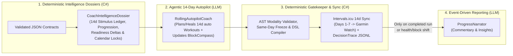

# .NET Agentic-First Coach & Self-Healing 14-Day Autopilot Architecture

**Date:** 2026-11-26  
**Status:** Target Architecture Implemented in `dotnet/` (v1 Autopilot + v2 Stage Milestones Verified; Shadow/Staging Ready)  
**Parent Migration Plan:** [`DOTNET_MIGRATION_PLAN.md`](DOTNET_MIGRATION_PLAN.md)  
**Domain & Coaching DNA Reference:** [`SYSTEM_SPEC.md`](SYSTEM_SPEC.md) (§3 Coaching DNA & Physiological Formulas)  
**Load Projection & Simulation Companions:** [`FORESIGHT_ENGINE_PLAN.md`](FORESIGHT_ENGINE_PLAN.md), [`AGENTIC_SIMULATION_PLAN.md`](AGENTIC_SIMULATION_PLAN.md)

---

## 1. Motivation & Core UX Philosophy ("Zero-Touch Autopilot, Override on Demand")

Steps 1–5 of [`DOTNET_MIGRATION_PLAN.md`](DOTNET_MIGRATION_PLAN.md) established strict C# domain contracts, physiological telemetry (`PhysiologicalCalculator`), readiness markers (`PlanningMarkersCalculator`), curated intelligence dossiers ([`CoachIntelligenceDossier.cs`](../dotnet/src/Laufen.Domain/CoachIntelligenceDossier.cs)), and the initial `Laufen.Cli` vertical slice (`athletes`, `report`, `markers`).

For the **planning and coaching slices**, translating Python's planner 1:1 would carry over three structural flaws, while a pure 1-session-ahead rolling planner would sacrifice calendar foresight and on-watch workout choice:

1. **Deterministic Planning Acts Like a Thermostat, Not a Coach**:
   - Python's [`schedule_workout.py`](../src/planner/schedule_workout.py) (`choose_adaptive_workout`) and [`daily_recommendation.py`](../src/analysis/daily_recommendation.py) rely on rigid binary cliff-edges (`sleep_score < 72`, `tsb < -8.0`, `days_since_last_run >= 7`) in [`extract_markers.py`](../src/planner/extract_markers.py) and stamp out static templates (`45m Z2` or `3x 8m Z4`) without multi-week progression (`50m -> 55m -> 60m` or `4x 5m -> 4x 6m -> 3x 8m`).
2. **Pure 1-Session Rolling vs. Rigid Pre-Planned Calendars Both Miss Real-Life UX**:
   - **Pure 1-session rolling** leaves the calendar empty beyond tomorrow: the athlete cannot see how the next two weeks build up, and only a single workout is synced to the Garmin watch—preventing spontaneous on-watch selection when time or mood shifts at the front door.
   - **Rigid pre-scheduled calendars** (where [`schedule_workout.py`](../src/planner/schedule_workout.py) freezes all future unpaired workouts via `[BEREITS GEPLANT]`) cannot self-heal when work, weather, illness, or out-of-order runs happen, creating stale calendar clutter or forcing evening A/B pre-decisions.
3. **Monolithic Coach Overload & Split-Brain Authority**:
   - [`ai_coach.py`](../src/analysis/ai_coach.py) bundles compliance auditing, workout prescription, long-form prose, and UI CSS classes into one prompt and competes with `schedule_workout.py` and `daily_recommendation.py`, causing the handoff gaps tracked in [`ARCHITECTURE_REVIEW_AND_FINDINGS.md`](ARCHITECTURE_REVIEW_AND_FINDINGS.md) (Findings 5.1–5.5).

### Athlete Interaction Principle: Zero Pre-Decisions, Ready on the Watch

1. **Zero Mandatory Interaction**: No Sunday check-in interviews and no mandatory evening A/B button prompts. In the happy path, the athlete never needs to open Telegram—lace up, press `Start` on the Garmin watch, and run.
2. **Two-Tier 14-Day Visibility via Natural Garmin Sync**:
   - **Days 1–7 (`Watch Commit Window`, ~3 sessions)**: Scheduled as single, clear `WORKOUT` events per planned training day in Intervals.icu and **automatically synced to the Garmin watch**. The athlete can start Today's suggested workout with one click—or spontaneously pick any of the week's other synced workouts (e.g., Z2 Base or Long Run) directly from the watch's `Workout Calendar` without waiting for a phone/Telegram roundtrip.
   - **Days 8–14 (`Preview & Progression Window`, ~3 sessions)**: Scheduled across the second week in Intervals.icu and rendered in the HTML Dashboard alongside projected CTL/ATL/TSB curves (per [`FORESIGHT_ENGINE_PLAN.md`](FORESIGHT_ENGINE_PLAN.md)), giving a transparent 14-day roadmap without overloading the watch.
3. **Telegram Preserved as Informational Briefing + Optional Override**:
   - Telegram keeps its current non-blocking role ([`telegram_bot.py`](../src/integrations/telegram_bot.py)): workouts sync to Intervals.icu first; morning briefings report readiness and the active plan; clicking `✅ Passt so` (`accept`) simply locks that date (`user_locked`), while override buttons (`📉 Lockerer`, `⏱️ Nur 35 Min`, `🛋️ Ruhetag`) and free-text messages remain available on demand. Scheduling one best-fit workout per planned day eliminates orphan `Slot 2A`/`2B` duplicates when messages go unanswered.

> [!IMPORTANT]
> **Intentional Evolution of `SYSTEM_SPEC.md` §1.2 #3 & §2.1 (Scoped Exclusively to `dotnet/`):**
> - The Python production codebase remains untouched per [`DOTNET_MIGRATION_PLAN.md`](DOTNET_MIGRATION_PLAN.md) Principle #1.
> - In `dotnet/`, the **Agentic Coach becomes the single authoritative planner**, sandwiched between deterministic C# **Intelligence Dossier Builders** (pre-agent) and a deterministic **Workout AST Validator & Intervals.icu DSL Compiler** (post-agent).
> - Instead of freezing *all* future unpaired workouts (`[BEREITS GEPLANT]`), calendar events distinguish **`auto` (coach-managed, self-healing)** from **`user_locked` (athlete-overridden or manually created, immutable)**.
> - All Coaching DNA invariants in [`SYSTEM_SPEC.md`](SYSTEM_SPEC.md) §3 (strict HR vs. Pace separation, Run-Walk biomechanics, non-judgmental tone, and multi-tenant isolation) remain strictly enforced.

---

## 2. End-to-End Pipeline Flow (Self-Healing 14-Day Autopilot)

---

## 3. Self-Healing Mechanics, Event Ownership & Everyday Adaptation (v1 Scope)

### 3.1 Calendar Ownership (`auto` vs. `user_locked`) & Same-Day Freeze

| Ownership State | How It Is Created | Autopilot Permission |
| :--- | :--- | :--- |
| **`auto`** *(Default)* | Created by `RollingAutopilotCoach` across `refDate .. refDate + 13` (tracked via persisted `auto_event_ids` and deterministic event metadata). | May be shifted, re-spaced, or downgraded/upgraded during the **06:00 Morning Sync** or **Post-Run Rebalance** when reality diverges from plan. |
| **`user_locked`** *(Sacred)* | Athlete clicks `accept`, `easier`, `shorter35`, `rest` or sends free-text in Telegram (`user_locked_dates`), or creates/edits a workout manually in Intervals.icu. | **Never modified or deleted** by the Autopilot. Treated as fixed anchor context around which remaining `auto` sessions are arranged. |

- **Same-Day Intraday Freeze**: To ensure a workout never mutates on the watch at 16:30 while the athlete is putting on running shoes, automatic adaptation of *today's* (`refDate`) workout is permitted **only during the early Morning Sync (~06:00)** or **after a completed run**. Mid-day mutations on `refDate` happen exclusively on explicit athlete Telegram override.
- **Anti-Churn Hysteresis**: Minor day-to-day noise (e.g., sleep score `74 -> 71` with stable RHR/HRV) keeps existing `auto` workouts intact; rescheduling requires a concrete trigger (missed run day, out-of-order completed run, or meaningful readiness/medical shift).

### 3.2 How the Autopilot Handles Real-Life Disruptions Without Athlete Micromanagement

1. **Work / Missed Planned Day (Zero Input Required)**:
   - If Tuesday's planned workout goes unrun, the athlete does nothing. On Wednesday at 06:00, the Autopilot deletes Tuesday's stale unpaired `auto` workout and re-spaces the 14-day window (e.g., `Wed -> Fri -> Sun`, respecting `allow_consecutive_run_days`). If multiple days slip, the 14-day `RollingStimulusLedger` prioritizes the highest-value stimuli for the remaining days of the week and rolls overflow smoothly into Days 8–14 rather than cramming back-to-back hard sessions.
2. **Spontaneous On-Watch Workout Swap or Off-Day Run (Post-Run Self-Healing)**:
   - If the athlete steps outside on Tuesday and picks Thursday's `Z2 Base` or Sunday's `Long Run` from the Garmin watch calendar (or runs on an unplanned day), the **Post-Run hook** inspects the actual physiological stimulus completed and automatically re-balances the remaining `auto` workouts across the 14-day window (e.g., moving the unexecuted `Threshold` session to the next recovery-safe day).
3. **Illness & Injury (`SickHold -> ReEntry` State Machine)**:
   - Acute illness is modeled as an explicit state transition rather than daily 1-day rollovers:
     - **Trigger**: Athlete texts `"krank"` / `"erkältet"` via Telegram, or `MedicalRedFlags` fire (fever/illness wellness comment, severe RHR spike).
     - **`SickHold` State**: Clears open `auto` workouts so the calendar stays clean and pauses proactive workout push pressure.
     - **Automatic or Explicit Exit -> `ReEntry`**: Ends when the athlete texts `"wieder fit"` *or* simply completes a light test run on the watch (with normalized RHR). `BreakReentryContext` (`CleanBaseRunsSinceRecentBreak < 2` in [`CoachIntelligenceDossier.cs`](../dotnet/src/Laufen.Domain/CoachIntelligenceDossier.cs)) then enforces gentle Z1/Z2 re-entry sessions before quality workouts re-enter the 14-day plan (resolving Findings 5.1–5.3 in [`ARCHITECTURE_REVIEW_AND_FINDINGS.md`](ARCHITECTURE_REVIEW_AND_FINDINGS.md)).
---

## 4. Lean Two-Role Agent Separation & Strategy Seam

We keep reasoning unified per decision rather than fragmenting single choices across micro-subagents:

| Agent Role | Trigger / Cadence | Curated Input Dossier | Strict Responsibility & Output |
| :--- | :--- | :--- | :--- |
| **1. `RollingAutopilotCoach`** *(14-Day Tactical & Progressive Planner)* | 06:00 Morning Sync, Post-Run completion, or ad-hoc Telegram override | `CoachIntelligenceDossier` + 14d `UpcomingCalendarDossier` (`auto` vs. `user_locked`), `BlockCompass` (incl. `HealthState`), optional athlete message | Emits the reconciled **14-day schedule** (`keep` / `upsert` / `delete` operations over `auto` dates, typically ~6 `WorkoutDefinition` ASTs), structured `DecisionRationale`, and updated `BlockCompass`. Produces **no** long-form essay or UI CSS classes. |
| **2. `ProgressNarrator`** *(Decoupled Editorial & Macro Review)* | Triggered **only** on completed runs or major health/block transitions—never on routine overnight rollovers | `NarrativeBriefingDossier` (completed run review, updated `BlockCompass`, 14d schedule summary + trace rationale, 4-week macro trends) | Produces human-readable Markdown commentary and domain-typed insights (`severity: info \| success \| warning`). Completely off the critical path of watch/calendar scheduling. |

- **Replaceable Planning Seam (`ICoachPlanningStrategy`) & Strict Clock Hygiene**:
  - Encapsulating the planner behind `ICoachPlanningStrategy` allows side-by-side simulation testing against real `berni` baselines (Section 7).
  - Every `.NET` domain builder, weather/calendar projector, memory updater, and trace writer **must** accept an explicit `DateOnly refDate` (never `DateTime.Now` / `DateTime.Today`), eliminating time-stepping leaks ([`ARCHITECTURE_REVIEW_AND_FINDINGS.md`](ARCHITECTURE_REVIEW_AND_FINDINGS.md) Findings 5.4 & 5.5).

---

## 5. Curated Intelligence Dossiers & Deferred v2 Stage Milestones

### 5.1 v1 Dossier Foundation (Implemented & Incremental Extensions in `Laufen.Domain`)
[`CoachIntelligenceDossier.cs`](../dotnet/src/Laufen.Domain/CoachIntelligenceDossier.cs) already provides `StimulusProgressionDossier` (`RollingStimulusLedger`, `BreakReentryContext`, `BaseProgressionChain`, `QualityProgressionChain`) and baseline-relative `ReadinessSignalDossier`. For the 14-day Autopilot, `Laufen.Domain` adds three lightweight extensions:
1. **Soft Default Run-Day Preferences (`AthleteProfile`)**: Optional `preferred_run_days` (e.g., `["tuesday", "thursday", "sunday"]`) and `TimeBudgets` (`typical_weekday_minutes` vs. `typical_weekend_minutes`) act as the default placement grid when a week is open—never as rigid role cages.
2. **14-Day Ownership-Aware Calendar Snapshot**: Extends `UpcomingCalendarDossier` from 7 days to **14 days** (`refDate .. refDate + 13`), tagging each item with `Ownership` (`Auto` | `UserLocked` | `Completed`) plus Banister EWMA load projection for the planned sequence.
3. **Compact State & Health Memory (`BlockCompass`)**: Persists `HealthState` (`Normal` | `SickHold` | `ReEntry`), current stimulus progression rung (e.g., Long Run `55m`, Threshold `4x 6m`), `auto_event_ids`, and concise observations.

### 5.2 Phase 2 Extension (v2 — Implemented in `dotnet/src/Laufen.Domain/StageMilestones.cs`): Measurable 14-Day Stage Milestones
Extending the validated v1 self-healing 14-day Autopilot, **v2** adds explicit, deterministic target tracking via `StageMilestoneEvaluator` (`CoachIntelligenceDossier.Milestones`, `DashboardHtmlRenderer`, and `Laufen.Cli trace`) without falling into short-term physiological noise:

- **Why Pure Pace/HR Outcome Targets Fail on a 14-Day Horizon**: Aerobic adaptations require 4–8 weeks, while ambient temperature (`±5 °C`), hydration, and time of day shift Z2 pace by `10–15 s/km` overnight and tempt athletes to force pace.
- **Two-Tier Measurable Goal Model (v2)**:
  1. **14-Day Stage Milestone (`StageMilestone` — Process, Capacity & Durability)**: Directly controllable and deterministically verifiable at the end of a 14-day window via `BaseProgressionChain`, `QualityProgressionChain`, and `ZonePaceStats`:
     - *Aerobic Durability*: e.g., *"Reach a `60m` Z2 Long Run with `>= 85%` Z1/Z2 time and `< 5%` first-to-second-half drift."*
     - *Threshold Capacity*: e.g., *"Progress Z4 time-in-zone from `4x 5m` (`20m`) to `3x 8m` (`24m`) with cadence `>= 160 spm` and zero calf complaints."*
     - *Consistency Budget*: e.g., *"Complete `5 of 6` planned sessions (`>= 240m` total volume) across the 14-day window."*
  2. **6–12 Week North-Star Compass (`MacroGoal` — Physiological Outcome)**: Tracks multi-week rolling improvements in walking-filtered Z2 GAP pace and Aerobic Efficiency Factor (`AEF`) toward longer-term distance or race goals.

---

## 6. Structured Workout AST & Post-Agent Gatekeeper (`Laufen.Domain`)

To give the Coach full freedom over workout progression beyond static `.txt` templates while guaranteeing 100% valid Garmin/Intervals.icu workouts:

1. **Typed C# `WorkoutDefinition` AST**:
   - Composed of typed steps: `WarmupStep`, `SteadyStep`, `RepeatBlock` (`Reps`, `WorkStep`, `RecoveryStep`), `ProgressionStep`, and `CooldownStep`, paired with structured `DecisionRationale` written to `decision_trace.jsonl`.
2. **Deterministic Domain Validation & DSL Compilation**:
   - **Modality Gatekeeper ([`SYSTEM_SPEC.md`](SYSTEM_SPEC.md) §3.1)**: Rejects or strips Pace targets on Z1/Z2 Easy and Long Run steps, and requires Pace/RPE rather than lagging HR on short `< 2m` speed reps.
   - **Calendar & Ownership Gatekeeper**: Enforces `user_locked` immutability, completed-workout preservation (`paired_activity_id != null`), and intraday Same-Day Freeze on `refDate`; if an LLM call fails or times out, existing planned workouts remain untouched.
   - **`IntervalsWorkoutCompiler`**: Deterministically renders validated `WorkoutDefinition` ASTs into Intervals.icu step DSL syntax and projects expected TSS/duration for the 14-day Banister curve.

---

## 7. Iterative `.NET` Slice Sequence & Simulation Validation

Following [`DOTNET_MIGRATION_PLAN.md`](DOTNET_MIGRATION_PLAN.md) §2:

1. **Slice A — `WorkoutDefinition` AST, Modality/Ownership Gatekeeper & Intervals.icu DSL Compiler (`Laufen.Domain`)**:
   - Pure domain model + compiler + unit tests verifying valid Intervals.icu workout step generation, synthetic load estimation, and strict HR-vs-Pace modality rules.
2. **Slice B — 14-Day Calendar Ownership & `BlockCompass` State (`Laufen.Domain`)**:
   - Extend [`CoachIntelligenceDossier.cs`](../dotnet/src/Laufen.Domain/CoachIntelligenceDossier.cs) (`UpcomingCalendarDossier` -> 14d `auto`/`user_locked` + Banister load projection, `HealthState` `Normal`/`SickHold`/`ReEntry` in `BlockCompass`), strictly parameterized by `DateOnly refDate`.
3. **Slice C — `ILlmClient` Harness & `RollingAutopilotCoach` CLI Vertical Slice (`Laufen.Infrastructure` + `Laufen.Cli`)**:
   - Provider abstraction (`agy` CLI / Gemini HTTP / test stub), JSON schedule reconciliation + gatekeeper validation, and `Laufen.Cli coach-plan --athlete berni --ref-date YYYY-MM-DD --dry-run` inspecting the full 14-day schedule and Banister projection on real data.
4. **Slice D — Multi-Day Agentic Simulation Runner (`Laufen.Cli simulate`)**:
   - Sandbox time-stepping harness (per [`AGENTIC_SIMULATION_PLAN.md`](AGENTIC_SIMULATION_PLAN.md)) stress-testing the 14-day Autopilot across 14–21 day scenarios: **`missed_workdays_auto_rollover`**, **`spontaneous_on_watch_workout_swap`**, **`illness_sickhold_and_reentry`**, and **`telegram_user_locked_override`**.
5. **Slice E — Decoupled `ProgressNarrator` & Staging (`berni-test`) Intervals.icu / Telegram Integration**:
   - Wire live Intervals.icu 14-day sync and existing Telegram briefing/override flows against staging tenant `berni-test` before production cutover; layer **v2 Measurable 14-Day Stage Milestones** on top once v1 Autopilot telemetry is proven.
