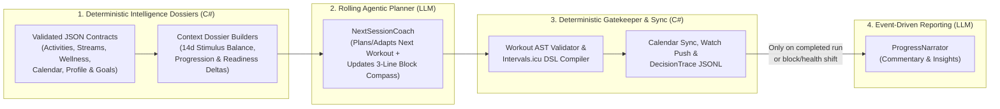

# .NET Agentic-First Coach & Rolling Planning Architecture

**Date:** 2026-11-25  
**Status:** Target Architecture (Hypothesis-Driven / To Be Validated via Simulation)  
**Parent Migration Plan:** [`DOTNET_MIGRATION_PLAN.md`](DOTNET_MIGRATION_PLAN.md)  
**Domain & Coaching DNA Reference:** [`SYSTEM_SPEC.md`](SYSTEM_SPEC.md) (§3 Coaching DNA & Physiological Formulas)  
**Simulation Companion:** [`AGENTIC_SIMULATION_PLAN.md`](AGENTIC_SIMULATION_PLAN.md)

---

## 1. Motivation & Intentional Divergence from Python Planning

Steps 1–5 of [`DOTNET_MIGRATION_PLAN.md`](DOTNET_MIGRATION_PLAN.md) established strict C# domain contracts, physiological telemetry (`PhysiologicalCalculator`), readiness markers (`PlanningMarkersCalculator`), and the initial `Laufen.Cli` vertical slice (`athletes`, `report`, `markers`) with differential parity against Python.

For the upcoming **planning and coaching slices**, translating the Python architecture 1:1 would carry over three structural flaws identified in the existing codebase:

1. **Deterministic Planning Acts Like a Thermostat, Not a Coach**:
   - Python's [`schedule_workout.py`](../src/planner/schedule_workout.py) (`choose_adaptive_workout`) and [`daily_recommendation.py`](../src/analysis/daily_recommendation.py) (`resolve_slot_recommendation`) rely on rigid binary cliff-edges (`sleep_score < 72`, `tsb < -8.0`, `days_since_last_run >= 7`) in [`extract_markers.py`](../src/planner/extract_markers.py). A sleep score of `71` blocks quality work even when resting HR (`-3 bpm`), HRV, and subjective feel are strong.
   - Workout outputs are static stamps (every base run defaults to `45m Z2` `10m + 30m + 5m`; threshold defaults to `3x 8m Z4`). Static rule trees cannot build multi-week progression (`50m -> 55m -> 60m` or `5x 4m -> 4x 6m -> 3x 8m`), weigh conflicting signals, or adapt interval structure to observed cadence/HR drift.
2. **Rigid Weekday Slots Break Under Irregular Real-Life Schedules**:
   - Current `weekly_slots` in [`athlete.json`](../athletes/berni/athlete.json) tie stimulus roles to fixed weekdays (`Mon/Tue = Quality`, `Wed–Fri = Flex`, `Sat/Sun = Long Run`). When work or family shifts training days unpredictably from week to week, pre-planned weekly calendars or fixed weekday slots create orphaned events, constant rescheduling churn, and false compliance failures.
3. **Monolithic Coach Overload & Split-Brain Authority**:
   - [`ai_coach.py`](../src/analysis/ai_coach.py) bundles five responsibilities into one prompt (compliance auditing, next-workout prescription, 220-word essay, UI CSS tags like `tag-amber`, and ad-hoc metric recomputation) and runs *before* `schedule_workout.py` in [`coach-plan.yml`](../.github/workflows/coach-plan.yml). Three competing decision makers (`ai_coach.py`, `schedule_workout.py`, `daily_recommendation.py`) cause the handoff bugs tracked in [`ARCHITECTURE_REVIEW_AND_FINDINGS.md`](ARCHITECTURE_REVIEW_AND_FINDINGS.md) (Findings 5.1–5.5).

### Core Architectural Shift for `.NET`

> [!IMPORTANT]
> **Intentional Evolution of `SYSTEM_SPEC.md` §2.1 (Scoped Exclusively to `dotnet/`):**
> - The Python production codebase remains untouched per [`DOTNET_MIGRATION_PLAN.md`](DOTNET_MIGRATION_PLAN.md) Principle #1.
> - In `dotnet/`, we **retire deterministic `if/else` workout selection**. The **Agentic Coach becomes the single authoritative planner**.
> - Deterministic C# code (`Laufen.Domain`) serves **before** the agent as an **Intelligence Dossier Builder** (telemetry, rolling stimulus balance, progression curves, baselines) and **after** the agent as a **Workout AST Compiler & Modality/Safety Validator**—never as a competing `if/else` prescription engine.
> - All Coaching DNA invariants in [`SYSTEM_SPEC.md`](SYSTEM_SPEC.md) §3 (strict HR vs. Pace separation, Run-Walk biomechanics, non-judgmental tone, and multi-tenant isolation) remain strictly enforced.

---

## 2. End-to-End Pipeline Flow (Rolling Session-by-Session Default)

---

## 3. Lean Two-Role Separation & Reversibility for Simulation

We explicitly **avoid** splitting single decisions across parallel metric subagents (e.g., separate "Wellness" and "Pace" subagents), because weighing conflicting signals requires one unified reasoning context and C# computes all underlying numbers in milliseconds.

To fit **irregular, week-to-week changing schedules** without overloading a single prompt, our primary hypothesis uses **two decoupled roles**:

| Agent Role | Trigger / Cadence | Curated Input Dossier | Strict Responsibility & Output |
| :--- | :--- | :--- | :--- |
| **1. `NextSessionCoach`** *(Rolling Tactical & Progressive Planner)* | Post-run (pre-plans the next session), morning/evening check, or athlete Telegram message | `NextSessionDossier` (rolling 14d stimulus balance, stimulus progression history, continuous readiness deltas, typical weekday/weekend time budget, currently scheduled workout, 3-line `BlockCompass`, optional athlete message) | Plans or updates **only the immediate next session** as a structured `WorkoutDefinition` AST (or Dual Option A/B when flexibility helps), logs structured `DecisionRationale`, and updates the compact `BlockCompass`. **Anti-churn rule:** if an uncompleted workout is already scheduled for the target date, defaults to `keep` unless readiness, date/time budget, or athlete feedback changed. Produces **no** long-form essay or UI CSS classes. |
| **2. `ProgressNarrator`** *(Decoupled Editorial & Macro Review)* | Triggered **only** when a new run is completed (or on major health/block transitions)—never on skipped/rolled-over days | `NarrativeBriefingDossier` (completed run review, updated `BlockCompass`, committed next workout + trace rationale, 4-week macro trends) | Produces human-readable Markdown commentary and domain-typed insights (`severity: info \| success \| warning`). Completely off the critical path of watch/calendar scheduling. |

### Keeping the Planning Horizon Replaceable (Empirical Validation First)
Whether rolling session-by-session planning (`NextSessionCoach` + 14d Stimulus Compass) outperforms a weekly pre-planning horizon (`WeeklyArchitect` + `DailyTactician`) under chaotic schedules is an **empirical question** to be validated via multi-day simulation (Section 6):
- **Shared Foundation (Zero Lock-In)**: 100% of the domain building blocks (`WorkoutDefinition` AST, Intervals.icu DSL compiler, `StimulusProgressionDossier`, `ReadinessSignalDossier`, `ILlmClient`, and `DecisionTrace`) are **identical** for both approaches.
- **Clean Strategy Seam (`ICoachPlanningStrategy`)**: Encapsulating the planning call behind a thin use-case seam (`RollingNextSessionStrategy` first, with optional `WeeklyHorizonStrategy` comparison later) lets us run identical 14–21 day simulation scenarios against real `berni` baselines before committing to production cutover.
- **Strict Simulation Clock Hygiene**: Every `.NET` domain builder, prompt projector, memory updater, and trace writer **must** accept an explicit `DateOnly refDate` (never `DateTime.Now` / `DateTime.Today`), avoiding Python's time-stepping leaks ([`ARCHITECTURE_REVIEW_AND_FINDINGS.md`](ARCHITECTURE_REVIEW_AND_FINDINGS.md) Findings 5.4 & 5.5) from day one.

---

## 4. Curated Intelligence Dossiers (`Laufen.Domain` Data Preparation)

Instead of dumping raw JSON files or rigid weekday-slot rules into prompts, `Laufen.Domain` builds compact, high-signal C# records:

### 4.1 Goals, Block Compass & Flexible Time Budgets (`AthleteProfile` Extension)
Extend `AthleteProfile` (`athlete.json`) with optional, backward-compatible properties (keeping existing `weekly_slots` nullable/optional):
- **Goals**: `primary_goal`, `target_horizon`, and `current_focus` (e.g., *build aerobic Long Run toward 65–70m, progress threshold durability without muscular calf overload*).
- **Time-Budget Hints Instead of Rigid Weekday Roles**: `typical_weekday_minutes` (e.g., `35–45`) vs. `typical_weekend_minutes` (e.g., `50–70`), overridable ad hoc via Telegram (*"have 60m free today"*).

### 4.2 Rolling 14-Day Stimulus Balance & Progression (`StimulusProgressionDossier`)
Solves the "loss of progression thread" risk in session-by-session planning without requiring a fixed weekly calendar (built on [`PhysiologicalMetrics.cs`](../dotnet/src/Laufen.Domain/PhysiologicalMetrics.cs) and [`RunReviewRecord.cs`](../dotnet/src/Laufen.Domain/RunReviewRecord.cs)):
- **Rolling 10–14 Day Stimulus Ledger**: Days elapsed since last aerobic anchor ($\ge 50\text{m}$ Z2), days since last threshold/interval stimulus, runs & volume in trailing 7d / 14d, and rolling 28d Z1/Z2 ratio—allowing the Coach to pick whichever stimulus is due next regardless of weekday.
- **Per-Stimulus Progression Chains (6–8 Weeks)**:
  - *Base & Long Run Chain*: Recent durations (`42m -> 46m -> 50m`), Z1/Z2 %, AEF, walking-filtered Z2 GAP pace (`zone_pace_stats`), and 1st-vs-2nd-half cardiac drift.
  - *Quality / Threshold Chain*: Last 3–5 quality sessions comparing *prescribed* workout steps (from paired `CalendarEventEntry`) vs. *executed* intervals, Z4/Z5 time, and cadence stability.

### 4.3 Continuous Readiness Signals (`ReadinessSignalDossier`)
Replaces hard boolean cliff-edges (`GuardrailEvaluation` in [`PlanningMarkers.cs`](../dotnet/src/Laufen.Domain/PlanningMarkers.cs)) as primary Coach input:
- **Baseline-Relative Deltas**: Sleep duration & score vs. 14d mean, resting HR vs. 30d baseline (`rhr_delta`), HRV vs. 14d baseline ratio, 3-day recovery trend, and Banister CTL/ATL/TSB.
- **Subjective & Muscular Context**: Athlete run notes (`athlete_note`), wellness comments, soreness/fatigue (`1–5`), and days since last complaint.
- **Acute Medical Red Flags Only**: Explicit `MedicalAlert` reserved strictly for acute infection/fever, active injury, or severe RHR spike—leaving normal training trade-offs to the Coach's judgment.

### 4.4 Compact Rolling Memory (`BlockCompass`)
Replaces using `coach_history.json` as a hidden boolean planner override (`unfulfilled_base_directive`):
- A concise, structured state record updated by `NextSessionCoach` (current progression milestone per stimulus family, observed athlete response patterns, and why the currently scheduled session was chosen).

---

## 5. Structured Workout AST & Post-Agent Validator

To give the Coach full freedom over workout progression (beyond the 9 static `.txt` templates) while guaranteeing 100% valid Garmin/Intervals.icu workouts:

1. **Typed C# `WorkoutDefinition` AST**:
   - Composed of typed steps: `WarmupStep`, `SteadyStep`, `RepeatBlock` (`Reps`, `WorkStep`, `RecoveryStep`), `ProgressionStep`, and `CooldownStep`, plus structured `DecisionRationale` (`observations`, `tradeoff_weighed`, `progression_intent`, `rejected_alternative`) written to `decision_trace.jsonl`.
2. **Deterministic Domain Validation & DSL Compilation (`Laufen.Domain`)**:
   - **Modality Gatekeeper ([`SYSTEM_SPEC.md`](SYSTEM_SPEC.md) §3.1)**: Enforces that Z1/Z2 Easy and Long Run steps *never* carry a Pace target, and short `< 2m` speed reps use Pace/RPE rather than lagging HR.
   - **Calendar Safety ([`SYSTEM_SPEC.md`](SYSTEM_SPEC.md) §1.2)**: Completed/paired workouts (`paired_activity_id != null`) are never modified or deleted; if an LLM call fails/times out, any existing planned workout on the calendar remains untouched.
   - **`IntervalsWorkoutCompiler`**: Deterministically renders validated `WorkoutDefinition` ASTs into Intervals.icu's step DSL syntax (verified against [`CalendarEventEntry.cs`](../dotnet/src/Laufen.Domain/CalendarEventEntry.cs)).

---

## 6. Iterative `.NET` Slice Sequence & Simulation Validation

Following [`DOTNET_MIGRATION_PLAN.md`](DOTNET_MIGRATION_PLAN.md) §2, we prioritize reaching a **playable, simulatable `NextSessionCoach` prototype** as quickly as possible before building external sync plumbing:

1. **Slice A — `WorkoutDefinition` AST, Modality Validator & Intervals.icu DSL Compiler (`Laufen.Domain`)**:
   - Pure domain model + compiler + unit tests verifying valid Intervals.icu workout step generation and strict HR-vs-Pace modality rules.
2. **Slice B — Intelligence Dossier Builders (`StimulusProgressionDossier` & `ReadinessSignalDossier`) (`Laufen.Domain`)**:
   - Optional `Goals` / time-budget fields on `AthleteProfile`, rolling 14-day stimulus ledger, stimulus-grouped progression chains, and baseline-relative readiness deltas verified against real `athletes/berni/` data (strictly parameterized by `DateOnly refDate`).
3. **Slice C — `ILlmClient` Harness & `NextSessionCoach` Vertical Slice (`Laufen.Infrastructure` + `Laufen.Cli`)**:
   - Provider abstraction (`agy` CLI / Gemini HTTP / test stub), strict JSON AST deserialization + modality gatekeeper, `BlockCompass` persistence, and `Laufen.Cli coach-next --athlete berni --ref-date YYYY-MM-DD --dry-run` for immediate real-data inspection.
4. **Slice D — Multi-Day Agentic Simulation Runner (`Laufen.Cli simulate`)**:
   - Sandbox time-stepping harness (per [`AGENTIC_SIMULATION_PLAN.md`](AGENTIC_SIMULATION_PLAN.md)) testing `NextSessionCoach` across 14–21 day trajectories—explicitly including **`irregular_chaotic_weeks`** (skipped weekday runs, shifting weekday/weekend availability, spontaneous Telegram time-budget overrides) alongside `illness_relapse_and_reentry` and `overpacing_and_cramp_cascade` to empirically check progression continuity vs. daily churn.
5. **Slice E — Decoupled `ProgressNarrator` & Live Intervals.icu / Telegram Integration**:
   - Finalize or refine the planning strategy based on Slice D simulation findings, add event-driven `ProgressNarrator`, and wire staging (`berni-test`) calendar/Telegram sync.
