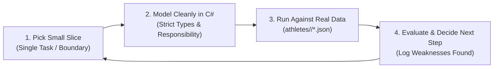

# Iterative C# / .NET Migration & Discovery Plan

**Date:** 2026-11-14  
**Status:** Active (Discovery-Driven / Iterative)  
**Authoritative Domain Reference:** [`SYSTEM_SPEC.md`](SYSTEM_SPEC.md)  
**Existing Python Contracts:** [`../src/core/contracts.py`](../src/core/contracts.py)

---

## 1. Guiding Principles

1. **Zero Modification to the Existing Python Project (Additive / Shadow & Test-Only Mode)**:
   - All existing Python modules in `src/`, BDD tests in `tests/`, the `./run` CLI runner, and the Python production deployment (`~/dockerContainer/laufen`) remain untouched and active until the very end of the migration.
   - All C# / **.NET 11 (`net11.0`)** work is added strictly on top and isolated inside `dotnet/` (deployed independently to `~/dockerContainer/laufen-dotnet`), with new capabilities enabled only selectively for testing and comparison.
2. **Intentionally Low Upfront Detail (Emergent Architecture)**:
   - We do **not** pre-specify all future layers, classes, or services upfront. Translating the existing Python structure 1:1 into a rigid master plan would carry over hidden coupling and domain flaws.
   - Instead, we proceed **one small step at a time**, evaluate what we uncover against real athlete data (`athletes/<slug>/*.json`), and decide the next step based on those findings.
3. **Separation by Responsibility**:
   - Code is strictly separated by task and responsibility (Domain Models & Rules vs. Data Access / Infrastructure vs. Application Use Cases vs. Presentation / CLI).
4. **Discovery Through Strict Typing & Differential Checks**:
   - Every step uses C#'s type system, strict JSON deserialization, and side-by-side comparison against the Python output to expose silent fallbacks (e.g., `.get(..., 0)` masking `null`), schema drift, and conflicting business rules.

---

## 2. Iterative Workflow Loop

Each iteration follows a four-step feedback cycle before we commit to the next scope:

### Loop Execution Constraints (Prompt & Edit Hygiene)

1. **Batch Schema Inspection First (`jq`)**: Before writing or editing C# domain contracts, run **one** combined `jq` query across all target tenant files (`athletes/berni/`, `athletes/berni-test/`) to extract all keys, types, 100%-present vs. optional fields, and timestamp formats (`DateOnly` vs. `DateTime` vs. `DateTimeOffset`). Do not discover optional fields through repeated `dotnet test` edit-fail cycles.
2. **Single-Pass Code & Test Authoring**: Author the domain model, loader, and tests in one complete pass based on the upfront schema inspection. Never hardcode volatile live-synced values (e.g., `resting_hr`, `max_hr`, zone counts) in contract tests—use physiological range assertions (`Is.InRange(...)`).
3. **Prefix-Matchable Commands Only**: Never use inline environment-variable prefixes (`VAR=val ...`), shell redirects (`>`), `cp`/`sed` file writes, or chained operators (`&&`, `;`, `||`) in `run_command`. Use native `edit_file`/`write_file` for file edits and clean single-command invocations for tests.
4. **Single Documentation Update per Loop**: Update Section 3 and Section 4 (`W-xx`) **once** at the end of a completed loop—never incrementally mid-loop.

---

## 3. High-Level Horizon (Uncommitted Direction)

Only **Step 1** is defined for immediate execution. Subsequent steps are rough placeholders and will be shaped after evaluating Step 1:

- **Step 1 (Completed) — Workspace Skeleton & Real-Data Contract Inspection**:
  - Created the .NET 11 solution in `dotnet/Laufen.sln` with four projects separated by responsibility: `Laufen.Domain`, `Laufen.Infrastructure`, `Laufen.Cli`, and `Laufen.Tests`.
  - Loaded and strictly deserialized all core JSON files across `athletes/berni/` and `athletes/berni-test/` (`registry.json`, `athlete.json`, `intervals_activities.json`, `intervals_wellness.json`, `run_reviews.json`, `coach_history.json`).
  - Documented all schema mismatches, unexpected `null` fields, and structural weaknesses uncovered by strict typing (`W-01`–`W-09`).
- **Next Candidate (Step 2) — Pure Physiological & Trend Calculations (`report` / Weekly Metrics)**:
  - Implement pure domain calculations (AEF, weekly volume/zone distribution, Banister CTL/ATL/TSB) in `Laufen.Domain` using the strict `IntervalsActivityEntry`, `IntervalsWellnessEntry`, and `AthleteProfile` contracts, with differential comparison against Python `report` output.
- **Later Candidates**:
  - Readiness markers & guardrails (`extract_markers`).
  - Workout planning (`schedule_workout` / `daily_recommendation`).
  - Post-run review (`run_reviewer`) & AI Coach (`ai_coach`).
  - External API clients (Intervals.icu, Telegram, LLM).

---

## 4. Discovered Weaknesses & Architectural Log

*This section is updated after each step with concrete flaws discovered in the existing data contracts or Python implementation.*

| ID | Discovered In Step | Affected Python / Data Area | Description of Weakness | Resolution in .NET |
| :--- | :--- | :--- | :--- | :--- |
| W-01 | Step 1 (`registry.json` & `athlete.json`) | `athletes/berni/athlete.json`, `athletes/berni-test/athlete.json` vs. [`../src/core/contracts.py`](../src/core/contracts.py) | `AthleteHeartRateContract` declares `icu_hr_zones` and `hr_zone_names`, whereas real `athlete.json` files store `raw_hr_zones` and `raw_zone_names`. | Mapped exact JSON keys (`raw_hr_zones`, `raw_zone_names`) in `HeartRateProfile` (`Laufen.Domain`) and enforced `JsonUnmappedMemberHandling.Disallow` in `StrictJsonLoader`. |
| W-02 | Step 1 (`registry.json` & `athlete.json`) | `athletes/berni/athlete.json` vs. [`../src/core/contracts.py`](../src/core/contracts.py) | `AthleteBodyContract` omits `pace_targets_min_per_km`, and `WeeklySlotContract` omits `target_hr_range`, `name_display`, `target_hr_max`, `duration_min`, and `is_mandatory_base` present in real `weekly_slots`. | Modeled all observed properties explicitly in `AthleteProfile` and `WeeklySlot` with `required` vs. nullable types (`T?`). |
| W-03 | Step 1 (`registry.json` & `athlete.json`) | `athletes/berni-test/athlete.json` vs. `athletes/berni/athlete.json` | Tenant profiles diverge structurally: `berni-test` lacks `weekly_slots`, `classification`, `training_mode`, `training_model_name`, and `target_runs_per_week`, while `berni` lacks `display_name`. | Marked tenant-optional fields nullable in `AthleteProfile` (`WeeklySlots?`, `DisplayName?`, etc.) so missing periodization config is explicit rather than silently defaulted. |
| W-04 | Step 1 (`registry.json` & `athlete.json`) | `athletes/registry.json` vs. [`../src/core/contracts.py`](../src/core/contracts.py) | `registry.json` has no `TypedDict` contract in `contracts.py`, and `berni-test` omits `telegram_chat_id` and `briefing_enabled`. | Added `AthleteRegistry` and `AthleteRegistryEntry` in `Laufen.Domain` with nullable `TelegramChatId` and `BriefingEnabled`. |
| W-05 | Step 1 (`coach_history.json`) | `athletes/berni/coach_history.json`, `athletes/berni-test/coach_history.json` vs. [`../src/core/contracts.py`](../src/core/contracts.py) | Open coaching cycles (`status: "offen"`) omit `evaluated_run_ids`, and `cycle-011` (`berni`) uses undocumented status `"angepasst_nach_tempo"` outside the contract comment (`"offen" \| "erfüllt" \| "teilweise" \| "verfehlt"`). | Modeled `CoachHistoryEntry` with nullable `EvaluatedRunIds` (`IReadOnlyList<string>?`) and `DateOnly` `Date` while keeping `Status` as `string` to avoid silent drops. |
| W-06 | Step 1 (`intervals_wellness.json`) | `athletes/berni/intervals_wellness.json`, `athletes/berni-test/intervals_wellness.json` vs. [`../src/core/contracts.py`](../src/core/contracts.py) | `intervals_wellness.json` has no `TypedDict` contract in `contracts.py`, and real Intervals.icu payloads exhibit cross-tenant nullability divergence across 47 daily fields: `ctl`, `atl`, `rampRate`, `ctlLoad`, `atlLoad`, `sportInfo`, `restingHR`, `steps`, and `floorsClimbed` are always populated in `berni` but nullable in `berni-test`, whereas `soreness`, `fatigue`, `stress`, and `comments` are populated in `berni-test` and `null` in `berni`. | Modeled all 47 fields and nested `WellnessSportInfo` explicitly in `IntervalsWellnessEntry` with strict `DateOnly` `Id`, `DateTimeOffset` `Updated`, and `T?` for all tenant-nullable metrics. |
| W-07 | Step 1 (`run_reviews.json`) | `athletes/berni/run_reviews.json`, `athletes/berni-test/run_reviews.json` vs. [`../src/core/contracts.py`](../src/core/contracts.py) | `CachedRunReviewRecordContract` omits `analyzed_at` (`DateTimeOffset`) and top-level `athlete_note` (`string?`), and declares `date: str` without noting it is a local `YYYY-MM-DDTHH:MM:SS` timestamp rather than `DateOnly`. `Stage1PhysiologyContract.parsed_intervals` and `zone_breakdown` are untyped (`Dict[str, Any]`). Cross-tenant & item divergence: `berni-test` omits `compliance_notes` (`stage2_compliance`), `actionable_advice` (`stage3_optimizations`), and top-level `athlete_note`; `cli_command` (`stage3_optimizations`) and `optimization_focus` (`stage4_next_run`) are also absent on older/minimal entries. | Modeled the full 4-stage `RunReviewRecord` hierarchy (`ZoneBreakdownEntry`, `ParsedReviewInterval`, `Stage1Physiology`–`Stage4NextRun`) in `Laufen.Domain` with `DateTime` `Date`, `DateTimeOffset` `AnalyzedAt`, and nullable tenant-optional fields. |
| W-08 | Step 1 (`intervals_activities.json`) | `athletes/berni/intervals_activities.json`, `athletes/berni-test/intervals_activities.json` vs. [`../src/core/contracts.py`](../src/core/contracts.py) | `intervals_activities.json` has no `TypedDict` contract in `contracts.py` (184 raw Intervals.icu fields per activity in `berni`, `[]` in `berni-test`). Only 4 fields (`id`, `icu_athlete_id`, `source`, `start_date_local`) are guaranteed across all records because Strava-only stubs omit `type`, `name`, `moving_time`, `icu_hr_zones`, etc. Includes stringified `strava_id`, integer `paired_event_id`, local `DateTime` `start_date_local` without offset, and nested `icu_hrr` object. | Modeled all 184 fields and `IntervalsHeartRateRecovery` explicitly in `IntervalsActivityEntry` (`Laufen.Domain`) with strict `JsonUnmappedMemberHandling.Disallow`, only the 4 guaranteed fields `required`, and `JsonElement?` for currently all-null fields. |
| W-09 | Step 1 (`athlete.json` live sync drift) | `athletes/berni/athlete.json` vs. `dotnet/tests/Laufen.Tests/AthleteContractLoadingTests.cs` | Live `sync-profile` updates physiological baselines and zone counts in `athletes/berni/athlete.json` (`resting_hr` `46 -> 48`, `max_hr` `204 -> 192`, `zones` / `raw_hr_zones` `7 -> 5`). Hardcoding exact values in contract tests causes false failures after profile syncs. | Replaced exact HR and zone-count assertions on live-synced `berni` data with physiological range assertions (`Is.InRange(...)`). |
