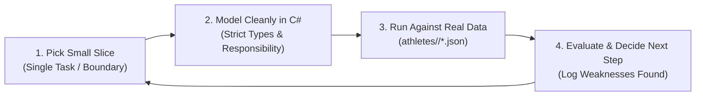

# Iterative C# / .NET Migration & Discovery Plan

**Date:** 2026-11-14  
**Status:** Active (Discovery-Driven / Iterative)  
**Authoritative Domain Reference:** [`SYSTEM_SPEC.md`](SYSTEM_SPEC.md)  
**Existing Python Contracts:** [`../src/core/contracts.py`](../src/core/contracts.py)

---

## 1. Guiding Principles

1. **Zero Modification to the Existing Python Project (Additive / Shadow & Test-Only Mode)**:
   - All existing Python modules in `src/`, BDD tests in `tests/`, the `./run` CLI runner, and the Python production deployment (`~/dockerContainer/laufen`) remain untouched and active until the very end of the migration.
   - All C# / **.NET 11 (`net11.0`)** work is added strictly on top and isolated inside `dotnet/` (deployed independently to `~/dockerContainer/laufen-dotnet`), with new capabilities enabled only selectively for testing and comparison.
2. **Intentionally Low Upfront Detail (Emergent Architecture)**:
   - We do **not** pre-specify all future layers, classes, or services upfront. Translating the existing Python structure 1:1 into a rigid master plan would carry over hidden coupling and domain flaws.
   - Instead, we proceed **one small step at a time**, evaluate what we uncover against real athlete data (`athletes/<slug>/*.json`), and decide the next step based on those findings.
3. **Separation by Responsibility**:
   - Code is strictly separated by task and responsibility (Domain Models & Rules vs. Data Access / Infrastructure vs. Application Use Cases vs. Presentation / CLI).
4. **Discovery Through Strict Typing & Differential Checks**:
   - Every step uses C#'s type system, strict JSON deserialization, and side-by-side comparison against the Python output to expose silent fallbacks (e.g., `.get(..., 0)` masking `null`), schema drift, and conflicting business rules.

---

## 2. Iterative Workflow Loop

Each iteration follows a four-step feedback cycle before we commit to the next scope:

---

## 3. High-Level Horizon (Uncommitted Direction)

Only **Step 1** is defined for immediate execution. Subsequent steps are rough placeholders and will be shaped after evaluating Step 1:

- **Step 1 (Current Focus) — Workspace Skeleton & Real-Data Contract Inspection**:
  - Create a minimal .NET 11 solution in `dotnet/Laufen.sln` with four projects separated by responsibility: `Laufen.Domain`, `Laufen.Infrastructure`, `Laufen.Cli`, and `Laufen.Tests`.
  - Load and strictly deserialize the existing JSON files in `athletes/berni/` (`registry.json`, `athlete.json`, `intervals_activities.json`, `intervals_wellness.json`, `run_reviews.json`, `coach_history.json`).
  - Document all schema mismatches, unexpected `null` fields, and structural weaknesses uncovered by strict typing.
- **Later Candidates (To Be Evaluated After Step 1)**:
  - Pure physiological & trend calculations (`report` / weekly metrics).
  - Readiness markers & guardrails (`extract_markers`).
  - Workout planning (`schedule_workout` / `daily_recommendation`).
  - Post-run review (`run_reviewer`) & AI Coach (`ai_coach`).
  - External API clients (Intervals.icu, Telegram, LLM).

---

## 4. Discovered Weaknesses & Architectural Log

*This section is updated after each step with concrete flaws discovered in the existing data contracts or Python implementation.*

| ID | Discovered In Step | Affected Python / Data Area | Description of Weakness | Resolution in .NET |
| :--- | :--- | :--- | :--- | :--- |
| W-01 | Step 1 (`registry.json` & `athlete.json`) | `athletes/berni/athlete.json`, `athletes/berni-test/athlete.json` vs. [`../src/core/contracts.py`](../src/core/contracts.py) | `AthleteHeartRateContract` declares `icu_hr_zones` and `hr_zone_names`, whereas real `athlete.json` files store `raw_hr_zones` and `raw_zone_names`. | Mapped exact JSON keys (`raw_hr_zones`, `raw_zone_names`) in `HeartRateProfile` (`Laufen.Domain`) and enforced `JsonUnmappedMemberHandling.Disallow` in `StrictJsonLoader`. |
| W-02 | Step 1 (`registry.json` & `athlete.json`) | `athletes/berni/athlete.json` vs. [`../src/core/contracts.py`](../src/core/contracts.py) | `AthleteBodyContract` omits `pace_targets_min_per_km`, and `WeeklySlotContract` omits `target_hr_range`, `name_display`, `target_hr_max`, `duration_min`, and `is_mandatory_base` present in real `weekly_slots`. | Modeled all observed properties explicitly in `AthleteProfile` and `WeeklySlot` with `required` vs. nullable types (`T?`). |
| W-03 | Step 1 (`registry.json` & `athlete.json`) | `athletes/berni-test/athlete.json` vs. `athletes/berni/athlete.json` | Tenant profiles diverge structurally: `berni-test` lacks `weekly_slots`, `classification`, `training_mode`, `training_model_name`, and `target_runs_per_week`, while `berni` lacks `display_name`. | Marked tenant-optional fields nullable in `AthleteProfile` (`WeeklySlots?`, `DisplayName?`, etc.) so missing periodization config is explicit rather than silently defaulted. |
| W-04 | Step 1 (`registry.json` & `athlete.json`) | `athletes/registry.json` vs. [`../src/core/contracts.py`](../src/core/contracts.py) | `registry.json` has no `TypedDict` contract in `contracts.py`, and `berni-test` omits `telegram_chat_id` and `briefing_enabled`. | Added `AthleteRegistry` and `AthleteRegistryEntry` in `Laufen.Domain` with nullable `TelegramChatId` and `BriefingEnabled`. |
