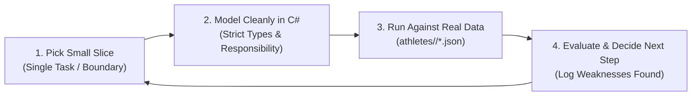

# Iterative C# / .NET Migration & Discovery Plan

**Date:** 2026-11-14  
**Status:** Active (Discovery-Driven / Iterative)  
**Authoritative Domain Reference:** [`SYSTEM_SPEC.md`](SYSTEM_SPEC.md)  
**Agentic Coach & Planning Target Design (Post-Step 5):** [`DOTNET_AGENTIC_COACH_DESIGN.md`](DOTNET_AGENTIC_COACH_DESIGN.md)  
**Existing Python Contracts:** [`../src/core/contracts.py`](../src/core/contracts.py)

---

## 1. Guiding Principles

1. **Zero Modification to the Existing Python Project (Additive / Shadow & Test-Only Mode)**:
   - All existing Python modules in `src/`, BDD tests in `tests/`, the `./run` CLI runner, and the Python production deployment (`~/dockerContainer/laufen`) remain untouched and active until the very end of the migration.
   - All C# / **.NET 11 (`net11.0`)** work is added strictly on top and isolated inside `dotnet/` (deployed independently to `~/dockerContainer/laufen-dotnet`), with new capabilities enabled only selectively for testing and comparison.
2. **Intentionally Low Upfront Detail (Emergent Architecture)**:
   - We do **not** pre-specify all future layers, classes, or services upfront. Translating the existing Python structure 1:1 into a rigid master plan would carry over hidden coupling and domain flaws.
   - Instead, we proceed **one small step at a time**, evaluate what we uncover against real athlete data (`athletes/<slug>/*.json`), and decide the next step based on those findings.
3. **Separation by Responsibility**:
   - Code is strictly separated by task and responsibility (Domain Models & Rules vs. Data Access / Infrastructure vs. Application Use Cases vs. Presentation / CLI).
4. **Discovery Through Strict Typing & Differential Checks**:
   - Every step uses C#'s type system, strict JSON deserialization, and side-by-side comparison against the Python output to expose silent fallbacks (e.g., `.get(..., 0)` masking `null`), schema drift, and conflicting business rules.

---

## 2. Iterative Workflow Loop

Each iteration follows a four-step feedback cycle before we commit to the next scope:

### Loop Execution Constraints (Prompt & Edit Hygiene)

1. **Batch Schema Inspection First (`jq`)**: Before writing or editing C# domain contracts, run **one** combined `jq` query across all target tenant files (`athletes/berni/`, `athletes/berni-test/`) to extract all keys, types, 100%-present vs. optional fields, and timestamp formats (`DateOnly` vs. `DateTime` vs. `DateTimeOffset`). Do not discover optional fields through repeated `dotnet test` edit-fail cycles.
2. **Single-Pass Code & Test Authoring**: Author the domain model, loader, and tests in one complete pass based on the upfront schema inspection. Never hardcode volatile live-synced values (e.g., `resting_hr`, `max_hr`, zone counts) in contract tests—use physiological range assertions (`Is.InRange(...)`).
3. **Prefix-Matchable Commands Only**: Never use inline environment-variable prefixes (`VAR=val ...`), shell redirects (`>`), `cp`/`sed` file writes, or chained operators (`&&`, `;`, `||`) in `run_command`. Use native `edit_file`/`write_file` for file edits and clean single-command invocations for tests.
4. **Single Documentation Update per Loop**: Update Section 3 and Section 4 (`W-xx`) **once** at the end of a completed loop—never incrementally mid-loop.

---

## 3. High-Level Horizon (Uncommitted Direction)

Only **Step 1** is defined for immediate execution. Subsequent steps are rough placeholders and will be shaped after evaluating Step 1:

- **Step 1 (Completed) — Workspace Skeleton & Real-Data Contract Inspection**:
  - Created the .NET 11 solution in `dotnet/Laufen.sln` with four projects separated by responsibility: `Laufen.Domain`, `Laufen.Infrastructure`, `Laufen.Cli`, and `Laufen.Tests`.
  - Loaded and strictly deserialized all core JSON files across `athletes/berni/` and `athletes/berni-test/` (`registry.json`, `athlete.json`, `intervals_activities.json`, `intervals_wellness.json`, `run_reviews.json`, `coach_history.json`).
  - Documented all schema mismatches, unexpected `null` fields, and structural weaknesses uncovered by strict typing (`W-01`–`W-09`).
- **Step 2 (Completed) — Pure Physiological & Trend Calculations (`report` / Weekly Metrics)**:
  - Implemented pure domain calculations in `Laufen.Domain` (`PhysiologicalCalculator`, `RunPhysiologicalMetrics`, `WeeklyTrendSummary`, `FitnessFormSummary`, `AthleteReportSnapshot`) for AEF, weekly volume & zone distribution, and Banister CTL/ATL/TSB with exponential rest-day decay.
  - Added differential tests in `dotnet/tests/Laufen.Tests/PhysiologicalMetricsDifferentialTests.cs` verifying exact parity against Python (`trends.py`, `recent_runs.py`, `forecast.py`) across `berni` and `berni-test`.
  - Documented base-run threshold drift, per-run rounding propagation, hardcoded CTL/ATL fallback, and activity-filter asymmetry (`W-10`–`W-13`).
- **Step 3 (Completed) — Readiness Markers & Guardrails (`extract_markers`)**:
  - Implemented pure domain marker and guardrail evaluation in `Laufen.Domain` (`PlanningMarkersCalculator`, `PlanningMarkersSnapshot`, `ReadinessMarkers`, `RunHistoryMarkers`, `PeriodizationMarkers`, `CoachContextMarkers`, `CalendarContextMarkers`, `GuardrailEvaluation`).
  - Added differential tests in `dotnet/tests/Laufen.Tests/PlanningMarkersDifferentialTests.cs` verifying parity against Python `extract_markers.py` across `berni` (`2026-11-11`, `2026-11-10`) and `berni-test` (`2026-11-11`).
  - Documented hardcoded `target_runs_per_week`, ISO-week-53 boundary bug, `injury: 0.0` string-coercion bug, and unmodeled synthetic fields (`W-15`–`W-18`).
- **Step 4 (Completed) — `calendar_events.json` Strict Contract & Calendar Context**:
  - Modeled `CalendarEventEntry`, `WorkoutDoc`, `WorkoutStep`, `WorkoutStepTarget`, and `WorkoutZoneTime` in `Laufen.Domain` with `StrictJsonLoader.LoadCalendarEvents` in `Laufen.Infrastructure`.
  - Added `PlanningMarkersCalculator.GetCalendarContext` and differential tests in `dotnet/tests/Laufen.Tests/CalendarEventContractTests.cs` against Python `extract_markers.get_calendar_context` (`W-19`).
- **Step 5 (Completed) — `Laufen.Cli` Vertical Slice (`athletes`, `report`, `markers`)**:
  - Added `WorkspaceLayout.DiscoverFrom` and `AthleteDataRepository` in `Laufen.Infrastructure` to resolve tenant slugs (`--athlete`, `--all`, default) and load validated athlete datasets (gracefully handling optional `calendar_events.json`, `intervals_wellness.json`, `coach_history.json`).
  - Implemented `LaufenCliRunner` in `Laufen.Cli` with `athletes`, `report`, `markers`, `help`, and `--health`, supporting both human-readable terminal output and `--json`.
  - Added `dotnet/tests/Laufen.Tests/CliRunnerTests.cs`, updated `RunReviewRecord` for `zone_pace_stats` (`W-20`), and stabilized the future-date decay test in `PhysiologicalMetricsDifferentialTests`.
- **Step 6 (Round 1 — Completed) — Real-Data Intelligence Dossiers & Clean Interval Parser**:
  - Extended `AthleteProfile` (`Laufen.Domain`) with backward-compatible nullable `Goals` and `TimeBudgets` fields (`AthleteGoalsProfile`, `AthleteTimeBudgets`).
  - Added `IntervalSummaryParser` (`Laufen.Domain`) to parse raw interval summaries (`"3x 4m 162bpm"`, `"4x 7m40s 150bpm"`, `"1x 69s 154bpm"`) cleanly against athlete HR zones without Python's duration/HR truncation defect (`W-21`).
  - Added `CoachIntelligenceDossierBuilder` (`Laufen.Domain`) with strict `<= refDate` time-travel cutoffs, `80%` Z1/Z2 pure aerobic base definition (`SYSTEM_SPEC.md` §3.5), integer `HeartRateZone.Zone` lookup, zero synthetic CTL/ATL fallback, rolling 7d/14d/28d stimulus ledgers, base/quality progression chains, break/re-entry context, continuous readiness baselines, and `DataQualityNotes`.
  - Updated `AthleteDataRepository` to load `run_reviews.json`, added `Laufen.Cli dossier` (text and `--json`), and verified against real `berni` and `berni-test` data (`CoachIntelligenceDossierTests.cs`, `CliRunnerTests.cs`).
- **Step 7 (Round 2 — Completed) — Dossier Signal Refinements, `WorkoutDefinition` AST, Modality Validator & Intervals.icu DSL Compiler**:
  - Refined `CoachIntelligenceDossier` (`Laufen.Domain`) to tag compromised/minor-drift base runs (`SessionQualityTag`, `IsCompromised`), expose `MaxHeartRate` on quality runs, and detect HR zone threshold recalibration shifts in `DataQualityNotes` (`W-24`).
  - Added flat, strict-JSON-compatible AST contracts (`CoachPlanDecision`, `CoachDecisionRationale`, `BlockCompassSnapshot`, `WorkoutDefinition`, `WorkoutStepNode`, `WorkoutIntervalLeg`, `WorkoutTargetSpec`) in `dotnet/src/Laufen.Domain/WorkoutAst.cs`.
  - Implemented `WorkoutModalityValidator` (`Laufen.Domain`) enforcing `SYSTEM_SPEC.md` §3.1 HR-vs-Pace separation, text pace-leak scanning, short-interval cardiac-lag rules, duration bounds, dual-option pairing, medical red flag blocks, and completed-calendar safety.
  - Implemented `IntervalsWorkoutCompiler` (`Laufen.Domain`) verified for byte-for-byte parity against real `berni` `calendar_events.json` (`Slot 2A` & `Slot 2B`), and added `Laufen.Cli validate-workout`.
- **Step 8 (Round 3 — Completed) — 14-Day Self-Healing Autopilot Domain Engine**:
  - Extended `AthleteProfile` (`Laufen.Domain`) with optional `PreferredRunDays` and `Location` (`AthleteLocationProfile`) and extended `BlockCompassSnapshot` with `HealthState` (`Normal` | `SickHold` | `ReEntry`) and `AutoEventIds`.
  - Extended `CoachIntelligenceDossier` (`Laufen.Domain`) with 14-day ownership-tagged calendar snapshots (`auto` | `user_locked` | `completed`), `UserLockedDates`, and optional `WeatherForecastDossier` (`DailyWeatherForecast`).
  - Implemented `TrainingLoadProjector` (`Laufen.Domain`) for step-weighted workout TSS estimation calibrated against real `berni` workouts and deterministic 14-day Banister CTL/ATL/TSB projection.
  - Implemented `AutopilotPlanDecision`, `AutopilotScheduleGatekeeper`, and `ReconciledAutopilotSchedule` (`Laufen.Domain`) enforcing `user_locked` immutability, Same-Day Intraday Freeze, `SickHold` / medical red flag blocks, post-break re-entry ramp-up before quality, and `AllowConsecutiveRunDays` preferences, plus `Laufen.Cli project-plan`.
- **Step 9 (Round 4 — Completed) — Gatekeeper Deadlock Fix, LLM Harness, `RollingAutopilotStrategy` & Live `agy` Dry-Run**:
  - Fixed `AutopilotScheduleGatekeeper` (`Laufen.Domain`) so untouched frozen (`intraday_check` on `refDate`), `user_locked`, or `completed` events never deadlock unrelated future-day operations under `reentry_requires_base_before_quality` or `consecutive_run_days_not_allowed` (`W-25`).
  - Added `ILlmClient`, `ICoachPlanningStrategy`, `AutopilotPromptBuilder`, `RollingAutopilotStrategy` (1-retry gatekeeper self-correction loop), and `AutopilotDecisionTraceEntry` in `dotnet/src/Laufen.Domain/AutopilotCoach.cs`.
  - Implemented `StubLlmClient`, `AgyLlmClient`, `GeminiApiLlmClient`, `OpenMeteoWeatherClient`, and isolated `AutopilotStateStore` (`block_compass.json`, `decision_trace_dotnet.jsonl`) in `Laufen.Infrastructure`.
  - Added `Laufen.Cli coach-plan` (`--dry-run`, `--provider`, `--trigger`, `--message`, `--retries`) and validated a live `agy --dry-run` on `berni` (`2026-11-25`) passing all Coaching DNA, re-entry ramp-up, and Intervals.icu DSL checks on Attempt 1 (`28.6s`).
- **Step 10 (Round 5 — Completed) — Domain Handoff Fixes, Multi-Day Self-Healing Simulator (`Laufen.Cli simulate`), Invariant Auditor & Live Multi-Day `agy` Validation**:
  - Closed domain handoff gaps in `CoachIntelligenceDossier`, `AutopilotScheduleGatekeeper`, and `AutopilotPromptBuilder`: exposed `ScheduledCalendarItem.DurationSeconds` and `MissedAutoWorkoutsLast7Days`, fixed `telegram_override` deletes on `user_locked` items, preserved kept durations, enforced `SickHold -> ReEntry -> Normal` state transitions, prevented completed same-day `post_run` double-counting inside `ValidateReentryRampUp`, and blocked `refDate + 1` consecutive scheduling when `DaysSinceLastRun == 0` (`W-26`).
  - Implemented `AutopilotSimulator`, `AutopilotScenarioCatalog` (`missed_workdays_auto_rollover`, `spontaneous_on_watch_workout_swap`, `illness_sickhold_and_reentry`, `storm_interval_swap`, `telegram_user_locked_override`), and `AutopilotSimulationAuditor` (`AUDIT-01`..`AUDIT-08`) in `dotnet/src/Laufen.Domain/AutopilotSimulation.cs`.
  - Added `SimulationStubLlmClient` and `SimulationReportWriter` (`report.md`, `timeline.json`) in `Laufen.Infrastructure`, wired `Laufen.Cli simulate`, and added full regression + adversarial auditor coverage in `Laufen.Tests` (all 100 tests passing offline).
  - Verified multi-day live `agy --dry-run` simulations across `storm_interval_swap` (`2/2` steps, `3` attempts via gatekeeper self-correction), `telegram_user_locked_override` (`4/4` first-attempt passes), and `illness_sickhold_and_reentry` (`5/5` first-attempt passes, `Normal -> SickHold -> ReEntry -> Normal`).
- **Step 11 (Round 6 — Completed) — Role 2: Decoupled `ProgressNarrator`, `NarrativeBriefingDossier` & `Laufen.Cli narrate`**:
  - Added `ProgressNarratorGate`, `NarrativeBriefingDossierBuilder` (strict `<= refDate` cutoff, 4-week macro trends, Z2 GAP trend, read-only reconciled schedule summary), `ProgressNarratorValidator` (domain-typed `info|success|warning` severities, CSS class leak blocking, prescriptive aerobic pace blocking while allowing factual historical GAP pace), `ProgressNarratorPromptBuilder`, and `LlmProgressNarrator` (`dotnet/src/Laufen.Domain/ProgressNarrator.cs`).
  - Extended `AutopilotStateStore` with `LoadLatestDecisionTrace`, `SaveNarrativeArtifacts` (`narrative_summary_dotnet.json`, `narrative_commentary_dotnet.md`), and `LoadNarrativeSummary`, and added `NarrativeStubLlmClient` in `Laufen.Infrastructure`.
  - Added `Laufen.Cli narrate` (`--trigger`, `--force`, `--provider stub|agy|gemini`, `--dry-run`, `--json`) and verified offline tests across `berni` and `berni-test` (`W-28`).
- **Step 12 (Round 7 — Completed) — Stream GAP `ZonePaceCalculator`, 4-Stage `PostRunReviewCalculator` & `Laufen.Cli review`**:
  - Modeled `ActivityStreamData` (`Laufen.Domain`) and updated `StrictJsonLoader` to allow explicitly typed nullable value-type elements (`IReadOnlyList<double?>`, `IReadOnlyList<int?>`) while preserving strict null rejection on reference-type collections, validated across all 79 real `berni` stream files (`W-29`).
  - Implemented `ZonePaceCalculator` (`Laufen.Domain`) with Minetti GAP math, integer-`Zone` HR resolution without single-tenant hardcoding, summed `dt` running seconds, and differential parity verified against `athletes/berni/run_reviews.json` (`i213105633`, `i209021118`, `i208292808`).
  - Implemented `PostRunReviewCalculator` (`Laufen.Domain`) emitting Schema v2 `RunReviewRecord` using clean `IntervalSummaryParser` intervals, integer `Zone == 2` HR lookup, complaint-aware Stage 2–4 recovery gating, isolated `run_reviews_dotnet.json` persistence in `AutopilotStateStore`, and `Laufen.Cli review`.
- **Step 13 (Round 8 — Completed) — Intervals.icu Bidirectional REST Client, Self-Describing `auto` Ownership (`external_id`) & Idempotent 14-Day Calendar Sync**:
  - Updated `CoachIntelligenceDossierBuilder` (`Laufen.Domain`) so uncompleted non-locked calendar events with `external_id` prefix `"laufen-auto-"` self-identify as `"auto"` ownership even without persisted numeric event IDs (`W-30`).
  - Implemented `IntervalsCalendarEventUpsertRequest`, `StagingSafetyGuard` (protecting production athletes from unintended live external API writes), and anti-churn `IntervalsCalendarSyncPlanner` (`skip_unchanged`, `skip_protected`, `delete`, `create`) in `dotnet/src/Laufen.Domain/IntervalsCalendarSync.cs`.
  - Added `DotEnvLoader`, `IIntervalsIcuClient`, `IntervalsIcuHttpClient` (Basic Auth, array-to-object stream normalization, idempotent 404 delete handling), and `IntervalsCalendarSyncExecutor` in `Laufen.Infrastructure`, wired `Laufen.Cli sync-calendar`, and verified all paths with offline mocked HTTP tests.
- **Step 14 (Round 9 — Completed) — Telegram State Contract, Registry Preferences, Briefing Presenter, Override Router & Bot HTTP Client**:
  - Extended `AthleteRegistryEntry` (`Laufen.Domain`) with granular Telegram briefing preferences (`briefing_time`, `morning_briefing_enabled`, `evening_briefing_time`, `evening_briefing_enabled`, `post_run_summary_enabled`) and `TelegramPreferencePolicy`.
  - Implemented `TelegramStateRecord`, `TelegramAutopilotPresenter` (HTML briefings, inline keyboards, `SickHold`/`ReEntry` banner, zero `/km` pace leakage on aerobic sessions), and `TelegramInteractionRouter` (chat authorization, idempotency, lock-without-LLM vs. `telegram_override` replan routing) in `dotnet/src/Laufen.Domain/TelegramAutopilot.cs`.
  - Updated `StrictJsonLoader`, `AthleteDataRepository`, and `AutopilotStateStore` (`telegram_state_dotnet.json` + automatic `user_locked_dates` merge across CLI/dossier/planner), added `TelegramBotHttpClient`, wired `Laufen.Cli telegram-briefing` & `telegram-override`, and verified all paths against real `athletes/berni/telegram_state.json` and mocked HTTP tests (`W-31`).
- **Step 15 (Round 10 — Completed) — Anti-Churn Hysteresis, Unified `AutopilotCycleOrchestrator`, 5th Simulation Scenario & CLI `autopilot-run`**:
  - Implemented `AutopilotHysteresisEvaluator` (preserving stable plans under routine readiness jitter while triggering immediately on red flags, `post_run`/`telegram_override`, missed `auto` sessions, underfilled/duplicate watch windows, or completed runs past compass date) and `AutopilotCycleOrchestrator` (`Dossier -> Hysteresis -> Planner -> CalendarSyncPlanner -> Narrator (fault-isolated) -> TelegramPresenter`) in `dotnet/src/Laufen.Domain/AutopilotOrchestrator.cs`.
  - Added the 5th multi-day simulation scenario `anti_churn_stable_week_hysteresis` in `AutopilotSimulation.cs` (`passed=5/5`, 0 audit failures), wired `Laufen.Cli autopilot-run` (with `--force-replan`, `--force-narrate`, and strict staging write safety), verified Release build/tests with 0 warnings/0 errors, and documented `W-32`.
- **Step 16 (Round 11 — Completed) — Telemetry Pull, Profile Sync, Incremental Streams & Activity Notes (`sync-data`, `sync-profile`, `note`)**:
  - Extended `IntervalsActivityEntry` (`Laufen.Domain`) with backward-compatible nullable `AthleteNote` (`athlete_note`), added tolerant `IntervalsAthleteProfileDto` / `AthleteProfileSyncMapper` (preserving existing `weekly_slots`, `goals`, `time_budgets`, and `preferred_run_days`), `ActivityNoteUpdateRequest`, `TelemetrySyncOptions`, `TelemetrySyncSummary`, and `ActivityNoteResult` in `dotnet/src/Laufen.Domain/TelemetrySync.cs`.
  - Extended `IIntervalsIcuClient` / `IntervalsIcuHttpClient` with `GetAthleteProfileAsync` (`JsonUnmappedMemberHandling.Skip`) and `UpdateActivityNoteAsync` (`PUT /activity/{id}`).
  - Implemented `TelemetrySyncService` (`Laufen.Infrastructure`) writing atomically into isolated `athletes/<slug>/.dotnet_sync/` by default, skipping existing stream caches, isolating per-stream HTTP errors, enforcing `StagingSafetyGuard` before workspace/remote writes, and recomputing 4-stage reviews on `note` into `run_reviews_dotnet.json`.
  - Wired `Laufen.Cli sync-data`, `sync-profile`, and `note` via partial `SyncCliCommands.cs` and documented `W-33`.
- **Phase 2 Cutover Candidates (In Progress)**:
  - *Status*: All core agentic slices from [`DOTNET_AGENTIC_COACH_DESIGN.md`](DOTNET_AGENTIC_COACH_DESIGN.md) (Slices A–E: domain dossier & modality compiler, rolling Role 1 planner, Role 2 narrator, multi-day simulator, bidirectional Intervals.icu sync, Telegram briefings/overrides, and unified hysteresis orchestrator) are implemented, verified in Release mode, and CLI-exposed in `Laufen.Cli`.
  - Live `berni-test` staging soak against Intervals.icu + dedicated staging Telegram chat before production cutover.
  - Pure `.NET` static HTML multi-tenant dashboard renderer (`dist/<dashboard_slug>/index.html`) consuming `run_reviews_dotnet.json` and `narrative_summary_dotnet.json`.
  - Long-running `.NET` background worker / systemd unit replacing `scripts/cron_sync.sh` and `src/integrations/telegram_bot.py` daemon polling.

---

## 4. Discovered Weaknesses & Architectural Log

*This section is updated after each step with concrete flaws discovered in the existing data contracts or Python implementation.*

| ID | Discovered In Step | Affected Python / Data Area | Description of Weakness | Resolution in .NET |
| :--- | :--- | :--- | :--- | :--- |
| W-01 | Step 1 (`registry.json` & `athlete.json`) | `athletes/berni/athlete.json`, `athletes/berni-test/athlete.json` vs. [`../src/core/contracts.py`](../src/core/contracts.py) | `AthleteHeartRateContract` declares `icu_hr_zones` and `hr_zone_names`, whereas real `athlete.json` files store `raw_hr_zones` and `raw_zone_names`. | Mapped exact JSON keys (`raw_hr_zones`, `raw_zone_names`) in `HeartRateProfile` (`Laufen.Domain`) and enforced `JsonUnmappedMemberHandling.Disallow` in `StrictJsonLoader`. |
| W-02 | Step 1 (`registry.json` & `athlete.json`) | `athletes/berni/athlete.json` vs. [`../src/core/contracts.py`](../src/core/contracts.py) | `AthleteBodyContract` omits `pace_targets_min_per_km`, and `WeeklySlotContract` omits `target_hr_range`, `name_display`, `target_hr_max`, `duration_min`, and `is_mandatory_base` present in real `weekly_slots`. | Modeled all observed properties explicitly in `AthleteProfile` and `WeeklySlot` with `required` vs. nullable types (`T?`). |
| W-03 | Step 1 (`registry.json` & `athlete.json`) | `athletes/berni-test/athlete.json` vs. `athletes/berni/athlete.json` | Tenant profiles diverge structurally: `berni-test` lacks `weekly_slots`, `classification`, `training_mode`, `training_model_name`, and `target_runs_per_week`, while `berni` lacks `display_name`. | Marked tenant-optional fields nullable in `AthleteProfile` (`WeeklySlots?`, `DisplayName?`, etc.) so missing periodization config is explicit rather than silently defaulted. |
| W-04 | Step 1 (`registry.json` & `athlete.json`) | `athletes/registry.json` vs. [`../src/core/contracts.py`](../src/core/contracts.py) | `registry.json` has no `TypedDict` contract in `contracts.py`, and `berni-test` omits `telegram_chat_id` and `briefing_enabled`. | Added `AthleteRegistry` and `AthleteRegistryEntry` in `Laufen.Domain` with nullable `TelegramChatId` and `BriefingEnabled`. |
| W-05 | Step 1 (`coach_history.json`) | `athletes/berni/coach_history.json`, `athletes/berni-test/coach_history.json` vs. [`../src/core/contracts.py`](../src/core/contracts.py) | Open coaching cycles (`status: "offen"`) omit `evaluated_run_ids`, and `cycle-011` (`berni`) uses undocumented status `"angepasst_nach_tempo"` outside the contract comment (`"offen" \| "erfüllt" \| "teilweise" \| "verfehlt"`). | Modeled `CoachHistoryEntry` with nullable `EvaluatedRunIds` (`IReadOnlyList<string>?`) and `DateOnly` `Date` while keeping `Status` as `string` to avoid silent drops. |
| W-06 | Step 1 (`intervals_wellness.json`) | `athletes/berni/intervals_wellness.json`, `athletes/berni-test/intervals_wellness.json` vs. [`../src/core/contracts.py`](../src/core/contracts.py) | `intervals_wellness.json` has no `TypedDict` contract in `contracts.py`, and real Intervals.icu payloads exhibit cross-tenant nullability divergence across 47 daily fields: `ctl`, `atl`, `rampRate`, `ctlLoad`, `atlLoad`, `sportInfo`, `restingHR`, `steps`, and `floorsClimbed` are always populated in `berni` but nullable in `berni-test`, whereas `soreness`, `fatigue`, `stress`, and `comments` are populated in `berni-test` and `null` in `berni`. | Modeled all 47 fields and nested `WellnessSportInfo` explicitly in `IntervalsWellnessEntry` with strict `DateOnly` `Id`, `DateTimeOffset` `Updated`, and `T?` for all tenant-nullable metrics. |
| W-07 | Step 1 (`run_reviews.json`) | `athletes/berni/run_reviews.json`, `athletes/berni-test/run_reviews.json` vs. [`../src/core/contracts.py`](../src/core/contracts.py) | `CachedRunReviewRecordContract` omits `analyzed_at` (`DateTimeOffset`) and top-level `athlete_note` (`string?`), and declares `date: str` without noting it is a local `YYYY-MM-DDTHH:MM:SS` timestamp rather than `DateOnly`. `Stage1PhysiologyContract.parsed_intervals` and `zone_breakdown` are untyped (`Dict[str, Any]`). Cross-tenant & item divergence: `berni-test` omits `compliance_notes` (`stage2_compliance`), `actionable_advice` (`stage3_optimizations`), and top-level `athlete_note`; `cli_command` (`stage3_optimizations`) and `optimization_focus` (`stage4_next_run`) are also absent on older/minimal entries. | Modeled the full 4-stage `RunReviewRecord` hierarchy (`ZoneBreakdownEntry`, `ParsedReviewInterval`, `Stage1Physiology`–`Stage4NextRun`) in `Laufen.Domain` with `DateTime` `Date`, `DateTimeOffset` `AnalyzedAt`, and nullable tenant-optional fields. |
| W-08 | Step 1 (`intervals_activities.json`) | `athletes/berni/intervals_activities.json`, `athletes/berni-test/intervals_activities.json` vs. [`../src/core/contracts.py`](../src/core/contracts.py) | `intervals_activities.json` has no `TypedDict` contract in `contracts.py` (184 raw Intervals.icu fields per activity in `berni`, `[]` in `berni-test`). Only 4 fields (`id`, `icu_athlete_id`, `source`, `start_date_local`) are guaranteed across all records because Strava-only stubs omit `type`, `name`, `moving_time`, `icu_hr_zones`, etc. Includes stringified `strava_id`, integer `paired_event_id`, local `DateTime` `start_date_local` without offset, and nested `icu_hrr` object. | Modeled all 184 fields and `IntervalsHeartRateRecovery` explicitly in `IntervalsActivityEntry` (`Laufen.Domain`) with strict `JsonUnmappedMemberHandling.Disallow`, only the 4 guaranteed fields `required`, and `JsonElement?` for currently all-null fields. |
| W-09 | Step 1 (`athlete.json` live sync drift) | `athletes/berni/athlete.json` vs. `dotnet/tests/Laufen.Tests/AthleteContractLoadingTests.cs` | Live `sync-profile` updates physiological baselines and zone counts in `athletes/berni/athlete.json` (`resting_hr` `46 -> 48`, `max_hr` `204 -> 192`, `zones` / `raw_hr_zones` `7 -> 5`). Hardcoding exact values in contract tests causes false failures after profile syncs. | Replaced exact HR and zone-count assertions on live-synced `berni` data with physiological range assertions (`Is.InRange(...)`). |
| W-10 | Step 2 (`trends.py` vs. `SYSTEM_SPEC.md`) | `src/analysis/trends.py` vs. [`SYSTEM_SPEC.md`](SYSTEM_SPEC.md) | `aggregate_weekly_trends` classifies pure base runs using `z1_z2 >= 0.70`, whereas `SYSTEM_SPEC.md` specifies `z1_z2_pct >= 80%`. It also collapses `icu_hr_zone_times` into 5 buckets (`Z5+ = sum(zone_times[4:])`) despite the spec's 7-zone mapping. | Matched Python's `0.70` threshold and 5-bucket aggregation in `PhysiologicalCalculator` for differential parity while isolating the constants so they can be aligned cleanly after Python cutover. |
| W-11 | Step 2 (`trends.py` rounding propagation) | `src/analysis/trends.py` (`calculate_run_metrics` & `aggregate_weekly_trends`) | `calculate_run_metrics` rounds `distance_km` to 2 decimals per run, and `aggregate_weekly_trends` sums those pre-rounded values for `total_distance_km` and `avg_pace_s` instead of summing raw meters. | Preserved exact Python rounding order in `PhysiologicalCalculator.AggregateWeeklyTrends` for differential parity and flagged it for cleanup post-cutover. |
| W-12 | Step 2 (`forecast.py` hardcoded CTL/ATL fallback) | `src/analysis/forecast.py` (`calculate_fitness_form_trend`) | When no activity has `icu_ctl`/`icu_atl` (e.g., `berni-test` with `[]` activities), `calculate_fitness_form_trend` falls back to hardcoded `latest_ctl = 14.6` and `latest_atl = 16.6`, leaking another athlete's baseline into empty tenants if no newer wellness entry overrides it. | Kept parity in `PhysiologicalCalculator.CalculateFitnessFormTrend` for differential verification and flagged the hardcoded baseline for removal in the pure .NET cutover. |
| W-13 | Step 2 (`forecast.py` vs. `trends.py` activity filter) | `src/analysis/forecast.py` vs. `src/analysis/trends.py` | `trends.py` and `recent_runs.py` require `type == "Run"`, `distance > 0`, and `moving_time > 0`, whereas `calculate_fitness_form_trend` only skips entries when `type` is truthy and `!= "Run"`, allowing `type == null` Strava stubs if they carry `icu_ctl`/`icu_atl`. | Replicated Python's exact filter predicate in `CalculateFitnessFormTrend` for differential parity while keeping `FilterValidRuns` strict for run metrics and weekly trends. |
| W-14 | Step 2 (`athlete.json` zone key drift) | `athletes/berni/athlete.json` vs. `src/analysis/forecast.py` | Live `sync-profile` names zone dictionary keys `"z1_zone_1"`..`"z5_zone_5"` instead of `"z2_aerobic"`, causing `forecast.py` (`hr_data.get("zones", {}).get("z2_aerobic", {})`) to miss the synced Z2 ceiling and fall back to hardcoded `148` bpm. | Resolved Z2 max in `PhysiologicalCalculator.CreateReportSnapshot` by `Zone == 2` (`HeartRateZone.Zone`) instead of dictionary key name. |
| W-15 | Step 3 (`extract_markers.py` hardcoded `target_runs_per_week`) | `src/planner/extract_markers.py` (`get_run_history_markers`) | `get_run_history_markers` ignores `athlete_profile["athlete"]["target_runs_per_week"]` and hardcodes `3`, violating `SYSTEM_SPEC.md` 1.1 #3 (no hardcoded athlete preferences). | `PlanningMarkersCalculator.GetRunHistoryMarkers` reads `athleteProfile?.TargetRunsPerWeek ?? 3`. |
| W-16 | Step 3 (`extract_markers.py` ISO-week-53 bug) | `src/planner/extract_markers.py` (`get_run_history_markers`) | Previous ISO week is computed via `current_week - 1 if current_week > 1 else 52`, which skips week 53 when `ref_date` falls in ISO week 1 after a 53-week ISO year (e.g. `2026-W53`). | `PlanningMarkersCalculator.GetRunHistoryMarkers` uses `ISOWeek.GetYear(refDate.AddDays(-7))` and `ISOWeek.GetWeekOfYear(refDate.AddDays(-7))`. |
| W-17 | Step 3 (`extract_markers.py` `injury` coercion & CTL fallback drift) | `src/planner/extract_markers.py` (`get_readiness_markers`) | Checks `injury` via string coercion (`str(raw_inj) not in ("none", "null", "0", "false")`), so numeric `0.0` evaluates as `"0.0"` and triggers a false injury warning; also uses hardcoded `ctl=13.0 / atl=15.0` fallback instead of `forecast.py`'s `14.6 / 16.6`. | `PlanningMarkersCalculator.GetReadinessMarkers` checks numeric `rec.Injury is > 0` cleanly. |
| W-18 | Step 3 (`extract_markers.py` unmodeled synthetic keys) | `src/planner/extract_markers.py` vs. `IntervalsActivityEntry` / `AthleteProfile` | Checks `run.get("workout_type")`, `run.get("athlete_note")`, and `slot.get("is_base_anchor")`, none of which exist in real Intervals.icu `intervals_activities.json` or `athlete.json` payloads. | Used the strictly modeled contract properties (`Name`, `Description`, `Role`, `IsMandatoryBase`) in `PlanningMarkersCalculator`. |
| W-19 | Step 4 (`calendar_events.json`) | `athletes/berni/calendar_events.json`, `athletes/berni-test/` vs. [`../src/core/contracts.py`](../src/core/contracts.py) | `calendar_events.json` has no `TypedDict` contract in `contracts.py` (62 top-level fields + recursive `workout_doc.steps` in `berni`), and `athletes/berni-test/calendar_events.json` is absent on disk. | Modeled all 62 fields and recursive `WorkoutDoc`/`WorkoutStep` hierarchy in `CalendarEventEntry` (`Laufen.Domain`), added `StrictJsonLoader.LoadCalendarEvents`, and verified `GetCalendarContext` against Python. |
| W-20 | Step 5 (`run_reviews.json` `zone_pace_stats` drift) | `athletes/berni/run_reviews.json` vs. [`../src/core/contracts.py`](../src/core/contracts.py) | `src/analysis/zone_pace.py` added `zone_pace_stats` (per-second HR-zone GAP pace & split metrics) to `run_reviews.json` without updating `contracts.py`, causing `StrictJsonLoader` (`Disallow`) to fail on `berni`. | Modeled `ZonePaceStats` and `ZonePaceEntry` on `RunReviewRecord` (`Laufen.Domain`) with nullable split fields. |
| W-21 | Round 1 (`run_reviews.json` `parsed_intervals`) | `src/analysis/run_reviewer.py` (`parsed_intervals`) vs. `athletes/berni/run_reviews.json` | Python's `parsed_intervals` corrupts interval strings without explicit seconds (e.g., `"3x 4m 162bpm"` -> `duration_s: 256` (`4m 16s`), `avg_hr: 2`, `role: "recovery"`). | Added `IntervalSummaryParser` (`Laufen.Domain`) using `[GeneratedRegex]` to parse raw `intervals` strings deterministically against `HeartRateProfile`. |
| W-22 | Round 1 (`calendar_events.json` historical coverage) | `athletes/berni/calendar_events.json` | `calendar_events.json` only stores current/future rolling-window events (`paired_count = 0` across 2 future entries on `2026-11-25`), so historical prescribed-vs-executed interval joins cannot depend on cached calendar history. | Treated `PairedCalendarWorkoutName` as optional enrichment in `CoachIntelligenceDossierBuilder` while deriving quality progression primarily from activities and reviews. |
| W-23 | Round 1 (Real-data anomalies on `2026-11-25` & `berni-test`) | `athletes/berni/`, `athletes/berni-test/` vs. `PhysiologicalMetrics` / `PlanningMarkers` | `berni` exhibits a 10-day back-injury break (`2026-11-12` -> `2026-11-22`), 3-day stale wellness, a 7-zone -> 5-zone HR schema shift, and lowercase `"z1"`..`"z4"` keys in `zone_pace_stats.zones`; `berni-test` has `0` activities alongside `71` orphaned `run_reviews.json` records. | Surfaced break/re-entry state, wellness staleness, zone-count transitions, and orphaned review counts in `CoachIntelligenceDossier`, removed hardcoded CTL/ATL fallbacks, and matched zones strictly by integer `Zone`. |
| W-24 | Round 2 (HR zone recalibration drift & aborted base-chain skew) | `athletes/berni/intervals_activities.json` (`i209021118`) & `BaseProgressionChain` (`i203449631`) | `i209021118` (`2026-11-12`, `max_hr: 174`) used `[143,152,160,169,192]` before profile recalibration to `[150,159,168,177,192]`, reporting `Z5=8.1m` without reaching current Z5 (`>= 178 bpm`); additionally, aborted cramp run `i203449631` (`2026-10-30`) skewed `BaseProgressionChain` with `06:53/km` Z2 GAP. | Added `MaxHeartRate` to `QualitySessionSummary`, flagged HR threshold shifts relative to current `RawHrZones` in `DataQualityNotes`, and tagged `BaseSessionSummary` with `SessionQualityTag` / `IsCompromised`. |
| W-25 | Round 4 (Gatekeeper freeze deadlock & `agy --print` CLI flag trap) | `AutopilotScheduleGatekeeper` & `AgyLlmClient` | First, enforcing re-entry/consecutive-day checks on untouched frozen/locked events on `refDate` would deadlock `intraday_check` when a pre-existing quality workout exists; second, passing bare `--print` before `--print-timeout` causes `agy` CLI to parse `--print-timeout` as the prompt string. | Exempted immutable/frozen non-upsert items from triggering re-entry/consecutive rejections, and invoked `agy` using `--input-format text` / `--output-format text` without a bare `--print` flag. |
| W-26 | Round 5 (Multi-day state handoffs, `post_run` double-count & illness negation) | `AutopilotScheduleGatekeeper`, `CoachIntelligenceDossier`, `AutopilotSimulationAuditor` | Four multi-day state defects exposed under simulation: `telegram_override` could upsert over `user_locked` items but failed `delete` on `user_locked`; `ValidateReentryRampUp` double-counted `refDate` `completed` events already included in `BaseProgressionChain` during `post_run`; `ValidateConsecutiveRunDays` checked `DaysSinceLastRun == 1` (`yesterday`) but missed `== 0` (`today` unpaired spontaneous run); and naive substring matching on `"fieber"` misclassified German recovery exits like `"Fieber ist weg, bin wieder fit"` as acute illness. | Enabled `telegram_override` deletes on non-completed items, preserved `DurationSeconds` & surfaced `MissedAutoWorkoutsLast7Days`, enforced `SickHold -> ReEntry -> Normal`, excluded `completed` items from re-entry forward counting, added `DaysSinceLastRun == 0` spacing guard, and added recovery/negation screening before acute illness keyword matching. |
| W-27 | Post-Round 5 UX review (Proactive web weather forecast churn) | `OpenMeteoWeatherClient`, `CoachIntelligenceDossier`, `AutopilotSimulation` | Proactive Open-Meteo 5-day forecasts cannot distinguish morning rain from dry evening windows or athlete willingness to run in rain, risking unwanted autopilot schedule churn when the athlete prefers deciding on the day via the 7-day Watch Commit Window or Telegram override. | Removed `OpenMeteoWeatherClient`, `WeatherForecastDossier`, `AthleteLocationProfile`, `storm_interval_swap`, and `AUDIT-08`; historical activity weather metrics in `IntervalsActivityEntry` remain available for post-run context. |
| W-28 | Round 6 (`ai_coach_summary.json` CSS coupling & split-brain authority) | `src/analysis/ai_coach.py` & `athletes/<slug>/ai_coach_summary.json` | Python's `ai_coach.py` embeds UI CSS classes (`tag-amber`, `tag-green`, `tag-cyan`) directly in LLM JSON output and emits competing workout prescriptions (`next_workout_type`, `next_target_hr`, `next_duration_min`), creating split-brain authority against the planner. | Decoupled Role 2 `ProgressNarrator` (`ProgressNarrator.cs`) using domain-typed `info|success|warning` severities, event-gated `ProgressNarratorGate` (suppressed on routine rollovers), read-only schedule highlights, and `ProgressNarratorValidator` rejecting CSS class leaks and prescriptive aerobic pace targets. |
| W-29 | Round 7 (`zone_pace.py` / `run_reviewer.py` & stream `fixed_altitude` nulls) | `src/analysis/zone_pace.py`, `src/analysis/run_reviewer.py`, `athletes/berni/streams/*.json` | `zone_pace.py` hardcodes Berni's HR zone bounds (`DEFAULT_HR_ZONE_BOUNDS`) and computes `total_running_seconds` as `len(running_samples)` instead of summing `dt`; `run_reviewer.py` uses dict-key `z2_aerobic` lookup and buggy `parse_interval_summary` (`W-21`); and real Garmin streams contain `null` elements inside `fixed_altitude`. | Modeled `ActivityStreamData` with `IReadOnlyList<double?>`, scoped `StrictJsonLoader` null-element checks to reference-type collections, resolved HR zones dynamically by integer `Zone` / `Lthr`, summed `dt` in `ZonePaceCalculator`, and eliminated interval truncation and key drift in `PostRunReviewCalculator`. |
| W-30 | Round 8 (Numeric-only `auto_event_ids` fragility & multi-day calendar churn) | `src/planner/schedule_workout.py`, `CoachIntelligenceDossierBuilder` | Relying solely on persisted numeric `auto_event_ids` loses ownership tracking if local state resets, and naive multi-day syncing deletes and recreates identical unchanged workouts on Intervals.icu. | Added deterministic `"laufen-auto-YYYY-MM-DD"` `external_id` self-identification in `CoachIntelligenceDossierBuilder` and anti-churn `skip_unchanged` diffing + `StagingSafetyGuard` inside `IntervalsCalendarSyncPlanner` and `IntervalsCalendarSyncExecutor`. |
| W-31 | Round 9 (Scattered Telegram preference defaults, implicit state locks & LLM roundtrip on `accept`) | `src/integrations/telegram_bot.py`, `src/athletes.py` | Callback lock persistence (`user_locked_dates`) lived separately from CLI planning (`--locked-dates`), notification toggles were split across ad-hoc dict lookups, and briefing formatting mixed presentation with bot polling. | Unified `TelegramPreferencePolicy`, strict `TelegramStateRecord` contract verified against live `telegram_state.json`, deterministic `accept`/`keep_rest` locking without LLM calls, HR-clean `TelegramAutopilotPresenter`, and automatic `MergeUserLockedDates` across CLI planning commands. |
| W-32 | Round 10 (Fragmented cycle orchestration & unnecessary calendar/LLM churn across crons/bot) | `scripts/cron_sync.sh`, `src/pipeline/cycle.py`, `src/integrations/telegram_bot.py` | Separate cron scripts and Telegram handlers lacked a single hysteresis gate and could re-invoke planning on benign day-to-day wellness noise or let commentary errors abort scheduling. | Consolidated execution into `AutopilotCycleOrchestrator` guarded by deterministic `AutopilotHysteresisEvaluator`, fault-isolated Role 2 narration off the critical path, and unified `Laufen.Cli autopilot-run` + `anti_churn_stable_week_hysteresis` simulation coverage. |
| W-33 | Round 11 (Synthetic `athlete_note` mutation & unisolated workspace writes in Python sync/note scripts) | `src/integrations/manage_note.py`, `src/integrations/sync_athlete.py`, `src/integrations/download_intervals.py` | `manage_note.py` injects a non-Intervals synthetic `athlete_note` field directly into raw `intervals_activities.json` and overwrites workspace files in place; `sync_athlete.py` drops custom fields not explicitly copied (`goals`, `time_budgets`, `preferred_run_days`). | Modeled optional `AthleteNote` backward-compatibly on `IntervalsActivityEntry`, emitted strictly canonical Intervals.icu `PUT /activity/{id}` fields (`description`, `feel`, `perceived_exertion`), preserved all `AthleteProfile` coaching config in `AthleteProfileSyncMapper`, and isolated `.dotnet_sync/` writes behind `StagingSafetyGuard`. |
