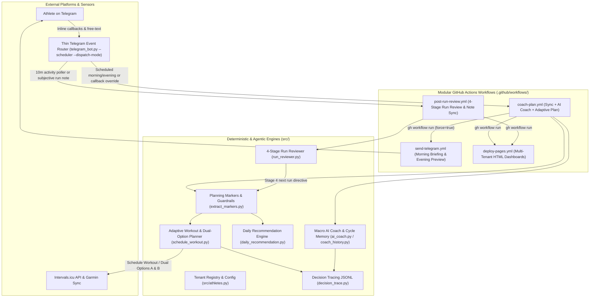
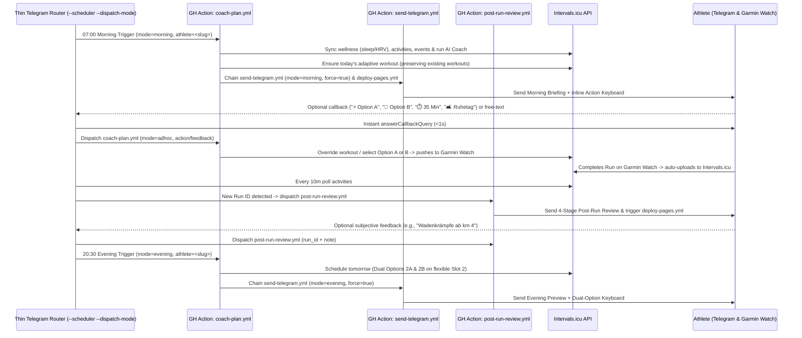

# Laufen System & Domain Specification (Authoritative SOLL Architecture & Ground Truth)

> [!IMPORTANT]
> **Purpose for Agentic Development:**
> This document is the authoritative **Single Source of Truth (SOLL Architecture & Domain Ground Truth)** for system architecture, component contracts, coaching philosophy, physiological formulas, and the 24-hour operational lifecycle.
> - For the current implementation convergence status (**IST**) and the roadmap to close remaining multi-day handoff gaps, see **[`ARCHITECTURE_REVIEW_AND_FINDINGS.md`](ARCHITECTURE_REVIEW_AND_FINDINGS.md)**.
> - When a user makes a request or proposes a change, agents MUST compare the request against this specification:
>   - If a request aligns with these invariants, execute it cleanly.
>   - If a request contradicts a core invariant or physiological guardrail (e.g., prescribing target paces for a Zone 2 HR run, or hardcoding one athlete's personal preferences into global code), **explicitly highlight the conflict** and ask whether to override or adapt the invariant.

---

## 1. Core System & Operational Invariants

### 1.1 Architectural & Engineering Invariants
1. **Zero External Runtime Dependencies**:
   - All production modules in [`src/`](../src/) and [`agent/`](../agent/) use **exclusively the Python 3 standard library** (`urllib.request`, `json`, `datetime`, `pathlib`, `re`, `csv`, `typing`).
   - External packages (`pytest`, `pytest-bdd`) are restricted strictly to `.venv` for offline/staging test execution.
2. **Deterministic Telemetry First, Cognitive Synthesis Second**:
   - Python deterministically computes all physiological metrics (7-zone HR distribution, Aerobic Efficiency Factor, Banister CTL/ATL/TSB, interval splits, and readiness counts).
   - The LLM ([`src/llm/client.py`](../src/llm/client.py)) interprets pre-computed facts and phrases human coaching guidance; it never calculates raw telemetry or invents numeric thresholds.
3. **Multi-Tenant & Configuration Isolation via [`src/athletes.py`](../src/athletes.py)**:
   - [`athletes/registry.json`](../athletes/registry.json) maps each athlete slug (`berni`, `berni-test`, etc.) to an isolated directory `athletes/<slug>/` and an unguessable dashboard output path `dist/<dashboard_slug>/index.html`.
   - **No Hardcoded Athlete Preferences in Code**: Heart rate zones, weekly run frequency, consecutive-day recovery rules, and weekly periodization slots are **athlete-specific configurations** stored in `athletes/<slug>/athlete.json`. Engine code must never hardcode one athlete's personal HR thresholds or weekday preferences for other tenants.
   - Live API E2E tests (`./run test:e2e`) and synthetic data seeding (`./run seed`) are **strictly restricted** to staging tenant `berni-test` (`i771119`). Production tenants are protected by hard safety checks in [`src/integrations/seed_athlete.py`](../src/integrations/seed_athlete.py).
4. **Intervals.icu as Calendar Single Source of Truth**:
   - Planned workouts (`category: "WORKOUT"`) and coach rest-day markers (`category: "NOTE"`, `"🛋️ Ruhetag (Coach)"`) are persisted directly to the Intervals.icu calendar via [`src/planner/schedule_workout.py`](../src/planner/schedule_workout.py).
   - Intervals.icu automatically syncs scheduled workouts for the upcoming 7 days to Garmin Connect and GPS watches.
5. **Strict BDD Test Driver Pattern & Relative Documentation Paths**:
   - Every code modification requires automated Gherkin BDD scenarios (`tests/*.feature`) bound to thin step definitions and encapsulated Test Drivers (`tests/test_*.py`, [`tests/drivers.py`](../tests/drivers.py)) per [`tests/README.md`](../tests/README.md).
   - All documentation links in the repository must use **relative paths** (never machine-specific `file://` or `/home/...` paths).

### 1.2 Operational & Data Invariants
1. **Executable Data Contract Validity ([`src/core/contracts.py`](../src/core/contracts.py))**:
   - All reviews in `athletes/<slug>/run_reviews.json` must validate against `RunReviewEvaluationV2Contract` (`schema_version: 2`).
   - All historical coaching entries in `athletes/<slug>/coach_history.json` must validate against `CoachCycleEntryContract`.
   - All decision records in `athletes/<slug>/decision_trace.jsonl` must validate against `DecisionTraceEntryContract`.
2. **Briefing & Notification Idempotency**:
   - Daily morning briefings and evening previews are dispatched at most once per athlete per day (`last_dispatched_briefing_date` / `last_briefing_date == today_iso`), unless explicitly triggered with `--force`.
   - Post-run reviews are sent only for runs completed today or within the last 6 hours (`notified_activity_ids`), preventing historical spam upon daemon reboot.
3. **Calendar & Workout Preservation**:
   - Rolling plan synchronization (`sync_adaptive_plan`) preserves all out-of-window calendar events ($> 14$ days future or past events) and never truncates `calendar_events.json`.
   - Existing unpaired workouts on a target date are preserved (`[BEREITS GEPLANT]`) and never blindly deleted or overwritten; only explicit athlete overrides (`override_workout_on_date`) or rest-day cleanup remove uncompleted future workouts.
   - Dry-run executions never mutate disk files or external APIs.

---

## 2. Target System & Component Architecture (SOLL)

The `laufen` platform reconciles intended training periodization (**SOLL**) with actual physiological execution (**IST**) across an event-driven 24-hour operational lifecycle.

### 2.1 Target Component Specifications (SOLL)

| Subsystem | Target Architecture (SOLL Specification) | Primary Modules |
| :--- | :--- | :--- |
| **Unified Planning Pipeline** | Single source of truth for all training decisions. Deterministic calculation of continuous telemetry markers (`consecutive_build_weeks`, `base_anchors_in_last_14d`, `days_since_last_run`, readiness) driving both calendar scheduling and daily dashboard recommendations without divergent procedural rules. | [`extract_markers.py`](../src/planner/extract_markers.py), [`schedule_workout.py`](../src/planner/schedule_workout.py), [`daily_recommendation.py`](../src/analysis/daily_recommendation.py) |
| **Calendar Event Context & Dual Options (A/B)** | Calendar events (workouts, rest notes, paired activities) act as decision context without short-circuiting empty days. Existing workouts are never blindly overwritten. On flexible Slot 2 evenings (`--dual-options`), both Option A (Threshold) and Option B (Z2 Base) are scheduled so both sync to the watch overnight. | [`schedule_workout.py`](../src/planner/schedule_workout.py), [`daily_recommendation.py`](../src/analysis/daily_recommendation.py) |
| **Health, Cramp & Re-Entry Guardrails** | Muscular cramps, illness symptoms, or elevated resting HR automatically forbid high-intensity work; extended breaks enforce gentle re-entry and progressive base ramp-up before unlocking quality; $\ge 3$ consecutive build weeks trigger a deload week. | [`extract_markers.py`](../src/planner/extract_markers.py), [`schedule_workout.py`](../src/planner/schedule_workout.py) |
| **Decision Tracing & Auditability** | Every automated training adjustment, adaptive workout selection, or AI Coach cycle records its evaluated criteria, rejected alternatives, and winning directive in `athletes/<slug>/decision_trace.jsonl` (inspectable via `./run trace` and published to `$GITHUB_STEP_SUMMARY`). | [`decision_trace.py`](../src/analysis/decision_trace.py) |
| **4-Stage Per-Run Review** | Deterministic 4-stage post-run evaluation (Stage 1 Physiology, Stage 2 Compliance, Stage 3 Optimization, Stage 4 Next Run Directive) conforming to Schema v2, with dynamic 24h/48h recovery windows and subjective note re-evaluation. | [`run_reviewer.py`](../src/analysis/run_reviewer.py), [`manage_note.py`](../src/integrations/manage_note.py) |
| **Macro AI Coach Pipeline** | Daily LLM evaluation of macro trends, weekly volume compass, and wellness telemetry (`--wellness`), updating `ai_coach_summary.json`, `ai_coach_commentary.md`, and `coach_history.json` consistently across both training and rest/illness days. | [`ai_coach.py`](../src/analysis/ai_coach.py), [`coach_history.py`](../src/analysis/coach_history.py) |
| **Event-Driven Workflow Dispatch & Thin Telegram Router** | Burkerserver daemon (`--scheduler --dispatch-mode`) acts as a low-latency sensor and event router (`< 1s` callback acknowledgement), dispatching auditable GitHub Actions runs (`coach-plan.yml`, `send-telegram.yml`, `post-run-review.yml`, `deploy-pages.yml`) synchronized via persistent host state (`~/dockerContainer/laufen/athletes/`). | [`telegram_bot.py`](../src/integrations/telegram_bot.py), [`.github/workflows/`](../.github/workflows/), [`WORKFLOW_DISPATCH_ARCHITECTURE_PLAN.md`](WORKFLOW_DISPATCH_ARCHITECTURE_PLAN.md) |
| **Multi-Tenant Scoping & Central Config** | Complete tenant isolation (`athletes/<slug>/`), unguessable dashboard slugs, and centralized environment/profile loading (`load_env_file`, `load_athlete_profile`, `is_quality_run`) with zero single-tenant hardcoding. | [`src/athletes.py`](../src/athletes.py), [`src/core/config.py`](../src/core/config.py), [`athletes/registry.json`](../athletes/registry.json) |
| **Automated Verification & CI/CD** | 100% offline mocked BDD test suite (`./run test`), live staging sandbox validation against `berni-test` (`./run test:e2e`), and exclusively automated deployments via GitHub Actions. | [`tests/drivers.py`](../tests/drivers.py), [`deploy-burkerserver.yml`](../.github/workflows/deploy-burkerserver.yml) |

---

## 3. Coaching DNA & Physiological Rules

### 3.1 Strict Modality Separation: Heart Rate vs. Pace

Garmin watches display either a **Heart Rate Zone Gauge** OR a **Pace Speedometer Gauge** per workout step—never both simultaneously. Mixing HR and Pace targets creates physiological conflicts:

| Session Archetype | Primary Control Modality | Rule & Coaching Rationale |
| :--- | :--- | :--- |
| **Easy Run, Recovery Run, Long Run, Warmup, Cooldown** | **Heart Rate Only** (`Z1 HR`, `Z2 HR`, `Z1-Z2 HR`) | **Never prescribe, estimate, or suggest a target pace** (e.g., never write *"ca. 7:00 /km"*). Pace in Zone 2 is purely an outcome of daily readiness, heat, elevation, and cardiac drift. Prescribing pace causes overpacing into Zone 3. |
| **Short Intervals & Speed Reps (< 2 min)** | **Pace Corridor Only** (`05:10-05:25/km Pace`) | **Never use Heart Rate targets for short reps.** Due to physiological **cardiac lag** (~30–60s), heart rate cannot respond quickly enough during 30s–90s intervals. |
| **Threshold / Sustained Tempo ($\ge 3\text{–}4\text{ min}$)** | **Either** `Z4 HR` **or** Pace Corridor | Choose one modality per workout (`Z4 HR` for sub-threshold/threshold effort on undulating terrain; Pace corridor for flat track/road threshold reps). Never combine both in the same step. |

### 3.2 Run-Walk Biomechanics & Elevation Handling
- **No "Slow-Jogging Shuffling"**: When heart rate drifts toward the athlete's configured upper Zone 2 ceiling (`heart_rate.zones.z2_aerobic.max` in `athlete.json`) on inclines or late in a run, the athlete should **switch proactively to brisk walking (`Gehpause`)** until HR drops by ~8–10 bpm, rather than shuffling at an unnatural, biomechanically stressful micro-stride.
- **Cadence Economy**: Target natural running cadence around `158–165 spm` during running phases instead of artificially throttling stride frequency.

### 3.3 Intensity Distribution (De-Dogmatized 80/20 Macro Compass)
- **80/20 Intensity Distribution (`z1_z2_pct`)**:
  - For low-to-moderate volume runners (e.g., 2–3 sessions/week), 80/20 is a **rolling multi-week / monthly macro compass**, not a rigid single-run or single-week pass/fail filter.
  - A 2-run week consisting of 1 Interval session + 1 Easy Run naturally yields ~65–70% Z1/Z2 time due to cardiac lag and afterburn in recovery jogs—this is physiologically normal as long as dedicated base runs stay strictly in Z1/Z2.
  - Deload weeks occur systematically after $\ge 3$ consecutive build weeks or when chronic fatigue accumulates ($\text{TSB} \le -15$).

### 3.4 Athlete-Specific Periodization & Slot Configuration (`athlete.json`)
Weekly training structure is **not hardcoded globally**; every athlete defines their own preferences, physiological thresholds, and weekly slot model in `athletes/<slug>/athlete.json`:
- **Frequency & Recovery Preferences**:
  - `target_runs_per_week`: Target number of weekly sessions (e.g., `2`, `3`, `4`, or `5`).
  - `allow_consecutive_run_days`: Boolean controlling whether back-to-back running days are permitted (`false` enforces at least 1 rest day between runs; `true` allows consecutive running days for higher-frequency athletes).
  - `training_mode`: Athlete-chosen periodization model (e.g., `flexi_hybrid`, `pyramidal_hybrid`, `polarized`).
- **Configurable `weekly_slots`**:
  - Each athlete profile defines an array of `weekly_slots` tailored to their personal schedule and goals:
    - `slot`: Numeric slot identifier (`1..N`)
    - `name` & `description`: Human-readable label and coaching intent
    - `role`: Functional role in the training week (e.g., `quality`, `flexible`, `base_anchor`)
    - `allowed_days`: List of weekdays (`monday`..`sunday`) on which this slot applies
    - `allowed_types` & `preferred_type`: Permitted workout archetypes from `workouts/templates/`
- **Heart Rate Thresholds (`heart_rate`)**:
  - `max_hr`, `resting_hr`, `lthr`, and `zones` (`z1_recovery`, `z2_aerobic`, `z3_tempo`, `z4_subthreshold` / `z4_threshold`, `z5_vo2max`) are synced per athlete via `./run sync-profile --athlete <slug>`.

### 3.5 Deterministic Physiological Formulas
- **7-Zone Heart Rate Mapping** ([`src/analysis/trends.py`](../src/analysis/trends.py), [`src/analysis/run_reviewer.py`](../src/analysis/run_reviewer.py)):
  - Maps `icu_hr_zone_times` (`Z1` Recovery, `Z2` Aerobic, `Z3` Tempo, `Z4` Sub-Threshold/Threshold, `Z5` VO2max, `Z6` Anaerobic, `Z7` Neuromuscular).
  - $\text{Z1/Z2 \%} = \frac{t_{Z1} + t_{Z2}}{\sum_{i=1}^{7} t_{Zi}} \times 100$.
- **Aerobic Efficiency Factor (AEF)**:
  $$\text{AEF} = \frac{\text{Speed (m/min)}}{\text{Average Heart Rate (bpm)}}$$
  Tracked across all runs and specifically filtered for pure Z2 base runs (`z1_z2_pct >= 80%`) to measure aerobic progression independent of pace.
- **Banister Impulse-Response Form** ([`src/analysis/forecast.py`](../src/analysis/forecast.py)):
  - Chronic Training Load ($\text{CTL}$, 42-day exponentially weighted moving average of `icu_training_load`).
  - Acute Training Load ($\text{ATL}$, 7-day EWMA).
  - Training Stress Balance ($\text{TSB} = \text{CTL} - \text{ATL}$).
- **Riegel Race Prediction** ([`src/analysis/forecast.py`](../src/analysis/forecast.py)):
  $$T_2 = T_1 \cdot \left(\frac{D_2}{D_1}\right)^k$$
  where the fatigue exponent $k$ is dynamically adjusted based on the athlete's weekly aerobic volume and long-run endurance base.

---

## 4. Data Contracts & Multi-Tenant Storage Layout

All inter-module JSON schemas and runtime validators are defined in **[`src/core/contracts.py`](../src/core/contracts.py)**.

### 4.1 Per-Athlete File Map (`athletes/<slug>/`)

| File | Producer(s) | Consumer(s) | Contract in `src/core/contracts.py` |
| :--- | :--- | :--- | :--- |
| `athlete.json` | [`sync_athlete.py`](../src/integrations/sync_athlete.py), [`onboard_athlete.py`](../src/integrations/onboard_athlete.py) | All planner, analysis & dashboard modules | [`AthleteProfileContract`](../src/core/contracts.py) (`validate_athlete_profile`) |
| `intervals_activities.json` | [`download_intervals.py`](../src/integrations/download_intervals.py), [`manage_note.py`](../src/integrations/manage_note.py) | `trends.py`, `run_reviewer.py`, `extract_markers.py`, `generate_dashboard.py` | Raw Intervals.icu Activity list |
| `intervals_wellness.json` | [`download_wellness.py`](../src/integrations/download_wellness.py) | `extract_markers.py`, `ai_coach.py`, `telegram_bot.py`, `generate_dashboard.py` | Raw Intervals.icu Wellness list |
| `calendar_events.json` | [`download_events.py`](../src/integrations/download_events.py), [`schedule_workout.py`](../src/planner/schedule_workout.py) | `daily_recommendation.py`, `ai_coach.py`, `telegram_bot.py`, `generate_dashboard.py` | Intervals.icu Event list |
| `run_reviews.json` | [`run_reviewer.py`](../src/analysis/run_reviewer.py) (`schema_version: 2`) | `ai_coach.py`, `telegram_bot.py`, `generate_dashboard.py` | [`CachedRunReviewRecordContract`](../src/core/contracts.py) / [`RunReviewEvaluationV2Contract`](../src/core/contracts.py) (`validate_run_review_evaluation`) |
| `coach_history.json` | [`coach_history.py`](../src/analysis/coach_history.py), [`ai_coach.py`](../src/analysis/ai_coach.py) | `run_reviewer.py`, `daily_recommendation.py`, `generate_dashboard.py` | [`CoachCycleEntryContract`](../src/core/contracts.py) (`validate_coach_history`) |
| `ai_coach_summary.json` & `ai_coach_commentary.md` | [`ai_coach.py`](../src/analysis/ai_coach.py) | `generate_dashboard.py`, `decision_trace.py` | Structured LLM macro summary & Markdown letter |
| `decision_trace.jsonl` | [`decision_trace.py`](../src/analysis/decision_trace.py), [`schedule_workout.py`](../src/planner/schedule_workout.py), [`ai_coach.py`](../src/analysis/ai_coach.py) | `decision_trace.py` (`./run trace`) | [`DecisionTraceEntryContract`](../src/core/contracts.py) (`validate_decision_trace_entry`) |
| `telegram_state.json` | [`telegram_bot.py`](../src/integrations/telegram_bot.py) | `telegram_bot.py` | Tracks `last_briefing_date`, `last_dispatched_briefing_date`, `last_evening_preview_date`, `last_dispatched_evening_date`, `notified_activity_ids`, `user_locked_dates`, and pending note state |

> [!WARNING]
> **Legacy Path Precaution (`data/` and `config/athlete.json`):**
> Root `data/` and `config/athlete.json` exist strictly as a legacy single-tenant fallback when `athletes/registry.json` is absent (e.g., in isolated unit test `tmp_path` fixtures). In the repository workspace, **always** pass `--athlete <slug>` (or invoke via `./run <cmd>`) so paths resolve to `athletes/<slug>/`.

---

## 5. 24-Hour Operational Lifecycle & Workflow-Dispatch State Machine

### Key Lifecycle Invariants
1. **Morning Briefing (`briefing_time` $\rightarrow$ `coach-plan.yml` + `send-telegram.yml`)**:
   - Dispatched once per day (`last_dispatched_briefing_date == today_iso`) and delivered with sleep/HRV readiness check and interactive override buttons.
2. **Immediate Post-Run Reviews (`post-run-review.yml`)**:
   - Polled every 10 minutes for runs completed today ($\le 6\text{ hours}$ old) with cold-start deduplication (`notified_activity_ids`).
3. **Evening Preview & Dual-Option Scheduling (`evening_briefing_time` $\rightarrow$ `--evening-preview --dual-options`)**:
   - Previews tomorrow: rest day if the athlete ran today, otherwise training day.
   - On flexible Slot 2 days when guardrails permit quality, schedules both **Slot 2A (Threshold)** and **Slot 2B (Z2 Base)** so both sync to the watch overnight and can be selected via inline buttons (`accept_a` / `accept_b`).
   - Workouts for today are never deleted in the evening.
4. **Workout Preservation & Athlete Veto Priority**:
   - Existing unpaired workouts on a target date are preserved (`[BEREITS GEPLANT]`) and never blindly overwritten by routine sync runs.
   - Any explicit athlete selection via Telegram inline buttons (`accept_a`, `accept_b`, `easier`, `shorter35`, `rest`) or free-text feedback calls `override_workout_on_date()`, locks the date in `user_locked_dates`, and synchronizes `coach_history.json`.

---

## 6. Workout DSL & Templates Reference

Structured workout templates live in [`workouts/templates/`](../workouts/templates/) and are rendered by [`src/planner/schedule_workout.py`](../src/planner/schedule_workout.py):

| Template Name (`--type`) | Template File | Target Modality | Primary Use Case |
| :--- | :--- | :--- | :--- |
| `easy_run` | [`easy_run.txt`](../workouts/templates/easy_run.txt) | `Z2 HR` (Warmup `Z1-Z2 HR`, Cooldown `Z1 HR`) | Standard aerobic base session |
| `recovery_run` | [`recovery_run.txt`](../workouts/templates/recovery_run.txt) | `Z1 HR` | Active regeneration after hard load or mild fatigue |
| `long_run` | [`long_run.txt`](../workouts/templates/long_run.txt) | `Z2 HR` | Extended endurance base anchor ($\ge 60\text{ min}$) |
| `intervals` | [`intervals.txt`](../workouts/templates/intervals.txt) | Pace Corridor (`05:10-05:25/km Pace`) or `Z4 HR` | Short speed / VO2max repetitions (`10x 1m`) |
| `fartlek` | [`fartlek.txt`](../workouts/templates/fartlek.txt) | Pace Corridor / RPE surges | Playful speed-play surges with easy jogging recovery |
| `tempo_run` | [`tempo_run.txt`](../workouts/templates/tempo_run.txt) | `Z4 HR` | Continuous threshold block (e.g., `20m Z4 HR`) |
| `threshold_intervals` | [`threshold_intervals.txt`](../workouts/templates/threshold_intervals.txt) | `Z4 HR` | Cruise intervals at sub-threshold/threshold (`3x 8m Z4 HR`) |
| `micro_threshold` | [`micro_threshold.txt`](../workouts/templates/micro_threshold.txt) | `Z4 HR` | Short threshold blocks (`5x 4m Z4 HR` with `90s` recovery) to limit lactate accumulation |
| `progressive_threshold` | [`progressive_threshold.txt`](../workouts/templates/progressive_threshold.txt) | `Z2 HR` $\rightarrow$ `Z3 HR` $\rightarrow$ `Z4 HR` | Progressive aerobic-to-threshold transition run |

---

## 7. Documentation Drift Prevention (Automated Verification)

Documentation in this repository is protected against drift by automated BDD tests in [`tests/documentation_integrity.feature`](../tests/documentation_integrity.feature) and [`tests/test_documentation_integrity.py`](../tests/test_documentation_integrity.py), executed on every `./run test`:

1. **Relative Link & Path Integrity**: Every relative file link across [`GEMINI.md`](../GEMINI.md), [`README.md`](../README.md), [`docs/SYSTEM_SPEC.md`](SYSTEM_SPEC.md), [`docs/ARCHITECTURE_REVIEW_AND_FINDINGS.md`](ARCHITECTURE_REVIEW_AND_FINDINGS.md), [`docs/WORKFLOW_DISPATCH_ARCHITECTURE_PLAN.md`](WORKFLOW_DISPATCH_ARCHITECTURE_PLAN.md), [`docs/AGENTIC_SIMULATION_PLAN.md`](AGENTIC_SIMULATION_PLAN.md), [`docs/FORESIGHT_ENGINE_PLAN.md`](FORESIGHT_ENGINE_PLAN.md), [`tests/README.md`](../tests/README.md), and [`.agents/skills/workout-scheduler/SKILL.md`](../.agents/skills/workout-scheduler/SKILL.md) is verified to exist on disk, and **absolute filesystem paths (`file://`, `/home/...`, `/mnt/...`) are rejected**.
2. **CLI Runner Subcommand Parity**: Every subcommand implemented in [`./run`](../run) is verified to appear in `./run help` (`show_help()`) and [`README.md`](../README.md).
3. **Workout Template Parity**: Every workout DSL template in [`workouts/templates/*.txt`](../workouts/templates/) is verified to be documented in [`docs/SYSTEM_SPEC.md`](SYSTEM_SPEC.md) and [`.agents/skills/workout-scheduler/SKILL.md`](../.agents/skills/workout-scheduler/SKILL.md).
4. **Executable Schema Contract Parity**: Outputs of `evaluate_run_deep()`, `extract_planning_markers()`, `load_coach_history()`, and `athletes/berni/athlete.json` are validated against [`src/core/contracts.py`](../src/core/contracts.py).
