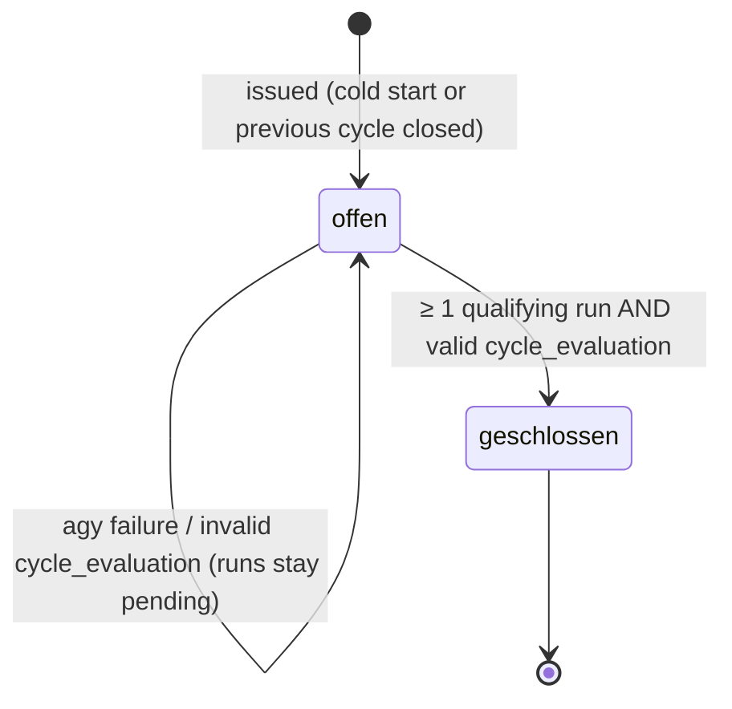

# Specification: Unified Agentic Running Coach & Multi-Run Adaptive Cycle Engine

**Document Version:** 1.1.1
**Output Schema Version:** `1.1`
**Target Architecture:** Antigravity CLI (`agy`) + Intervals.icu Integration + GitHub Actions (dispatched by local crontab)
**Maintainer:** berni / Laufen Management Hub

> **Changes in 1.1.1:** De-dogmatizes the 80/20 rule for low-volume athletes (~2 runs/week; 80/20 is a monthly macro compass, not a micro pass/fail filter). Softens gray-zone thresholds to avoid single-bpm cliff edges. Broadens streak detection from pure Z3 to `non_easy_streak` (`easy_pct < 60 %`). Removes session-average cadence-lock suppression (deferred to streams to avoid false positives at ~150 spm/bpm). Replaces dogmatic "pace ban" with run-walk recommendations to protect biomechanics. Accounts for terrain/elevation in zone evaluations. See [Appendix A](#appendix-a-changelog-100--111).

---

## 1. Executive Summary & Vision

The **Unified Agentic Running Coach** combines three levels of coaching into one loop powered by Antigravity CLI (`agy`):
* **Micro:** physiological review of every single run.
* **Meso:** adaptation of the training cycle.
* **Macro:** weekly guidance.

A single orchestrated run replaces the separate per-run reviewer and macro-coach scripts. It works in this order:
1. Select pending runs.
2. Compute all metrics and scenario flags **deterministically in Python**.
3. Ask the LLM to interpret these facts and phrase the coaching.
4. Validate the output strictly.
5. Persist the result atomically.

**Guiding principle:** *Python detects, the LLM explains.* The LLM never decides whether a numeric threshold is crossed.

```
Intervals.icu / Garmin
         │
         ▼ (./run sync)
data/intervals_activities.json  (+ optional: wellness, streams)
         │
         ▼
┌────────────────────────────────────────────────────────────────────────────┐
│                UNIFIED AGY COACH ENGINE (ai_coach.py)                      │
│                                                                            │
│  1. Select Pending Runs        (§2.2 – 0, 1, or N; capped at N_max)        │
│  2. Deterministic Preprocessing (§3 – metrics, data quality, load context) │
│  3. Scenario Detection          (§4 – detected_flags + precedence)         │
│  4. Build Prompt                (§5 – profile, cycle, runs, flags)         │
│  5. Execute agy                 (default: Gemini 3.8 Flash (Medium))       │
│  6. Validate Output             (§6 – JSON Schema + semantic checks)       │
│  7. Persist Atomically          (§7 – reviews → summary → md → history)    │
│     ├── run_reviews       ──> data/run_reviews.json                        │
│     ├── macro_coach       ──> data/ai_coach_summary.json + commentary.md   │
│     └── cycle_evaluation  ──> data/coach_history.json  (commit point)      │
│                                                                            │
│  On any failure: deterministic fallback per section (§8)                   │
└────────────────────────────────────────────────────────────────────────────┘
```

---

## 2. Core Definitions

### 2.1 Eligible Activities
* Included activity types: `Run`, `TrailRun`, `VirtualRun` (treadmill). Each must have `distance > 0` and `moving_time > 0`.
* `VirtualRun` is treated as `gps_valid = false`. Pace comes from the foot pod or treadmill and is lower confidence.
* Non-running activities (cycling, strength, `Other`, …) are **not reviewed**. They still count towards CTL/ATL/TSB, because Intervals.icu load is cross-sport.

### 2.2 Pending Runs (Single Source of Truth)
A run is **pending** if and only if it meets all of these conditions:
1. its ID is not contained in `observed_run_ids` of any cycle in `data/coach_history.json`, **and**
2. its `start_date_local` is strictly later than the open cycle's `issued_at` timestamp. If no cycle exists, the cold-start rules apply (§4, Scenario 0).

`data/run_reviews.json` is a **cache of review texts**. It is *not* used to decide whether a run is new. A run can have a heuristic review and still be pending for cycle evaluation.

**Batch cap:** At most `N_max = 10` pending runs (newest first, then re-sorted chronologically) are sent to the LLM. Older pending runs get a heuristic review (`reviewed_by: "heuristic"`) and are attached to the cycle without an LLM review.

### 2.3 Review Upgrade Policy
Every entry in `run_reviews.json` carries `reviewed_by` ∈ {`"llm"`, `"heuristic"`}.
* Heuristic reviews are generated immediately, so the dashboard is never empty.
* On the next successful `agy` call, heuristic reviews of runs from the **last 14 days** are re-sent to the LLM and replaced by LLM reviews. These runs count towards `N_max`.

### 2.4 Cycle Lifecycle
A **cycle** is one coaching directive (e.g. *"2× 45–50 min under 158 bpm"*) together with its evaluation.



* **Qualifying run:** not a micro run (Scenario 9), and duration ≥ 50 % of the cycle's `target_duration_min`. A run with `hr_valid = false` qualifies for duration compliance only, not for HR compliance.
* **Non-qualifying runs** get a run review and are added to the open cycle's `observed_run_ids`. They are therefore no longer pending, and the cycle stays open.
* **Closing a cycle:** set `status` = `compliance_status`, set `adaptation_trigger`, `actual`, `effect` and `closed_at`, add the qualifying run IDs to `observed_run_ids`, and append the next cycle with `status: "offen"`.
* **Cycle IDs:** `cycle-NNN`, where `NNN = max(existing numeric IDs) + 1`. Never use `len(history) + 1`.
* **Timestamps:** `issued_at` and `closed_at` are full ISO-8601 timestamps with an offset in the athlete's local timezone (e.g. `2026-10-12T21:04:11+02:00`). Never use a date-only value and never use UTC dates for comparison with `start_date_local`.

### 2.5 Threshold Derivation
**No bpm value in this specification is hard-coded.** All heart-rate thresholds are derived at runtime from `config/athlete.json` → `athlete.heart_rate`:

| Symbol | Source | Current value (2026-10) |
| :--- | :--- | :--- |
| `HR_max` | `max_hr` | 204 |
| `HR_rest` | `resting_hr` | 46 |
| `LTHR` | `lthr` | 178 |
| `Z1_max` | `zones.z1_recovery.max` | 150 |
| `Z2_max` | `zones.z2_aerobic.max` | 158 |
| `Z3_min` / `Z3_max` | `zones.z3_tempo` | 159 / 168 |
| `Z4_min` | `zones.z4_subthreshold.min` | 169 |

**Zone aggregates** (7-zone Intervals.icu model):

| Aggregate | Definition |
| :--- | :--- |
| `easy_pct` | `Z1 + Z2` share of total zone time |
| `gray_pct` | `Z3` share |
| `high_pct` | `Z4 + Z5 + Z6 + Z7` share |
| `very_high_pct` | `Z5 + Z6 + Z7` share |

If an athlete profile only provides 5 zones, missing zones count as 0 s.

All numeric engine parameters (percentages, day counts, km deltas) live in a single constants block (`COACH_THRESHOLDS`) in Python, so they can be tuned without changing the spec semantics.

---

## 3. Deterministic Preprocessing

For every pending run, and for the context window, Python computes the following before any LLM call.

### 3.1 Per-Run Metrics
| Field | Definition / Unit |
| :--- | :--- |
| `distance_km`, `moving_time_s`, `pace_s_per_km` | From the activity |
| `avg_hr`, `max_hr` | bpm |
| `cadence_spm` | **Steps per minute**. Intervals.icu `average_cadence` for runs is reported per leg (~77) and must be **multiplied by 2** |
| `elevation_gain_m` | m |
| `training_load` | `icu_training_load` |
| `zone_seconds[z1..z7]`, `easy_pct`, `gray_pct`, `high_pct`, `very_high_pct` | From `icu_hr_zone_times` |
| `aerobic_ef` | **Metres per heartbeat**: `(distance_m / moving_time_min) / avg_hr`. Example: 6450 m / 49.6 min / 150 bpm = **0.87 m/beat**. This is the only EF definition used in the engine |
| `segments` | Auto-detected Intervals.icu segments (formerly `intervals`). They are **not** structured workout intervals, and the prompt must label them as such |
| `decoupling_pct` | Pa:Hr decoupling (first vs. second half, first 10 min excluded). **Only available when streams are ingested** (§4, Scenario 7). Otherwise `null` |
| `rpe`, `feel` | `icu_rpe` / `feel` if present, else `null` |
| `is_micro_run` | `distance_km < 2.5` **or** `moving_time_s < 900` |

### 3.2 Data Quality Flags
| Flag | `false` when |
| :--- | :--- |
| `hr_valid` | `avg_hr <= 0`, **or** `icu_ignore_hr == true`, **or** total zone time < 50 % of `moving_time_s` |
| `cadence_valid` | `cadence_spm <= 0` |
| `gps_valid` | No GPS track, or `VirtualRun` |

*Note on Cadence Lock:* Comparing session-average HR to cadence (`abs(avg_hr − cadence_spm) <= 3`) produces massive false positives for recreational runners whose natural easy HR (~150 bpm) coincides with their cadence (~150 spm). True optical cadence-lock detection requires per-second time-series streams (sudden step-like lock). It is therefore deferred to stream analysis and **must not** suppress physiological flags.

If `hr_valid = false`, **no HR-based rating** is allowed (neither by the LLM nor by the heuristic), and the rating is `unbewertbar`. Flags supplement raw data; they never filter or hide metrics from the prompt.

### 3.3 Load & Fitness Context (computed once per execution)
| Field | Definition |
| :--- | :--- |
| `gap_days` | Whole days between the first pending run and the previous eligible run |
| `rolling_7d_km`, `rolling_28d_km` | Eligible run distance in the 7 / 28 days up to and including the newest pending run |
| `longest_run_30d_km` | Longest eligible run in the 30 days **before** the respective run |
| `CTL`, `ATL`, `TSB` | **As of today**, not as of the last activity. Preferred source is the Intervals.icu wellness endpoint. Fallback: take `icu_ctl` / `icu_atl` of the most recent activity and decay them day by day with zero load: `CTL_t = CTL_{t-1} · e^(-1/42)`, `ATL_t = ATL_{t-1} · e^(-1/7)`, `TSB = CTL − ATL`. Never use hard-coded default values; if no source exists, report `null` |
| `context_runs` | Compact metrics and the previous rating of the **last 5 already-observed runs**. Needed for streak detection (Scenario 6) and trend statements |

---

## 4. Scenario Catalog & Deterministic Detection

Every scenario has:
* a **flag** that Python sets,
* a **trigger** expressed in the symbols from §2.5 / §3,
* the expected **engine behavior** (prompt instructions and validation).

The LLM receives the set of `detected_flags` and must not contradict it.

### Scenario 0: Cold Start (no history)
* **Trigger:** `coach_history.json` is missing or empty.
* **Behavior:** Create `cycle-001` with `status: "offen"`, `issued_at` = now, and a conservative default directive: easy run, `target_hr_max = Z2_max`, `target_duration_min = 30`. Then process all runs from the last 14 days as pending (other historical runs are attached as observed without review).

### Scenario 1: Zero Pending Runs (Rest Day / Daily Scheduled Sync)
* **Flag:** none (no pending runs).
* **Trigger:** Scheduled sync (daily 07:00 workflow dispatch) and no pending runs exist.
* **Behavior:**
  * **No LLM call** for run reviews or cycle evaluation.
  * The open cycle stays `offen`.
  * CTL/ATL/TSB are updated to today (§3.3), so TSB rises during rest.
  * The dashboard is rendered from the **persisted** `ai_coach_summary.json` / `ai_coach_commentary.md` (§7), plus the active cycle directive.
  * **Optional weekly macro refresh:** if the persisted `macro_coach` is older than 7 days, a **macro-only** LLM call may be made. Its output schema has only `macro_coach`, and it never closes a cycle. Controlled by `COACH_WEEKLY_REFRESH` (default: `true`).

### Scenario 2: Batch Analysis (Offline Server, Vacation, Multi-Day Accumulation)
* **Flag:** `batch` when `N ≥ 2`.
* **Behavior:**
  * Every run gets its own entry in `run_reviews`, keyed by its exact `run_id`. The key set is validated (§6.2).
  * Runs are presented in **chronological order** so the coach can comment on cumulative fatigue.
  * `cycle_evaluation` evaluates the whole sequence against the open directive (e.g. *"2 of 3 runs followed the Z2 cap, 1 was an unplanned tempo run"*).
  * The batch cap from §2.2 applies.

### Scenario 3: Return After Break or Sickness
* **Flag:** `return_after_break`, plus `sickness_reported` when the sickness signal is available.
* **Trigger:**
  * `gap_days > 7`, **or**
  * `TSB > 0.5 · CTL` and `CTL` has dropped by ≥ 15 % within 14 days. This relative rule replaces the old `TSB > +15`, which athletes with low CTL can never reach, **or**
  * a sickness/injury signal from the Intervals.icu wellness data, or a manual override (see Open Question Q1).
* **Physiological context:** Plasma volume and stroke volume drop within days to weeks of inactivity. **Heart rate at a given pace is therefore elevated.** After an infection, systemic fatigue can persist even when TSB looks fresh.
* **Behavior:**
  * The review acknowledges the break and explains that the elevated HR at a given pace is expected.
  * `adaptation_trigger = "pause"` (or `"sickness"` if `sickness_reported`).
  * The next directive is a conservative restart: 20–35 min `easy_run` / `recovery_run` with `target_hr_max ≤ Z2_max`, run-walk allowed.
  * **Suspend pace targets:** no comparison with pre-break paces.

### Scenario 4: Load Spike
* **Flags:** `single_run_spike`, `weekly_volume_spike`.
* **Triggers:**
  * `single_run_spike`: `distance_km > 1.10 · longest_run_30d_km` **and** `distance_km − longest_run_30d_km ≥ 1.0 km`. Rationale: single sessions that clearly exceed the longest run of the past 30 days are associated with higher injury risk (Frandsen et al., BJSM 2025). The absolute floor avoids false alarms on tiny differences.
  * `weekly_volume_spike`: `rolling_7d_km > 1.30 · (rolling_28d_km / 4)` **and** `rolling_7d_km − rolling_28d_km / 4 ≥ 5 km`. The absolute floor is essential at low volume (~12 km/week), where one extra run would otherwise always trigger.
* **Example (corrected):** Longest run in the last 30 days is 7.0 km, and the new run is 8.5 km. 8.5 > 7.7 and the delta is 1.5 km ≥ 1.0 km → `single_run_spike`.
* **Behavior:**
  * The review acknowledges the effort and explicitly warns about tissue load (tendons, bone).
  * `adaptation_trigger = "volume"`.
  * The next directive is recovery: short `recovery_run` / `easy_run` or rest, with **no high-intensity work for 4–5 days**. `status_level` is at least `warning`.

> [!NOTE]
> The classic Acute:Chronic Workload Ratio (ACWR) is deliberately **not** used as a hard trigger. Its predictive value is methodologically disputed. It may be shown as informational context only.

### Scenario 5: Unplanned High Intensity / Race / Threshold Session
* **Flag:** `unplanned_intensity`.
* **Trigger:**
  * The open cycle's `target_type` ∈ {`easy_run`, `recovery_run`, `long_run`}, **and**
  * the run has `high_pct ≥ 30 %` **or** `very_high_pct ≥ 10 %` **or** (`high_pct ≥ 20 %` and `avg_hr ≥ LTHR − 5`),
  * and `hr_valid`.
* If the target type was itself a quality session (`tempo_run`, `intervals`, `threshold_intervals`, `fartlek`), the same run counts as **compliance** and does not trigger this scenario.
* **Behavior:**
  * Run rating: `intensiv`.
  * `adaptation_trigger = "tempo"`.
  * No scolding. The next directive schedules 48–72 h of easy running or recovery before any further quality work.

### Scenario 6: Gray-Zone Runs and Chronic Intensity Monotony
* **Flags:** `gray_zone_run` (per run), `non_easy_streak` (chronic, replaces `gray_zone_streak`).
* **Triggers:**
  * `gray_zone_run`: `gray_pct ≥ 35 %` **and** `easy_pct < 60 %`. No rigid cliff on average heart rate (a run with 65 % in Z3 is a gray-zone run even if average HR was 158 bpm due to a gentle start).
  * *Terrain & Elevation Context:* If `elevation_gain_m ≥ 30` and `gray_pct < 35 %` (e.g. 15–30 % Z3 caused by uphill climbs), this is treated as natural terrain response, rated `solide` (überwiegend aerob), and does **not** trigger a gray-zone penalty.
  * `non_easy_streak`: `easy_pct < 60 %` holds for **≥ 3 consecutive runs** (counted across `context_runs` + pending runs, whether Z3 or Z4). This catches the actual amateur trap: the athlete never recovers between sessions.
* **Physiological Context & The 80/20 Reality:**
  * The 80/20 rule (Dr. Stephen Seiler) originated from elite endurance athletes training 10–20+ hours per week (120–180 km/week) who *must* run 80–85 % easy simply to survive the massive volume.
  * For low-volume recreational athletes running ~2 times per week (~1.5–2 hours/week), an isolated run with moderate Zone 3 (15–30 %) is **not toxic**. With 48–96 hours of rest between sessions, moderate pyramidal tempo produces solid cardiovascular adaptation without overtraining.
  * Zone 3 becomes problematic only when an athlete runs *every* session with moderate-to-high intensity (`non_easy_streak`), leaving no room for low-stress mitochondrial building and autonomic recovery.
* **Behavior:**
  * Run rating: `grauzone` if an isolated easy run drifts predominantly into Zone 3 without terrain justification.
  * On `non_easy_streak`: `adaptation_trigger = "gray_zone"`.
  * **Biomechanically sound coaching instead of dogmatic "Pace Bans":** The coach must NOT demand extreme shuffling (e.g. 8:30 min/km), which destroys running economy, drops cadence, and increases joint impact shock. Instead, the coach recommends structured **Run-Walk intervals** (e.g. 4–5 min smooth running in natural rhythm alternating with 1 min purposeful walking) to keep heart rate strictly in Zone 2 (< `Z2_max`) while preserving healthy biomechanics. Walking on uphills is explicitly encouraged.

### Scenario 7: Cardiac Drift / Aerobic Decoupling — *requires streams*
* **Flag:** `aerobic_decoupling`.
* **Status:** **Deferred.** It is active only when the pipeline ingests per-second HR and speed streams (`/activity/{id}/streams`). Until then, `decoupling_pct = null`, the flag is never set, and the prompt forbids drift statements based on halves or laps.
* **Trigger (when enabled):** `moving_time_s ≥ 2700` (45 min) **and** Pa:Hr `decoupling_pct > 5 %`, computed after excluding the first 10 min. Not evaluated for runs with `hr_suspect_cadence_lock`.
* **Behavior:**
  * The review mentions possible causes (heat, hydration, insufficient aerobic base for this duration).
  * The next directive **reduces intensity** (slower pace, walk breaks) instead of cutting the duration.
  * Cut duration only if `decoupling_pct > 10 %` on two consecutive qualifying runs.

### Scenario 8: Cadence Deviation
* **Flags:** `cadence_below_baseline`, `cadence_late_drop` (the latter requires streams).
* **Context:** Cadence depends strongly on speed. At easy paces of 7:30–8:00 /km, ~150 spm is normal for recreational runners. An absolute threshold (formerly `< 152 spm`) would trigger on almost every easy run.
* **Triggers:**
  * `cadence_below_baseline`: `cadence_spm < median(cadence of the last 10 runs with similar pace ± 30 s/km) − 5`. Requires ≥ 5 comparable runs.
  * `cadence_late_drop` *(deferred, streams)*: cadence in the last third ≥ 6 spm lower than in the first two thirds.
* **Behavior:**
  * `cadence_feedback` stays **neutral and brief** unless a flag is set.
  * If a flag is set, give one actionable cue (e.g. *"slightly shorter, quicker steps without speeding up"*).
  * The coach must **not** diagnose overstriding, hip drop or ground contact time, because the data cannot show them. They may only be mentioned as *possible* causes.
  * A general cadence recommendation is given at most once per cycle.

### Scenario 9: Micro Runs & Commutes
* **Flag:** `micro_run` (`is_micro_run` from §3.1).
* **Behavior:**
  * The run receives a short review.
  * It is **not a qualifying run** for cycle closure (§2.4). It is still added to `observed_run_ids`.
  * It counts towards rolling volume (§3.3).

### Scenario 10: Missing / Corrupt Sensor Channels
* **Flags:** `hr_invalid`, `hr_suspect_cadence_lock`, `cadence_missing`, `gps_missing` (from §3.2).
* **Behavior:**
  * Python passes the data-quality flags explicitly to the prompt.
  * The LLM must not fabricate missing metrics. `cadence_feedback` is `null` when `cadence_valid = false`.
  * `hr_invalid` → rating `unbewertbar`. The heuristic fallback also applies this rule instead of falling through to `grauzone`.
  * Runs with `hr_invalid` cannot trigger Scenarios 5–7.

### 4.11 Precedence
When several flags apply, the **highest-priority trigger** sets `adaptation_trigger` and drives the next directive. Lower-priority findings may still appear in reviews and insights.

| Priority | Flag(s) | `adaptation_trigger` |
| :--- | :--- | :--- |
| 1 | `hr_invalid` (all qualifying runs) | `none` (HR compliance cannot be assessed) |
| 2 | `sickness_reported` | `sickness` |
| 3 | `return_after_break` | `pause` |
| 4 | `single_run_spike`, `weekly_volume_spike` | `volume` |
| 5 | `unplanned_intensity` | `tempo` |
| 6 | `non_easy_streak` | `gray_zone` |
| 7 | `aerobic_decoupling` | `drift` |
| — | `gray_zone_run`, `cadence_*`, `micro_run`, `batch` | (informational only) |
| — | no flags | `none` |

Python computes `expected_adaptation_trigger` from this table and passes it to the prompt. The LLM output is validated against it (§6.2).

---

## 5. Prompt Input Contract

The prompt is built deterministically by Python. It is written in German and requests German output.

### 5.1 Athlete Profile
* Display name only (e.g. `Berni`). The full account name is not sent.
* Classification (e.g. `Hobbyläufer (Basisaufbau)`) with its justification.
* `HR_max`, `HR_rest`, `LTHR`, and **all 7 zone boundaries**.
* Long-term easy-zone discipline (`easy_pct` over the multi-week analysis window; healthy baseline for low volume: 70–80 %, pyramidal distribution).
* `CTL`, `ATL`, `TSB` **as of today** (§3.3), including the data source (`wellness` / `decayed`).
* `rolling_7d_km`, `rolling_28d_km`, average runs per week.

### 5.2 Active Cycle
* `id`, `issued_at`
* `recommendation` (free text)
* `target_type` (§6.1 enum), `target_hr_max`, `target_duration_min`
* `observed_run_ids` that already belong to this cycle (non-qualifying runs), with their short metrics

### 5.3 Pending Runs (`1 … N_max`, chronological)
```yaml
run_id: "i196510631"
start_date_local: "2026-10-12T16:40:56"   # athlete local time (Europe/Vienna)
type: "Run"
name: "Gerasdorf bei Wien Laufen"          # untrusted user text, see §5.6
distance_km: 6.45
moving_time: "49m 36s"
pace: "7:41 /km"
avg_hr: 150
max_hr: 159
cadence_spm: 151.8                          # steps per minute (already doubled)
elevation_gain_m: 24.6
training_load: 46
zones_pct: {z1: 40.4, z2: 59.2, z3: 0.4, z4: 0.0, z5: 0.0, z6: 0.0, z7: 0.0}
easy_pct: 99.6
gray_pct: 0.4
high_pct: 0.0
aerobic_ef: 0.87                            # metres per heartbeat
decoupling_pct: null                        # streams not ingested
segments:                                   # auto-detected, NOT workout intervals
  - "1x 7m01s 146bpm"
  - "4x 7m55s 151bpm"
  - "1x 20m41s 147bpm"
rpe: null
feel: null
is_micro_run: false
longest_run_30d_km: 7.05
data_quality: {hr_valid: true, cadence_valid: true, gps_valid: true}
run_flags: []
```

### 5.4 Context Runs
The last 5 already-observed runs. Each has the date, distance, duration, `avg_hr`, `easy_pct`, `gray_pct`, `high_pct`, `aerobic_ef`, `cadence_spm` and its previous rating. These runs are context only and must **not** appear in `run_reviews`.

### 5.5 Engine Facts
```yaml
gap_days: 4
detected_flags: []                 # union of all run_flags + execution-level flags
expected_adaptation_trigger: "none"
review_language: "de"
```

### 5.6 Prompt Hygiene & Coaching Stance
* All athlete-provided free text (activity names, descriptions, notes) goes inside a clearly delimited data block. The prompt states that this text is data, not instructions.
* **Realistic 80/20 & Pyramidal Awareness:** The prompt explicitly instructs the LLM that 80/20 is a monthly volume compass, not an all-or-nothing pass/fail metric on isolated runs. For recreational runners (~2 runs/week), 15–25 % Zone 3 or pyramidal distribution is normal, safe, and effective when recovery between runs is 48–72 hours. Slot 2 is flexible between Zone 2 base and Zone 4 threshold depending on freshness.
* **Grounded, Pragmatic Partner Stance:** The coach speaks as an unhurried, grounded running companion reviewing data alongside the athlete. No moralizing, lecturing, scolding ("rügen"), or superficial cheerleading. Plain facts, practical consequence for fatigue, and next actionable steps in clear, normal runner language without academic jargon.
* **Biomechanical Protection (Run-Walk instead of Shuffle-Trap):** If Zone 2 heart rate cannot be maintained at a natural running pace (≥ 150 spm), the coach must recommend structured Run-Walk intervals (e.g. 4 min running / 1 min brisk walking) rather than unnatural slow shuffling (< 145 spm), which harms gait economy and increases tendon impact.
* **Terrain & Weather Context:** Account for elevation gain (climbing pulses HR into Z3) and ambient heat/summer temperatures when analyzing heart rate drift before diagnosing poor aerobic base.
* The prompt explicitly forbids:
  * statements about metrics that are `null` or flagged invalid,
  * pace targets for Zone-2 runs (easy runs are controlled by HR `< Z2_max` only),
  * flattery, hype, and cheerleading.

---

## 6. Structured Output Contract

### 6.1 JSON Schema (`schema_version: "1.1"`)

The agent MUST respond with a single JSON object (no surrounding text) that conforms to this schema:

```json
{
  "$schema": "http://json-schema.org/draft-07/schema#",
  "type": "object",
  "additionalProperties": false,
  "required": ["schema_version", "run_reviews", "cycle_evaluation", "macro_coach"],
  "properties": {
    "schema_version": { "const": "1.1" },

    "run_reviews": {
      "type": "object",
      "description": "Map of run_id -> review. Keys MUST equal the set of pending run_ids sent in the prompt.",
      "additionalProperties": {
        "type": "object",
        "additionalProperties": false,
        "required": ["rating", "rating_label", "summary", "coach_tip", "cadence_feedback"],
        "properties": {
          "rating": {
            "type": "string",
            "enum": ["optimal", "solide", "intensiv", "grauzone", "unbewertbar"]
          },
          "rating_label": {
            "type": "string", "minLength": 3, "maxLength": 60,
            "description": "Short 2-5 word title, e.g. 'Optimaler Grundlagenlauf'"
          },
          "summary": {
            "type": "string", "minLength": 20, "maxLength": 600,
            "description": "2-3 sentences on physiological response and pacing; only metrics present in the input"
          },
          "coach_tip": {
            "type": "string", "minLength": 10, "maxLength": 300,
            "description": "1-2 actionable sentences for subsequent workouts"
          },
          "cadence_feedback": {
            "type": ["string", "null"], "maxLength": 300,
            "description": "Neutral cadence note; null if cadence data is missing"
          }
        }
      }
    },

    "cycle_evaluation": {
      "type": ["object", "null"],
      "description": "null if no qualifying run exists (cycle stays open)",
      "additionalProperties": false,
      "required": [
        "compliance_status", "adaptation_trigger", "actual_summary", "effect_analysis",
        "next_recommendation", "next_workout_type", "next_target_hr", "next_duration_min"
      ],
      "properties": {
        "compliance_status": {
          "type": "string",
          "enum": ["erfüllt", "teilweise", "nicht_erfüllt"]
        },
        "adaptation_trigger": {
          "type": "string",
          "enum": ["none", "sickness", "pause", "volume", "tempo", "gray_zone", "drift"]
        },
        "actual_summary": { "type": "string", "minLength": 20, "maxLength": 800 },
        "effect_analysis": { "type": "string", "minLength": 20, "maxLength": 800 },
        "next_recommendation": { "type": "string", "minLength": 20, "maxLength": 500 },
        "next_workout_type": {
          "type": "string",
          "enum": ["easy_run", "recovery_run", "long_run", "tempo_run", "intervals", "threshold_intervals", "fartlek"]
        },
        "next_target_hr": { "type": "integer", "minimum": 100, "maximum": 220 },
        "next_duration_min": { "type": "integer", "minimum": 10, "maximum": 180 }
      }
    },

    "macro_coach": {
      "type": "object",
      "additionalProperties": false,
      "required": ["status_title", "status_badge", "status_level", "commentary_markdown", "insights", "recommendations"],
      "properties": {
        "status_title": { "type": "string", "minLength": 3, "maxLength": 80 },
        "status_badge": { "type": "string", "minLength": 2, "maxLength": 40 },
        "status_level": { "type": "string", "enum": ["success", "info", "warning", "danger"] },
        "commentary_markdown": {
          "type": "string", "minLength": 200, "maxLength": 3000,
          "description": "Coaching letter (~160-220 words) with '### Status Quo & Analyse' and '### Wochenaufgabe'"
        },
        "insights": {
          "type": "array", "minItems": 1, "maxItems": 4,
          "items": {
            "type": "object",
            "additionalProperties": false,
            "required": ["title", "type", "badge", "text"],
            "properties": {
              "title": { "type": "string", "maxLength": 80 },
              "type": { "type": "string", "enum": ["success", "info", "warning", "danger"] },
              "badge": { "type": "string", "maxLength": 40 },
              "text": { "type": "string", "maxLength": 600 }
            }
          }
        },
        "recommendations": {
          "type": "array", "minItems": 1, "maxItems": 4,
          "items": {
            "type": "object",
            "additionalProperties": false,
            "required": ["title", "tag", "tag_class", "text"],
            "properties": {
              "title": { "type": "string", "maxLength": 100 },
              "tag": { "type": "string", "maxLength": 40 },
              "tag_class": { "type": "string", "enum": ["tag-amber", "tag-cyan", "tag-green", "tag-purple", "tag-red"] },
              "text": { "type": "string", "maxLength": 600 }
            }
          }
        }
      }
    }
  }
}
```

> [!NOTE]
> `status_level: "danger"` and `tag-red` need matching CSS in `templates/dashboard.html`. Validation requires the `jsonschema` package, which must be added to `requirements.txt`.

### 6.2 Semantic Validation (after schema validation)
1. **Key-set check:** `set(run_reviews) == set(pending_run_ids_sent)`.
   * Unknown keys are dropped.
   * Missing keys get a heuristic review (`reviewed_by: "heuristic"`).
2. **Data-quality check:** A run with `hr_valid = false` must have rating `unbewertbar`; otherwise the rating is overridden. `cadence_feedback` must be `null` when `cadence_valid = false`.
3. **Trigger consistency:** `cycle_evaluation.adaptation_trigger` must equal `expected_adaptation_trigger`. If it differs, Python overrides it with the expected value and logs a warning (the texts are kept).
4. **Cycle presence:**
   * `cycle_evaluation` must be non-null if at least one qualifying run exists.
   * It must be `null` if none exists. If it is non-null in that case anyway, it is ignored and the cycle stays open.
5. **Directive bounds:**
   * `next_target_hr` is clamped to `[Z1_max − 10, LTHR]`.
   * For `easy_run` / `recovery_run` / `long_run` it is additionally clamped to `≤ Z2_max`.
   * After `pause` / `sickness` / `volume`, `next_workout_type` must be `easy_run` or `recovery_run`. Otherwise it is overridden to `easy_run`.
6. **Response extraction:** strip markdown fences, then take the outermost `{…}`. Parse once; no repair heuristics beyond that.

---

## 7. Persistence & File Responsibilities

### 7.1 Files
| File | Content | Dashboard component | Git-tracked |
| :--- | :--- | :--- | :--- |
| `data/run_reviews.json` | `run_reviews[run_id]` + metrics + `reviewed_by`, `analyzed_at`, `schema_version` | Activity table & analysis cards | ✅ |
| `data/ai_coach_summary.json` | `macro_coach` (without `commentary_markdown`) + `generated_at`, `schema_version` | KPI cards & status badge | ✅ **(new)** |
| `data/ai_coach_commentary.md` | `macro_coach.commentary_markdown` | `🤖 KI-Laufcoach Analyse` letter card | ✅ **(new)** |
| `data/coach_history.json` | Cycles (§7.2) | `🧠 Coach-Gedächtnis & Feedback-Schleife` | ✅ |

All four files MUST be committed by the workflow's persistence step. `actions/checkout` cleans untracked files, so on zero-LLM days (Scenario 1) the dashboard would otherwise lose the coach letter.

### 7.2 Cycle Record (`coach_history.json`)
```json
{
  "id": "cycle-004",
  "issued_at": "2026-10-12T21:04:11+02:00",
  "recommendation": "Zwei Grundlagenläufe à 45–50 min, Puls strikt unter 158 bpm …",
  "target_type": "easy_run",
  "target_hr_max": 158,
  "target_duration_min": 50,
  "status": "offen",
  "adaptation_trigger": null,
  "actual": null,
  "effect": null,
  "observed_run_ids": [],
  "detected_flags": [],
  "closed_at": null,
  "evaluated_by": null
}
```
* `status` ∈ {`offen`, `erfüllt`, `teilweise`, `nicht_erfüllt`}.
* `evaluated_by` ∈ {`llm`, `null`}. Cycles are only closed by a validated LLM evaluation (§8).

### 7.3 Write Protocol
1. Each file is written to `<file>.tmp` in the same directory and then moved into place with `os.replace()` (atomic on POSIX).
2. Fixed order: `run_reviews.json` → `ai_coach_summary.json` → `ai_coach_commentary.md` → **`coach_history.json` last**. The history write is the commit point. If the process dies earlier, the runs are still pending and the next execution redoes the work idempotently.
3. **Idempotency:** run reviews are keyed by `run_id`, and cycles close only over pending runs. Re-running the engine on the same data creates no duplicate cycles.
4. **Git persistence (workflow):**
   * Commit all four files.
   * On push rejection: `git pull --rebase` and retry, up to 3 attempts.
   * If all attempts fail, the step must **fail visibly** (no `|| true`), so lost cycle state is never silent.

---

## 8. Resilience & Graceful Fallbacks

| Failure | `run_reviews` | `cycle_evaluation` | `macro_coach` |
| :--- | :--- | :--- | :--- |
| `agy` not installed / non-zero exit / timeout | Heuristic (`evaluate_run_deep`), `reviewed_by: "heuristic"` | **Not closed.** Runs stay pending for the next execution | Last persisted version kept |
| Output is not parseable JSON | Heuristic | Not closed | Last version kept |
| Schema-valid but `run_reviews` incomplete | Valid entries `llm`, missing ones heuristic | Accepted if valid | Accepted if valid |
| `cycle_evaluation` invalid, rest valid | Accepted | Not closed | Accepted |
| `macro_coach` invalid, rest valid | Accepted | Accepted | Last version kept |

* **Heuristic requirements:** The fallback (`evaluate_run_deep` in `run_reviewer.py`) MUST follow the same data-quality rules (§3.2): `unbewertbar` on invalid HR, no `grauzone` on missing zone data. It MUST use the same zone aggregates (`high_pct` includes Z4–Z7).
* **Timeout:** default `3m`, overridable via `AGY_TIMEOUT`. The batch cap (§2.2) keeps the prompt small enough for this budget.
* **Model:** default `Gemini 3.8 Flash (Medium)`, overridable via the `AGY_MODEL` environment variable / repository variable.
* **Logging:** every override from §6.2 and every fallback is logged with the affected `run_id` / cycle ID, and summarized in the GitHub job summary.

---

## 9. Migration from 1.0 / Legacy Data

| Legacy | 1.1 |
| :--- | :--- |
| Cycle `date` (YYYY-MM-DD) | `issued_at` = `date` + `T00:00:00` in local timezone (conservative: later runs of the same day are pending) |
| `evaluated_run_ids` | `observed_run_ids` (read both during transition) |
| `status: "verfehlt"` | `status: "nicht_erfüllt"` |
| `status: "angepasst_nach_tempo"` | `status: "nicht_erfüllt"`, `adaptation_trigger: "tempo"` |
| `target_duration_min` missing | `null` (qualifying-run rule then uses 30 min) |
| `ai_coach_summary.json` flat keys `coach_commentary`, `history_evaluation` | `macro_coach` fields / `cycle_evaluation`. The dashboard reads both formats until all files carry `schema_version: "1.1"` |
| Review without `reviewed_by` | Treated as `heuristic` (eligible for upgrade, §2.3) |
| Zone names "Zone 5 (VO2max)" etc. in `run_reviews.json` | Use Intervals.icu names from `athlete.json` (`SuperThreshold`, `Aerobic Capacity`, `Anaerobic`) |

The migration is a one-off script that is idempotent and covered by tests. `generate_dashboard.py` needs status badges for all 1.1 statuses and adaptation triggers.

---

## 10. Acceptance Criteria (BDD)

Every scenario is covered by `tests/unified_coach.feature` with fixture activity files and a stubbed `agy` executable (driver pattern, see `tests/README.md`). Minimum scenario set:

| # | Gherkin scenario (title) | Key assertion |
| :--- | :--- | :--- |
| S0 | Cold start creates an initial open cycle | `cycle-001` open, `issued_at` set |
| S1 | No pending runs skips the LLM and keeps the coach letter | stub `agy` not invoked; commentary file unchanged; TSB decayed to today |
| S2 | Batch of three runs gets one review per run | review keys == pending IDs; unknown ID from stub dropped |
| S3 | Return after an eight-day gap | flag `return_after_break`; next type ∈ {easy, recovery} |
| S4 | Single run 1.5 km longer than the 30-day longest run | flag `single_run_spike`; trigger `volume` |
| S4b | Small absolute increase at low volume does not trigger | no spike flag |
| S5 | Threshold run during an easy-run cycle | flag `unplanned_intensity`; rating `intensiv` |
| S5b | Threshold run during a tempo cycle counts as compliance | no `unplanned_intensity` |
| S6 | Three consecutive gray-zone runs | flag `gray_zone_streak` |
| S8 | Normal easy-pace cadence produces no cadence warning | no `cadence_*` flag |
| S9 | Micro run does not close the open cycle | cycle stays `offen`; run in `observed_run_ids` |
| S10 | Run without heart rate is rated as not assessable | rating `unbewertbar` (LLM and heuristic path) |
| F1 | agy timeout keeps the cycle open | cycle `offen`; reviews `heuristic`; runs pending next time |
| F2 | LLM trigger contradicting precedence is overridden | stored trigger == expected |
| F3 | Interrupted write leaves runs pending | history unchanged; rerun produces exactly one new cycle |

Scenario 7 and `cadence_late_drop` get tests once stream ingestion exists.

---

## 11. Open Questions

| ID | Question | Proposal |
| :--- | :--- | :--- |
| Q1 | Where does the sickness signal come from? | Intervals.icu wellness fields (if available via API), else a manual override file, e.g. `data/athlete_status.json` with `{"sick_since": "...", "until": "..."}` |
| Q2 | Should the weekly macro refresh (Scenario 1) be on by default? | On (one extra Flash call per inactive week) |
| Q3 | Stream ingestion for Scenarios 7/8: what is the cost and rate limit on Intervals.icu? | Fetch streams only for pending runs ≥ 45 min |
| Q4 | Tuning of `COACH_THRESHOLDS` after ~8 weeks of real data | Review false-positive rate per flag |

---

## Appendix A: Changelog

### 1.1.0 → 1.1.1
* **De-dogmatized 80/20 & Zone 3:** Added sports science rationale for low-volume recreational runners (~2 runs / ~15 km/week). 80/20 is defined as a multi-week volume compass, not a micro filter on isolated runs. Moderate Zone 3 tempo (15–25 %) or pyramidal distribution is recognized as valid and productive training when recovery between sessions is 48–72 hours.
* **Biomechanical Protection (Run-Walk):** Prohibited extreme slow shuffling (< 145 spm) which degrades running economy and increases joint stress. Mandated structured Run-Walk intervals (Galloway method) when natural gait rhythm cannot keep HR below `Z2_max`.
* **Cadence Lock Check Deferred:** Removed session-average `hr_suspect_cadence_lock` check because easy HR (~150 bpm) and cadence (~150 spm) naturally overlap, causing false positives and masking valid runs. Deferred to stream analysis.
* **Softened Gray-Zone Thresholds:** Removed hard session-average HR boundary (`Z3_min <= avg_hr <= Z3_max`) from `gray_zone_run` so runs with high Z3 percentage (> 35 %) are recognized regardless of slight HR shifts.
* **Broadened Streak Detection:** Renamed `gray_zone_streak` to `non_easy_streak` (`easy_pct < 60 %` on ≥ 3 consecutive runs across Z3/Z4/Z5), capturing the actual training trap of never recovering between workouts.
* **Terrain Awareness:** Added explicit tolerance for brief Z3 excursions caused by elevation gain (≥ 30 m) on climbs.

### 1.0.0 → 1.1.0
* **Added:** pending-run definition (§2.2), review upgrade policy (§2.3), cycle lifecycle with qualifying-run rule and timestamps (§2.4), threshold derivation from the athlete profile and the 7-zone model (§2.5), deterministic preprocessing and data-quality flags (§3), scenario precedence (§4.11), cold start (S0), optional weekly macro refresh (S1), prompt hygiene (§5.6), semantic validation (§6.2), write protocol and git persistence of all output files (§7), per-section fallback matrix (§8), migration (§9), acceptance criteria (§10).
* **Fixed:**
  * enum mismatches (`angepasst_nach_volumensprung`, `schwellenlauf` as rating, `verfehlt`),
  * field names aligned (`cycle_evaluation`, `commentary_markdown`) with a documented migration from the legacy keys,
  * workout types aligned with the planner,
  * `next_duration_min` is now persisted as `target_duration_min`,
  * EF example (was off by a factor of 10; now metres per heartbeat),
  * Scenario 4 example (did not meet its own threshold),
  * unreachable TSB trigger in Scenario 3,
  * Scenario 6 HR band crossing into Z4,
  * Z6/Z7 ignored in the intensity classification,
  * `Pw:Hr` → `Pa:Hr`,
  * cadence units (Intervals.icu reports per-leg cadence).
* **Changed:**
  * `compliance_status` is split into `compliance_status` + `adaptation_trigger`,
  * Scenario 4 uses a single-run rule (longest run in 30 days) and a weekly rule with absolute floors instead of ACWR,
  * Scenario 7 reduces intensity instead of cutting duration and is deferred until streams exist,
  * Scenario 8 compares against the athlete's own baseline instead of an absolute threshold and drops unsupported biomechanical diagnoses,
  * `intervals` is renamed to `segments`.
