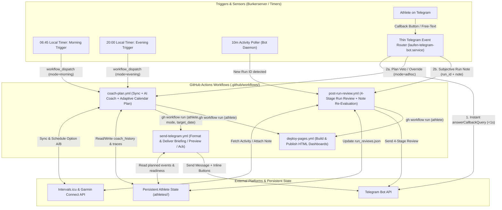

# Implementation Plan: Event- & Workflow-Driven Architecture (GitHub Actions Dispatches)

**Date:** 2026-11-13  
**Status:** Implemented (Phases 1–3 Active on `main`; Phase 4 Staging Verification)  
**Scope:** Full decoupling of macro coaching, calendar workout scheduling, post-run evaluations, and Telegram notifications into auditable, event-driven GitHub Actions workflows (`workflow_dispatch`).  
**Authoritative Spec Reference:** [`SYSTEM_SPEC.md`](SYSTEM_SPEC.md) | [`ARCHITECTURE_REVIEW_AND_FINDINGS.md`](ARCHITECTURE_REVIEW_AND_FINDINGS.md)

---

## 1. Problem Statement & Architectural Goals

Historically, training plan mutations, LLM coaching runs, and Telegram notifications were split across two competing execution environments:
1. **GitHub Actions ([`deploy-pages.yml`](../.github/workflows/deploy-pages.yml))**: Ran daily sync, 4-stage reviews, Macro AI Coach (`run-ai-coach.sh`), Git commits, and GitHub Pages builds in a single monolithic job.
2. **Burkerserver Daemon ([`src/integrations/telegram_bot.py`](../src/integrations/telegram_bot.py))**: Independently polled activities, mutated the Intervals.icu calendar during morning/evening briefings, and maintained local state in `athletes/<slug>/telegram_state.json`.

This dual-brain setup caused state drift (local `telegram_state.json` vs. GitHub workspace), opaque calendar mutations outside CI logs, and noisy repository commit histories.

### Core Target Principles
1. **Single Planning & Review Authority in GitHub Actions**:
   - Every calendar mutation on Intervals.icu (`schedule_workout.py`), 4-stage run review (`run_reviewer.py`), and Macro AI Coach synthesis (`ai_coach.py`) executes inside a dedicated GitHub Actions workflow run.
2. **GitHub Actions as Central Audit & Control Dashboard**:
   - Every morning check, evening preview, post-run review, and athlete ad-hoc override is a visible workflow run with structured inputs, step summaries (`$GITHUB_STEP_SUMMARY`), and decision traces (`decision_trace.jsonl`).
3. **Thin Event-Router Telegram Daemon**:
   - The persistent daemon on Burkerserver (`laufen-telegram-bot.service`) loses all autonomous planning logic. It acts strictly as a low-latency **sensor and event router** that acknowledges Telegram callbacks within $< 1\text{ s}$ and dispatches parameterized `gh workflow run` events.
4. **Zero Code-Branch Commit Noise**:
   - Routine coaching cycles no longer pollute the `main` commit log with `chore(coach): update artifacts [skip ci]` commits on every trigger. Runtime state is persisted cleanly via the self-hosted runner's shared state volume (`$HOME/dockerContainer/laufen/athletes/<slug>/`) and an optional dedicated state branch (`coach-state`).

---

## 2. End-to-End Architecture & Role Separation



---

## 3. Modular GitHub Actions Workflows (`.github/workflows/`)

> [!IMPORTANT]
> **Why Explicit `gh workflow run` Chaining Instead of `workflow_run`:**
> GitHub's native `workflow_run` trigger does **not** forward `workflow_dispatch` input parameters (`athlete`, `mode`, `target_date`, `action`) to downstream workflows and always fires immediately upon completion. Using explicit `gh workflow run` calls at the end of `coach-plan.yml` preserves full multi-tenant isolation (`--athlete <slug>`) and exact execution context.

### A. `coach-plan.yml` (Primary Planning & Macro Coaching Workflow)

- **Responsibilities:**
  1. Syncs profile, wellness (sleep, HRV, RHR), activities, and calendar events from Intervals.icu for the target `--athlete <slug>`.
  2. Executes the Macro AI Coach pipeline ([`.github/scripts/run-ai-coach.sh`](../.github/scripts/run-ai-coach.sh)) when in `morning` or `evening` mode.
  3. Executes deterministic calendar planning via [`src/planner/schedule_workout.py`](../src/planner/schedule_workout.py):
     - **`mode=evening`**: Evaluates tomorrow's readiness and slot rules. On flexible slots (`role: "flexible"`, Slot 2) when guardrails permit quality, schedules **both** Option A (Threshold/Quality) and Option B (Zone 2 Base) on Intervals.icu so both sync to the Garmin watch overnight. Never blindly overwrites existing unpaired workouts.
     - **`mode=morning`**: Re-evaluates today's plan with fresh overnight sleep and HRV telemetry. Preserves existing workouts unless critical recovery guardrails (`rest_day_recommended`) fire and the date is not locked by the athlete.
     - **`mode=adhoc`**: Processes an explicit athlete choice (`action: accept_a | accept_b | easier | shorter35 | rest | run_today` or free-text `feedback`). Uses `override_workout_on_date()` to remove unchosen sibling options on `target_date`, schedule the selected workout (or rest note), and tag the calendar event as athlete-locked.
  4. Persists updated artifacts (`coach_history.json`, `calendar_events.json`, `decision_trace.jsonl`) to the persistent athlete state directory and publishes the reasoning trace to `$GITHUB_STEP_SUMMARY`.
  5. Dispatches `send-telegram.yml` (passing `athlete`, `mode`, `target_date`) and `deploy-pages.yml` (passing `athlete`).
- **Triggers & Inputs (`workflow_dispatch`):**
  - `athlete` (`string`, required, default: `berni`): Target tenant slug from [`athletes/registry.json`](../athletes/registry.json).
  - `mode` (`choice`: `morning` | `evening` | `adhoc`, required, default: `morning`).
  - `target_date` (`string`, optional): ISO date `YYYY-MM-DD` (defaults to `today` for `morning`, `tomorrow` for `evening`).
  - `action` (`string`, optional): Callback action key (`accept_a`, `accept_b`, `easier`, `shorter35`, `rest`, `keep_rest`, `run_today`, `refresh_sleep`).
  - `feedback` (`string`, optional): Free-text athlete constraint (e.g., `"Only 30 minutes available today"`).
- **Concurrency:**
  - `group: coach-plan-${{ inputs.athlete || 'all' }}` (`cancel-in-progress: false` to serialize calendar mutations per athlete).

### B. `send-telegram.yml` (Notification & Interactive Keyboard Workflow)

- **Responsibilities:**
  1. Reads the synchronized readiness telemetry, `calendar_events.json`, and `ai_coach_summary.json` for `--athlete <slug>`.
  2. Formats and sends the context-specific Telegram message via [`src/integrations/telegram_bot.py`](../src/integrations/telegram_bot.py):
     - `mode=morning`: Morning Briefing with sleep/HRV readiness check and action buttons (`✅ Passt so`, `📉 Lockerer (Z2)`, `⏱️ Nur 35 Min`, `🛋️ Ruhetag`, or `🔄 Schlaf aktualisieren`).
     - `mode=evening`: Evening Preview for tomorrow. If two workouts (Option A & Option B) are scheduled on tomorrow's date, renders the dual-option comparison and buttons (`⚡ Option A: Schwelle`, `🌿 Option B: Z2 Basis`, `⏱️ Nur 35m`, `🛋️ Ruhetag`).
     - `mode=adhoc`: Sends the confirmation card for the newly overridden workout or rest day, including a direct link to the GitHub Actions run.
- **Triggers & Inputs (`workflow_dispatch`):**
  - `athlete` (`string`, required): Target athlete slug.
  - `mode` (`choice`: `morning` | `evening` | `coach_summary`, required).
  - `target_date` (`string`, optional): Target ISO date `YYYY-MM-DD`.
  - `force` (`boolean`, optional, default: `false`): Override notification idempotency when chained from `coach-plan.yml`.

### C. `post-run-review.yml` (Deterministic 4-Stage Post-Run Specialist)

- **Responsibilities:**
  1. Downloads fresh activities from Intervals.icu for `--athlete <slug>`.
  2. If `note` input is provided (athlete replied to a review with subjective feedback such as *"Calf tightness at km 4"*), attaches the note to `run_id` on Intervals.icu via [`src/integrations/manage_note.py`](../src/integrations/manage_note.py).
  3. Runs the 4-stage physiological & compliance review ([`src/analysis/run_reviewer.py`](../src/analysis/run_reviewer.py)) for `run_id` (or the latest unreviewed run) and updates `athletes/<slug>/run_reviews.json`.
  4. Cleans up any remaining unpaired alternative workout on today's date (e.g., if Option A and Option B were both on the calendar and the athlete completed Option B).
  5. Sends the formatted 4-stage review message to the athlete via Telegram and triggers `deploy-pages.yml`.
- **Triggers & Inputs (`workflow_dispatch`):**
  - `athlete` (`string`, required): Target athlete slug.
  - `run_id` (`string`, required): Intervals.icu activity ID (e.g., `i209021118`).
  - `note` (`string`, optional): Subjective athlete feedback to attach before re-evaluating.
- **Concurrency:**
  - `group: post-run-review-${{ inputs.athlete }}-${{ inputs.run_id }}` (`cancel-in-progress: false`).

### D. `deploy-pages.yml` (Pure Dashboard Visualization & Hosting)

- **Responsibilities:**
  - Strictly decoupled from LLM coaching and calendar scheduling.
  - Reads the latest persisted state from `athletes/<slug>/`, runs `./run dashboard --all` ([`src/visualization/generate_dashboard.py`](../src/visualization/generate_dashboard.py)), and deploys `dist/` to GitHub Pages and the local Burkerserver web root.
- **Triggers:**
  - `workflow_dispatch` (chained from `coach-plan.yml` and `post-run-review.yml`, or manual).
  - `push` to `main` touching `src/**`, `templates/**`, or `.github/workflows/deploy-pages.yml`.

---

## 4. State Persistence & Deduplication Architecture

Eliminating ad-hoc state silos requires a clear answer to where mutable state lives so ephemeral GitHub Actions workspaces (`actions/checkout@v4`) and the Telegram router never diverge:

| State Category | Authoritative Store | Mechanism |
| :--- | :--- | :--- |
| **Planned Workouts, Dual Options (A/B) & Athlete Locks** | **Intervals.icu Calendar** (`calendar_events.json`) | Single Source of Truth per [`SYSTEM_SPEC.md` §1.4](SYSTEM_SPEC.md). Athlete overrides tag the event description/name (e.g., `[LOCKED]`) so subsequent `morning`/`evening` runs respect the veto without needing `user_locked_dates` in `telegram_state.json`. |
| **Coaching Memory, Reviews & Decision Traces** | **Persistent Host Volume + `coach-state` Branch** (`athletes/<slug>/`) | Because all workflows run on the `self-hosted` Burkerserver runner, `coach-plan.yml` and `post-run-review.yml` synchronize `coach_history.json`, `run_reviews.json`, `ai_coach_summary.json`, and `decision_trace.jsonl` atomically with `$HOME/dockerContainer/laufen/athletes/<slug>/` (and optionally push daily snapshots to an orphan `coach-state` branch instead of `main`). |
| **Poller Cursor & Callback Ledger** | **Minimal Router Ledger** (`telegram_state.json`) | Restricted strictly to transport-level deduplication: `last_update_id` (Telegram offset), `dispatched_activity_ids` (prevents the 10-minute poller from re-triggering `post-run-review.yml` for the same `run_id`), and `last_reviewed_activity_id` (links free-text subjective replies to the latest run). Contains **zero** planning or calendar state. |

---

## 5. Thin Telegram Event Router (`laufen-telegram-bot.service`)

The Burkerserver daemon ([`src/integrations/telegram_bot.py`](../src/integrations/telegram_bot.py)) is stripped of `sync_adaptive_plan()`, `override_workout_on_date()`, and internal cron timers (`check_and_send_due_briefings`, `check_and_send_due_evening_previews`), retaining only three lightweight duties:

1. **10-Minute Activity Sensor**:
   - Polls `fetch_intervals_activities()` every 10 minutes for active athletes.
   - When a run completed today ($\le 6\text{ hours}$ old) is not in `dispatched_activity_ids`, records the ID in `dispatched_activity_ids` and executes:
     ```bash
     gh workflow run post-run-review.yml -f athlete="<slug>" -f run_id="<activity_id>"
     ```
2. **Low-Latency Callback & Chat Router**:
   - When an athlete clicks an inline button (e.g., `accept_b:2026-11-13` or `shorter35:2026-11-13`):
     1. Immediately answers the Telegram callback query (`answerCallbackQuery` $< 1\text{ s}$: *"⏳ Updating your plan via GitHub Actions..."*) so the Telegram UI never times out.
     2. Dispatches:
        ```bash
        gh workflow run coach-plan.yml \
          -f athlete="<slug>" \
          -f mode="adhoc" \
          -f target_date="2026-11-13" \
          -f action="accept_b"
        ```
   - When an athlete sends free-text messages:
     - If the message is a reply to a Post-Run Review (or explicitly describes run symptoms on a day a run was completed), dispatches `post-run-review.yml -f athlete="<slug>" -f run_id="<id>" -f note="<text>"`.
     - Otherwise, dispatches `coach-plan.yml -f athlete="<slug>" -f mode="adhoc" -f feedback="<text>"`.
3. **Precise Local-Timezone Scheduling (CET/CEST Safe)**:
   - Because GitHub Actions `schedule:` crons run in static UTC (shifting by 1 hour across Central European Daylight Saving Time transitions) and suffer 15–45 minute queue delays, daily morning (`06:45 Europe/Vienna`) and evening (`20:00 Europe/Vienna`) triggers are fired via Burkerserver `systemd` timers invoking `gh workflow run coach-plan.yml -f athlete="<slug>" -f mode="morning|evening"`. GitHub `schedule:` remains commented or configured only as a fallback.

---

## 6. 24-Hour Operational Audit Timeline

In the **GitHub Actions tab**, every operational step forms a transparent, chronological audit trail:

| Local Time (`Europe/Vienna`) | Workflow Run | Trigger & Inputs | Deterministic & Agentic Outcome |
| :--- | :--- | :--- | :--- |
| **06:45** | `coach-plan.yml` | Timer Dispatch (`athlete=berni`, `mode=morning`) | Syncs overnight sleep & HRV; runs Macro AI Coach; verifies today's workout against recovery guardrails; chains `send-telegram.yml` & `deploy-pages.yml`. |
| **06:47** | `send-telegram.yml` | Chained Dispatch (`athlete=berni`, `mode=morning`) | Delivers Morning Briefing with sleep readiness & inline override keyboard. |
| **12:15** | `post-run-review.yml` | Poller Dispatch (`athlete=berni`, `run_id=i209021118`) | Computes 4-stage review; cleans up any unchosen sibling workout on today's date; sends Telegram review; chains `deploy-pages.yml`. |
| **12:18** | ` post-run-review.yml` | Telegram Dispatch (`run_id=i209021118`, `note="Felt great"`) | Attaches athlete note to Intervals.icu activity and updates 4-stage evaluation. |
| **20:00** | `coach-plan.yml` | Timer Dispatch (`athlete=berni`, `mode=evening`) | Evaluates tomorrow's slot; schedules Option A & Option B on Intervals.icu for flexible Slot 2; chains `send-telegram.yml` & `deploy-pages.yml`. |
| **20:02** | `send-telegram.yml` | Chained Dispatch (`athlete=berni`, `mode=evening`) | Sends Evening Preview with dual buttons (`⚡ Option A: Schwelle` / `🌿 Option B: Z2 Basis`). |
| **21:15** | `coach-plan.yml` | Telegram Dispatch (`mode=adhoc`, `action=accept_b`, `target_date=tomorrow`) | Removes Option A from Intervals.icu, locks Option B (`[LOCKED]`), syncs to Garmin watch, and sends confirmation via `send-telegram.yml`. |

---

## 7. Phased Implementation Roadmap

1. **Phase 1 — Planner Dual-Option (A/B) & Lock Tag Support ([`src/planner/schedule_workout.py`](../src/planner/schedule_workout.py)):**
   - Extend `sync_adaptive_plan(evening_preview=True)` to schedule both Option A (Quality) and Option B (Z2 Base) on flexible slots when guardrails are green and no workout exists on `target_date`.
   - Extend `override_workout_on_date()` to support selecting Option A or Option B (deleting the unchosen sibling event and marking the retained workout `[LOCKED]`), and auto-clean unpaired sibling workouts once an activity is completed on that date.
   - Add offline BDD scenarios in [`tests/schedule_workout.feature`](../tests/schedule_workout.feature).
2. **Phase 2 — Modular Workflow Creation (`.github/workflows/`):**
   - Create `.github/workflows/coach-plan.yml`, `.github/workflows/send-telegram.yml`, and `.github/workflows/post-run-review.yml` with explicit `workflow_dispatch` inputs and shared state synchronization to `$HOME/dockerContainer/laufen/athletes/`.
   - Slim down [`.github/workflows/deploy-pages.yml`](../.github/workflows/deploy-pages.yml) to pure dashboard generation and deployment.
3. **Phase 3 — Thin Telegram Event Router ([`src/integrations/telegram_bot.py`](../src/integrations/telegram_bot.py)):**
   - Add a `dispatch_github_workflow()` helper invoking `gh workflow run` (or GitHub REST API `/actions/workflows/<id>/dispatches` using `GITHUB_TOKEN` for zero CLI dependency).
   - Route callback queries and free-text messages to `coach-plan.yml` / `post-run-review.yml` after immediate `answerCallbackQuery`.
   - Add BDD test coverage in [`tests/telegram_bot.feature`](../tests/telegram_bot.feature) with mocked workflow dispatch calls.
4. **Phase 4 — Staging Verification (`berni-test`):**
   - Validate all dispatch chains (`morning`, `evening`, `adhoc`, `post-run-review`) against staging tenant `berni-test` before enabling production timers for `berni`.
