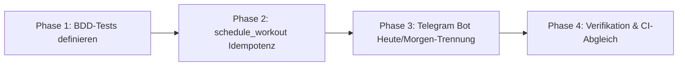

# Implementierungsplan: Idempotente Tages-Trainingsplanung & Telegram-Interaktion

**Spezifikation:** [idempotent_planning_and_telegram_spec.md](file:///mnt/data/work/laufen/docs/plans/idempotent_planning_and_telegram_spec.md)  
**Status:** Geplant  
**Datum:** 2026-10-26  

---

## Phasenübersicht



---

## Phase 1: BDD-Tests für Idempotenz & Heute/Morgen-Entkopplung
**Ziel:** Definition der Soll-Verhaltensweisen via Gherkin-Szenarien vor Code-Anpassungen.

- [ ] **1.1 Erweiterung `tests/schedule_workout.feature`**:
  - Szenario: Mehrfache Ausführung von `sync_adaptive_plan` am selben Tag führt zu identischen Events (Idempotenz).
  - Szenario: Ein vorhandener Ruhetag-Marker (`NOTE` auf Intervals.icu) verhindert das Überschreiben durch ein neues Workout.
  - Szenario: Ein geplantes Training für morgen beeinflusst nicht die Entscheidung über das heutige Training.
- [ ] **1.2 Erweiterung `tests/telegram_bot.feature`**:
  - Szenario: Briefing an einem Ruhetag bietet spezifische Ruhetag-Aktionen für heute (`keep_rest`, `run_today`).
  - Szenario: Klick auf `[ ✅ Ruhetag beibehalten ]` löscht nicht das vorgemerkte Training für morgen.

---

## Phase 2: Kernlogik `schedule_workout.py` (Idempotenz & Ruhetag-Marker)
**Ziel:** Deterministisches Verhalten unabhängig von Ausführungshäufigkeit und Vorhandensein von Folgetags-Workouts.

- [ ] **2.1 Bereinigung der Ruhetags-Erkennung (`sync_adaptive_plan`)**:
  - Entfernen der Bedingung, die `today` zum Ruhetag erklärt, wenn für `tomorrow` bereits ein Event existiert.
  - Prüfung auf vorhandene Events mit `category == "NOTE"` und Ruhetag-Kennzeichnung.
- [ ] **2.2 Einführung der Ruhetag-Notiz (`category: "NOTE"`)**:
  - Funktion zur Erstellung eines Intervals.icu `NOTE`-Events bei bestätigtem/festgestelltem Ruhetag:
    `🛋️ Ruhetag (Coach)`.
  - Anpassung von `override_workout_on_date`: Beim Löschen eines Workouts zugunsten eines Ruhetags wird optional direkt das `NOTE`-Event gesetzt.

---

## Phase 3: Telegram-Bot Heute/Morgen-Trennung (`telegram_bot.py`)
**Ziel:** Klare Trennung zwischen Aktionen für den aktuellen Tag und reiner Vorschau auf den Folgetag.

- [ ] **3.1 Differenzierte Inline-Tastaturen (`build_briefing_keyboard`)**:
  - Wenn `is_rest_day == False`: Standard-Tastatur für heute (`accept`, `easier`, `shorter35`, `rest`).
  - Wenn `is_rest_day == True`: Dedizierte Ruhetags-Tastatur (`keep_rest:{today}`, `run_today:{today}`).
- [ ] **3.2 Callback-Query-Handler anpassen**:
  - `keep_rest`: Bestätigt den Ruhetag für heute und belässt morgige Events unangetastet.
  - `run_today`: Wandelt den heutigen Ruhetag in einen 30-minütigen lockeren Zone-2-Lauf um.
- [ ] **3.3 Text-Parser Heuristik (`telegram_coach.py`)**:
  - Bei Freitext-Eingaben an einem Ruhetag (z. B. „Laufe heute 30 min“) Ziel-Datum strikt auf `today` setzen, sofern nicht explizit „morgen“ im Text steht.

---

## Phase 4: Verifikation & CI-Abgleich
**Ziel:** Vollständige Testabdeckung und Überprüfung gegen den Runner.

- [ ] **4.1 Lokale Testsuite ausführen**:
  ```bash
  ./run test
  ```
- [ ] **4.2 Simulation von Mehrfach-Syncs**:
  - Dry-Run-Prüfung von `./run sync` nach manueller Ruhetag-Wahl.
- [ ] **4.3 Review & Commit auf `main`**.
