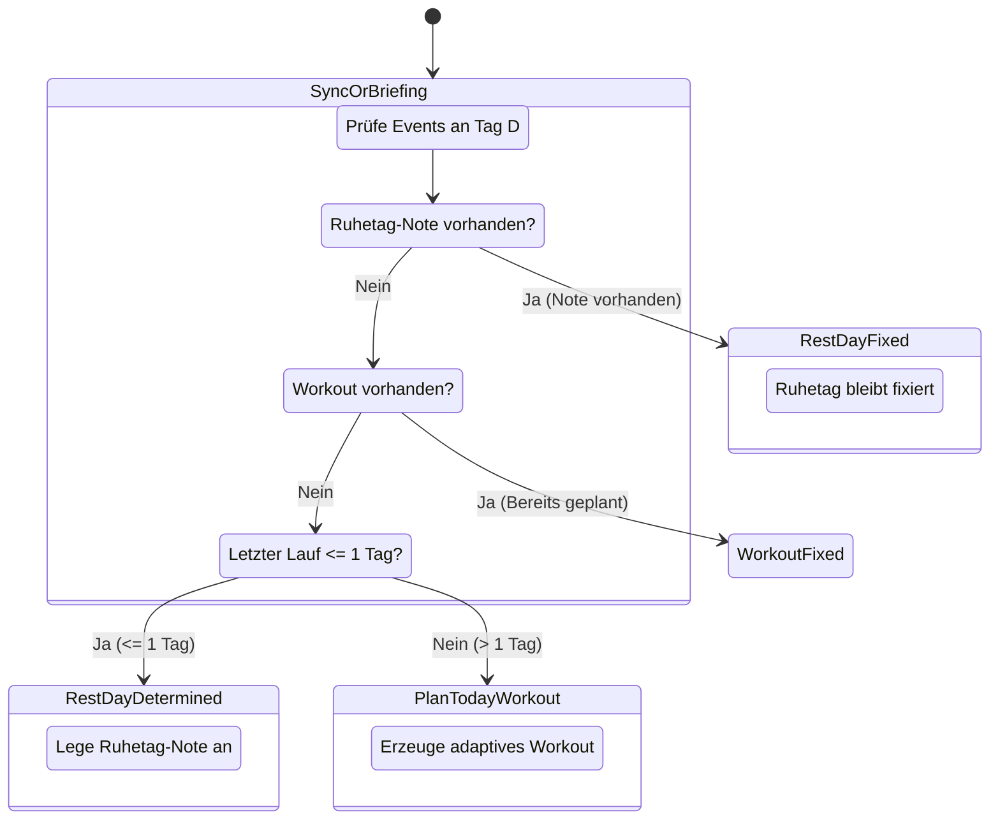

# Spezifikation: Idempotente Tages-Trainingsplanung & Telegram-Interaktion

**Status:** Entwurf  
**Datum:** 2026-10-26  
**Bereich:** `src/planner/schedule_workout.py`, `src/integrations/telegram_bot.py`, `src/analysis/telegram_coach.py`  
**Referenzen:** [UNIFIED_COACH_SPEC.md](file:///mnt/data/work/laufen/docs/UNIFIED_COACH_SPEC.md), [marker_basierte_trainingsplanung_spezifikation.md](file:///mnt/data/work/laufen/docs/plans/marker_basierte_trainingsplanung_spezifikation.md)

---

## 1. Problemstellung & Motivation

Im aktuellen System existieren zwei Wechselwirkungen, die bei wiederholter Ausführung (z. B. periodischer Sync, Dashboard-Build via GitHub Actions, `./run sync`, `./run dispatch`) zu Fehlverhalten führen:

1. **Nicht-idempotente Ruhetag-Erkennung (`sync_adaptive_plan`):**
   - Befindet sich im Kalender bereits ein Workout für den Folgetag ($D+1$), deklariert die Planungslogik den aktuellen Tag ($D$) fälschlicherweise als Ruhetag und gibt $D+1$ als Ziel-Datum zurück.
   - Ein wiederholter Aufruf von `./run sync` führt dadurch zu wechselnden Zuständen oder fehlplatzierter Planung.

2. **Fehlende Entkopplung zwischen Heute ($D$) und Morgen ($D+1$) im Telegram-Briefing:**
   - Ist $D$ ein Ruhetag und enthält das Briefing eine Vorschau auf $D+1$, waren die Inline-Buttons (`[ 🛋️ Ruhetag ]`, `[ ⏱️ Nur 35 Min ]` etc.) mit dem Zieldatum $D+1$ verknüpft.
   - Bestätigte der Athlet den heutigen Ruhetag, wurde das geplante Training von morgen gelöscht.

3. **Verlust manueller Athleten-Entscheidungen bei erneutem Sync:**
   - Wählt der Athlet im Telegram-Bot `[ 🛋️ Ruhetag ]`, wird das Workout auf Intervals.icu gelöscht.
   - Läuft 10 Minuten später ein Dashboard-Update oder Sync (`./run sync`), sieht der Planer keinen Eintrag für $D$ und plant das Workout erneut ein („Zombie-Workout“).

---

## 2. Kernarchitektur & Designprinzipien

### 2.1 Strikte Idempotenz von `sync_adaptive_plan`
Ein Aufruf von `sync_adaptive_plan` muss beliebig oft mit identischem Ergebnis ausgeführt werden können:
- **Eingangsfaktoren für Training vs. Ruhetag an Tag $D$:**
  1. `days_since_last_run <= 1` $\rightarrow$ Physiologischer Ruhetag.
  2. Im Kalender existiert an Tag $D$ bereits eine Notiz/Eintrag `category: "NOTE"` mit Kennzeichnung `Ruhetag` $\rightarrow$ Manueller Ruhetag (Fixierung).
  3. Im Kalender existiert an Tag $D$ bereits ein `category: "WORKOUT"` $\rightarrow$ Als geplant markiert, **keine** Änderung vornehmen (`skipped`).
- **Verbot:** Das Vorhandensein eines Workouts an Tag $D+1$ darf **niemals** den Status von Tag $D$ beeinflussen.

### 2.2 Intervals.icu als Single Source of Truth („Ruhetag-Marker“)
Um race conditions zwischen lokalem Runner, GitHub Actions Workflow und Telegram-Daemon ohne verteilte Datenbanken zu lösen:
- Wählt der Athlet einen Ruhetag oder entscheidet der Coach auf Ruhetag, wird auf Intervals.icu ein Event vom Typ `NOTE` angelegt:
  ```json
  {
    "category": "NOTE",
    "start_date_local": "YYYY-MM-DDT07:00:00",
    "name": "🛋️ Ruhetag (Coach)",
    "description": "Geplanter oder vom Athleten gewählter Ruhetag. Verhindert automatisches Überplanen."
  }
  ```
- **Wirkung:** Jeder spätere Sync-Lauf (auch in GitHub Actions) erkennt diesen Eintrag an Tag $D$ und legt kein neues Workout an.

### 2.3 Kontextsensitive Telegram-Briefing-Aktionen
Das morgendliche Briefing um 07:00 Uhr unterscheidet zwei exakte Zustände:

#### Zustand A: Tag $D$ ist Trainingstag
- **Nachricht:** Fokus auf das heutige Training ($D$).
- **Aktionen:**
  - `[ ✅ Passt so ]` (bestätigt Workout $D$)
  - `[ 📉 Lockerer (Z2) ]` (modifiziert Workout $D$)
  - `[ ⏱️ Nur 35 Min ]` (kürzt Workout $D$)
  - `[ 🛋️ Ruhetag ]` (löscht Workout $D$, setzt Ruhetag-Note $D$)

#### Zustand B: Tag $D$ ist Ruhetag
- **Nachricht:** Bestätigt Erholung für heute ($D$). Zeigt rein informativ die Vorschau auf morgen ($D+1$).
- **Aktionen:**
  - `[ ✅ Ruhetag beibehalten ]` (setzt/bestätigt Ruhetag-Note für heute, lässt $D+1$ unangetastet)
  - `[ 🏃 Heute trotzdem locker laufen (30m) ]` (plant lockere Einheit für **heute** ein)
- **Regel:** Es gibt keinen Button, der ohne expliziten Textbefehl das morgige Training manipuliert.

---

## 3. Datenfluss & Zustandsübergänge



---

## 4. API & Signatur-Änderungen

### 4.1 `src/planner/schedule_workout.py`
- `sync_adaptive_plan(..., mark_rest_day_note: bool = True)`
  - Entfernung der `existing_tomorrow`-Logik, die fälschlich heute als Ruhetag einstufte.
  - Prüfung auf bestehende Events mit `category == "NOTE"` und "ruhetag" im Namen.
  - Wenn Ruhetag für heute festgestellt wird, Erstellung der Ruhetag-Notiz via Intervals.icu API.
- `override_workout_on_date(target_date_iso, new_payload, is_rest_day: bool = False, ...)`
  - Wenn `is_rest_day=True`, wird das bestehende Workout gelöscht und ein `NOTE`-Event für diesen Tag angelegt.

### 4.2 `src/integrations/telegram_bot.py`
- `build_briefing_keyboard(target_date_iso: str, is_rest_day: bool)`
  - Erzeugt Zustand-A- oder Zustand-B-Tastatur.
- `handle_telegram_update(...)`
  - Callback-Handler verarbeitet `keep_rest:YYYY-MM-DD` und `run_today:YYYY-MM-DD`.

---

## 5. Test- & Verifikationskriterien (BDD)

1. **Idempotenz bei Mehrfachaufruf:**
   - 3 aufeinanderfolgende Aufrufe von `sync_adaptive_plan` am selben Stichtag führen exakt zu denselben Events (1 Event, 0 Duplikate, keine Statusänderung).
2. **Schutz vor Zombie-Workouts:**
   - Wird ein Ruhetag via Bot gesetzt, verhindert ein anschließendes `sync_adaptive_plan` (z. B. via CI) das Neuanlegen des gelöschten Laufs.
3. **Entkopplung Heute/Morgen:**
   - Klick auf Ruhetag an einem Tag mit Ruhetag-Briefing belässt das für den Folgetag geplante Workout unberührt.
