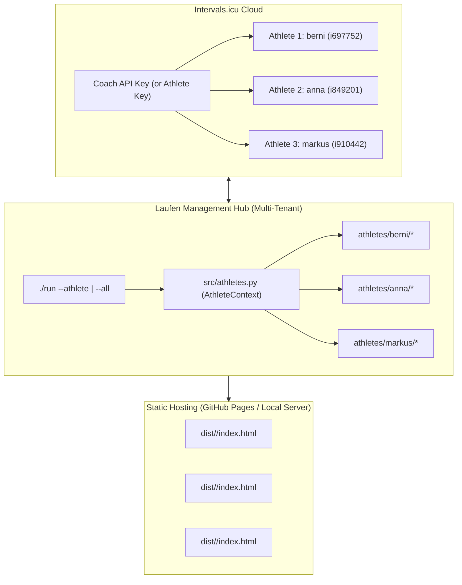

# Specification: Multi-Athlete Architecture & Dual-Mode Operation

**Document:** `docs/plans/multi_athlete_architecture_specification.md`  
**Status:** Approved Specification  
**Reference:** Extends the single-tenant pipeline around `./run`, `config/athlete.json`, and `.github/workflows/deploy-pages.yml` into a multi-tenant, portable architecture.

---

## 1. Objectives & Dual-Mode Architecture

The repository is structured to support **two operating models simultaneously** from a single unified codebase:

1. **Managed Multi-Athlete Mode (Centrally Hosted):**
   * Central execution of repo, agent (`.github/scripts/run-ai-coach.sh`), and CI/CD pipelines.
   * Additional runners add the owner account under *Settings $\rightarrow$ Coaches* in Intervals.icu. A single `INTERVALS_API_KEY` accesses activities, wellness metrics, and training calendars via athlete IDs (e.g., `i123456`).
   * Each athlete gets an isolated dashboard exported under an unguessable privacy slug (`dist/<dashboard_slug>/index.html`) alongside automated workout sync to Garmin/Coros/Wahoo watches.
2. **Self-Hosted / Open-Skill Mode (Repo & Skills Distribution):**
   * Eliminating hardcoded references to specific athletes from source code, prompts, and `workout-scheduler/SKILL.md`.
   * Any developer/runner can clone the repo, run `./run add-athlete`, and use the skills within their local AI coding agent (Antigravity, Cursor, Claude Code).



---

## 2. Directory & Data Structure

### 2.1 Tenant Directory Layout `athletes/<slug>/`
All athlete-specific configuration, cache, and runtime artifacts reside in an isolated tenant folder:

```text
athletes/
├── registry.json                    # Active athlete registry, default slug, and dashboard slugs
├── berni/                           # Default athlete
│   ├── athlete.json                 # Heart rate zones, periodization slots, Intervals ID
│   ├── intervals_activities.json    # Activities history
│   ├── intervals_wellness.json      # Sleep, HRV, resting HR, CTL/ATL metrics
│   ├── coach_history.json           # Recommendation memory and feedback tracking
│   ├── run_reviews.json             # Cached per-run qualitative reviews
│   ├── ai_coach_summary.json        # Structured AI evaluation
│   └── ai_coach_commentary.md       # Markdown summary for dashboard
└── <additional_athlete>/            # Athlete 2..N
    ├── athlete.json
    └── ...
```

> [!IMPORTANT]
> **Backward Compatibility for Existing Tests & Scripts:**
> If no `--athlete` flag is passed and legacy paths (`data/intervals_activities.json` or `config/athlete.json`) are provided, scripts continue to operate identically. When run without path flags, the `default_athlete` defined in `athletes/registry.json` is resolved automatically.

### 2.2 Tenant Roles: Production vs. Staging Sandbox
Tenants in the registry serve explicit operational purposes:
- **Production Tenant (`berni` / `i697752`):** Real historical data, daily training calendar, production dashboard. Guarded by safety checks against synthetic seeding and automated test writes.
- **Staging / Test Tenant (`berni-test` / `i771119`):** Dedicated live sandbox on Intervals.icu. Used for contract testing (`./run test:e2e`), API drift verification, and manual dry-runs of new planner templates. Can be populated and cleared anytime via `./run seed --athlete berni-test`.

### 2.3 Schema: `athletes/registry.json`

```json
{
  "default_athlete": "berni",
  "athletes": {
    "berni": {
      "intervals_id": "i697752",
      "display_name": "Berni",
      "active": true,
      "dashboard_slug": "berni"
    },
    "anna": {
      "intervals_id": "i849201",
      "display_name": "Anna",
      "active": true,
      "dashboard_slug": "anna-7f9c2a"
    }
  }
}
```

---

## 3. Central Athlete Resolution (`src/athletes.py`)

A shared resolution module provides type-safe path and credential resolution across CLI tools, pipeline scripts, and tests:

```python
@dataclass(frozen=True)
class AthleteContext:
    slug: str
    intervals_id: str
    display_name: str
    active: bool
    dashboard_slug: str
    base_dir: Path
    athlete_config_path: Path
    activities_path: Path
    wellness_path: Path
    coach_history_path: Path
    run_reviews_path: Path
    ai_summary_path: Path
    ai_commentary_path: Path
    dashboard_output_dir: Path
```

Resolution order for active athlete:
1. Explicit CLI argument (`--athlete <slug>`)
2. Environment variable `ATHLETE_SLUG`
3. `default_athlete` specified in `athletes/registry.json`
4. Legacy fallback (`config/athlete.json` and `data/`)

---

## 4. CLI Runner & Integration Enhancements

### 4.1 Task Runner (`./run`)
* `./run <command> [--athlete <slug>]`: Runs targeted command for the specified athlete.
* `./run <command> --all`: Iterates across all active athletes registered in `athletes/registry.json` (for `sync`, `wellness`, `review`, `coach`, `dashboard`).
* `./run add-athlete <slug> --intervals-id <id> [--name <name>]`: Executes onboarding sequence.
* `./run athletes`: Lists registered athletes, their status, Intervals ID, and dashboard paths.

### 4.2 Onboarding Workflow (`src/integrations/onboard_athlete.py`)
1. Validates connection to `/api/v1/athlete/<intervals_id>` using configured `INTERVALS_API_KEY`.
2. Creates tenant folder `athletes/<slug>/` and assigns a random privacy `dashboard_slug` (e.g. `<slug>-<6hex>`).
3. Calls profile sync to capture Resting HR, Max HR, LTHR, and custom zones into `athlete.json`.
4. Bootstraps 90-day activity history and 30-day wellness metrics.
5. Updates `athletes/registry.json`.

---

## 5. Skills & AI Coach Decoupling

* **Interactive Athlete Selection**: The `workout-scheduler` skill checks active athletes. If multiple athletes exist and none was specified in the user's prompt, the agent prompts for selection or defaults to `default_athlete`.
* **Dynamic Targets**: Replaces static pace/HR values in prompts and templates with values resolved from `AthleteContext` and `extract_planning_markers`.
* **Athlete Notes & Wellness Feedback**: Reads athlete notes, soreness ratings, and comments from `intervals_wellness.json` to feed external athlete requests back into cognitive planning.

---

## 6. GitHub Actions & CI/CD Deployment

In `.github/workflows/deploy-pages.yml`:
* Iterates across all active athletes in `athletes/registry.json`.
* Executes sync, adaptive planning, reviews, AI coach (incremental, skipped if no unreviewed runs), and dashboard generation.
* Deploys multi-tenant dashboards to `dist/<dashboard_slug>/index.html` (with `default_athlete` also published to `dist/index.html`).
* Commits updated coach history and reviews back to tenant directories in Git.

---

## 7. Testing Strategy (BDD & Driver Pattern)

* Feature file: `tests/multi_athlete.feature`
* Step definitions & driver: `tests/test_multi_athlete.py`
* Covers:
  1. Adding a new athlete via coach API mock
  2. Isolated execution of metrics, planning, and dashboard per athlete
  3. Batch processing via `--all`
  4. Backward compatibility with legacy path arguments
